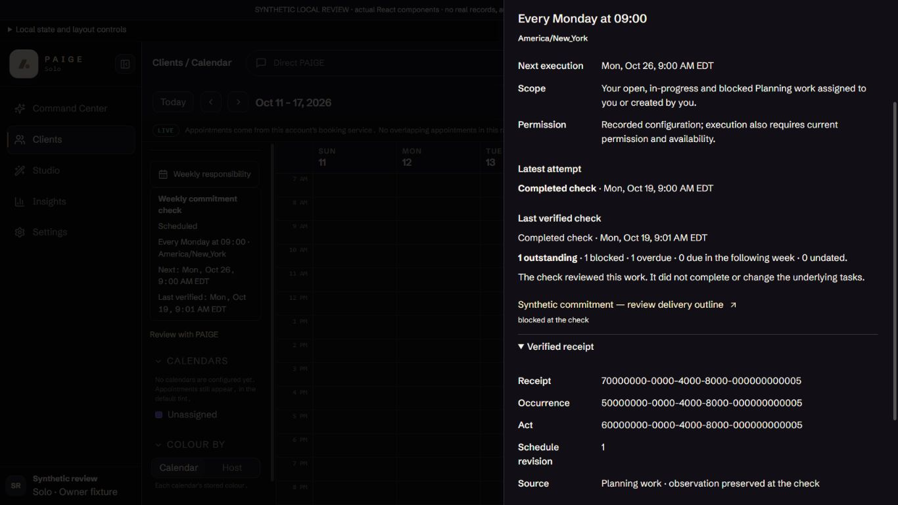
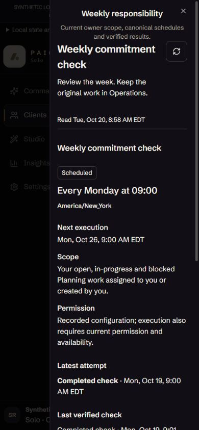

# Experience05 corrective rendered review

Actual React components; **synthetic local transport only**. These captures do not show a signed-in customer, actual records, scheduling authorization, production execution or accepted outcome. Product source: `0f1941f6efd307914b03b715d2de4d94d26f1401`; browser: Codex in-app Chromium, October14,2026; theme: Obsidian. No business obligations were changed. PAIGE Chat requests were not sent.

The corrective browser drive followed the weekly result's typed Planning link, closed the source inspector, opened the ordinary Work card, changed Status to Blocked without saving, left for Calendar using the fixture's incumbent MemoryRouter history control, returned and reopened the ordinary card. Blocked remained the unsaved selection while the current persisted fixture still said In progress. Discard was then used; no save/approval/execution was attempted. This proves rendered scoped draft retention, not native BrowserRouter Back blocking. Native BrowserRouter indexed Back/Forward preservation is separately automated in `OperationsRoute.test.tsx`.

At390×844, Calendar View options opened one weekly sheet; Escape closed it and returned focus to `.sc-board`, with no remaining dialog. On desktop, the receipt disclosure exposes the occurrence, act, receipt and schedule revision; the source task and completed check remain visibly different states. The receipt screenshot is intentionally scrolled to its evidence.

## Existing Chat and Calendar responsive surfaces

Captured with PAIGE closed/open. The dev-only host uses incumbent components and a fixture shell; its navigation expansion survives viewport changes. Full authenticated production shell, a second legitimate tenant, actual browser zoom and native assistive technologies are not proven by this host.

| Viewport | PAIGE closed | PAIGE open |
|---|---|---|
|1536×770|[Capture](1536-closed.png)|[Capture](1536-open.png)|
|1366×768|[Capture](1366-closed.png)|[Capture](1366-open.png)|
|1024×768|[Capture](1024-closed.png)|[Capture](1024-open.png)|
|900×1000|[Capture](900-closed.png)|[Capture](900-open.png)|

These are additive correction captures. The [existing full state gallery](../experience-05-prototype/connected-weekly-rendered-review/owner-rendered-review.md) remains historical evidence for the prior inert implementation, not new proof of this source or customer acceptance. Final owner design/activation approval remains separately required before live execution.
