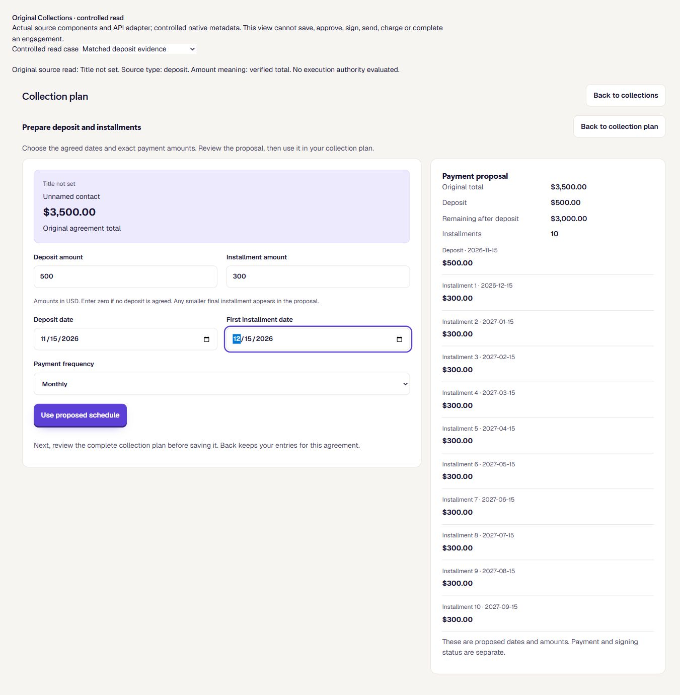
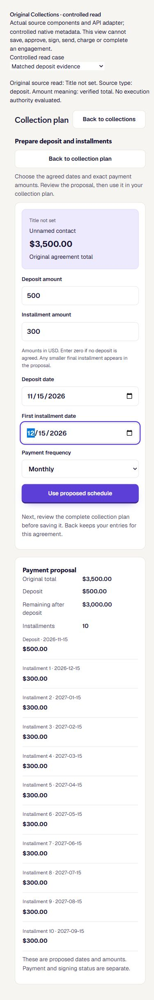
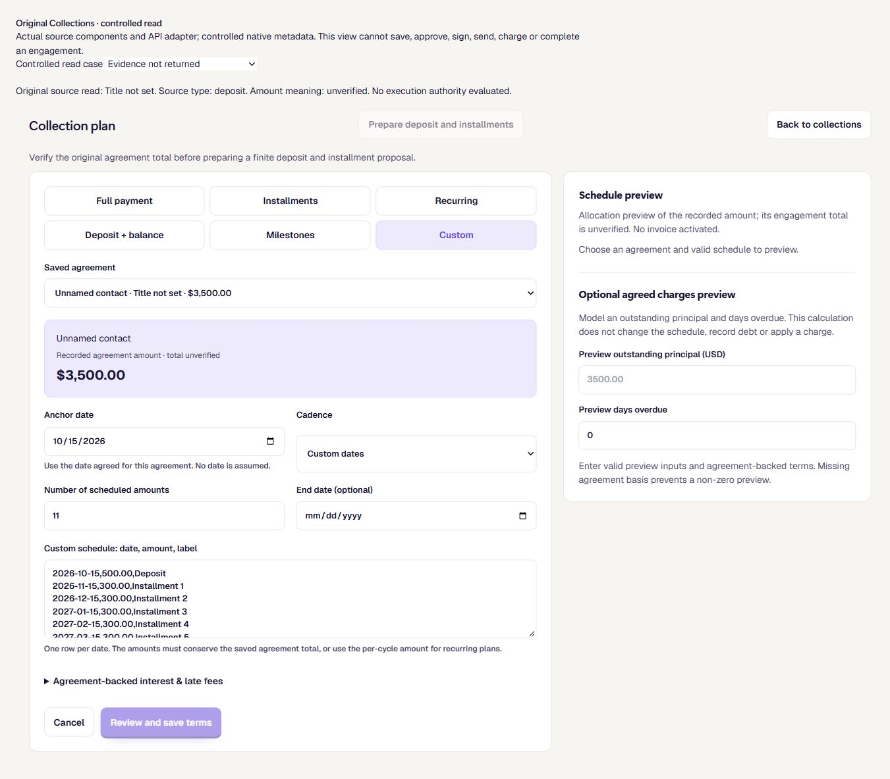
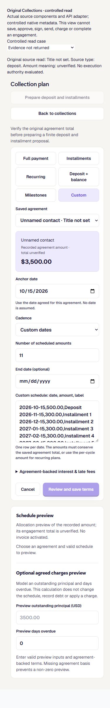

# Prepare a payment plan from the original accepted total

UI_DELIVERY_EVIDENCE_VERSION: 1
FLOW_BY_FLOW: PASS: original scoped commercial read → verify amount meaning → enter explicit deposit/installment amounts and dates → inspect proposal → apply to existing plan → existing governed review/write. Source change, missing evidence, incompatible recurring meaning and lost authority remain refusals.
PAIGE_UI_DESIGN: PASS: original Collections components, canonical tokens, form grid, contextual source panel, preview, review, Back and Cancel preserved; no competing component or navigation system.
MATERIAL_FLOW_CHANGE: YES: reuse the original locally implemented preparation flow and finish its accepted-source integration, rather than expose an amount-only proposal or rebuild that flow.
FLOW_PROTOTYPE: PASS: original C58 actual-component prototype and pre-edit findings recorded in ANT-51 comment57683b8e-2425-4c78-a7f2-25dbeae5cb50; original source f328e56e774352d6c29cb3148467ab20979b013e received by normal merge ecc1bdc05189b1311877cbb97288768c87e9b064. Explicit dates reuse C57/#2910. Owner authorized routine design and integrated founder evaluation; no slice signoff inferred.
PURPOSE_AUDIENCE_PRIMARY_ACTION: PASS: eligible SOLO owner or authorized manager prepares the selected client's exact finite repayment plan from verified original economics, then reaches the original review.
VISUAL_DIRECTION: PASS: incumbent PAIGE Operate design, semantic purple primary action, existing source summary and dated proposal. No new visual system, motion or decorative chart.
AUTOMATED_EVIDENCE: PASS: 216 tests/13files; supervised original native proof includes89 accepted-total/recurring assertions, real lock controls, replay, original executor identity and whole-preview inverse. Broader native counts are nested, never summed. Synthetic Auth, governance and document metadata do not establish hosted acceptance.
STATIC_EVIDENCE: PASS: scoped ESLint and diff; TypeScript ratchet baseline10/current6/no-new; exact runtime Deno Chat9base/9head/no-new and collection endpoint clean; web build and original Solo entry385KiB/520KiB guard. Baseline diagnostics remain, so this is not an unqualified clean compile.
RENDERED_EVIDENCE: PASS: actual adapter/components/styles at1366x768 and390x844 with controlled native read rows; assets/e04-accepted-total-preparation/proposal-desktop.png, proposal-narrow.png, missing-proof-desktop.png and missing-proof-narrow.png. SDK read boundary alone is simulated. This is neither full-shell nor authenticated acceptance.
BEHAVIORAL_EVIDENCE: PASS: missing native proof keeps total unverified and both preparation/review disabled; matched deposit proof permits explicit500/300 and dates, shows ten installments/3500 principal, local Apply reaches original review callback. Back retains amounts/dates; focus enters the preparation heading and returns to its opener. The callback is simulated and performs no approval or save.
AUTHENTICATED_RUNTIME: UNVERIFIED: candidate is not deployed. Actual eligible owner/staff/linked client, second legitimate tenant context, original governed save/receipt/reload, Chat retrieval and Central QA remain owed.
KEYBOARD_FOCUS: PASS: actual Enter opener→preparation heading, Tab from Back→Deposit amount, native date controls and opener restoration inspected. Full-shell/assistive-technology coverage remains owed.
ZOOM_REFLOW: UNVERIFIED: controlled390px document width375px/no horizontal overflow, desktop inspected; actual browser200% zoom and full-shell reflow not established.
REDUCED_MOTION: UNVERIFIED: no motion added or changed; actual preference drive not performed for this combined candidate.
STATE_COVERAGE: UNVERIFIED: source missing/mismatched, valid dated proposal, wrong amount meaning, programmatic submit refusal, source-proof replacement at the same plan revision, lost manager authority and discard/focus are covered by source tests. Real parent loading/error/permission/approval-pending/unknown-save recovery and all-shell role coverage remain owed.
TRUTHFUL_STATE_LABELS: PASS: a recorded amount is not automatically an engagement total; accepted terms and working plan revisions stay distinct. A proposal/review callback is never labelled saved, effective, invoiced, sent, signed or paid.
SOLO_UI: YES: existing Sales → Payments → Collections → Collection plan for all eligible SOLO businesses.
UNVERIFIED: exact-head hosted CI/review, full-shell/eight viewport-and-PAIGE states, two authorized contexts, deployment/readback, original save/reload and authenticated roles. Keep DRAFT; these labels do not waive mandatory release gates. All O1–O12 and founder acceptance remain open.

OWNER_INTENT: original full EXP04 commercial relationship, including the consultant3500 agreement/500 deposit/ten300 payments journey; preparation alone does not complete O2/O3/O4/O5 or the Experience.
MUST_NOT_HAPPEN: no accepted total from a scalar kind/basis label, caller-supplied evidence as execution authority, finite principal treated as recurring rate, assumed dates, rewritten signed terms, automatic invoice/send/charge or duplicated obligation.
MUST_PRESERVE: original commercial/client/offer identity, signing/digest/accepted version, immutable effectuation operation/Rail, locked executor, original calculator/parser, approval/high-risk path, old readers and legitimate recurring saves.
ACCEPTANCE_CRITERIA: eligible real owner prepares exact amounts/dates from the correct original record, inspects source and proposal, saves through the existing authorized path once, sees truthful receipt/current plan after reload and retrieves the same commercial identity later; stale/foreign/missing evidence and unauthorized actors refuse without effects. Linked client signing/payment/service acceptance require their separate proofs.
MOTION_PURPOSE: NONE: no motion or preference behavior change.
PROTECTED_SEAMS: strict read validator; original private accepted/effectuation predicates; scoped native reader and preview; whole original executor unchanged; original HIGH review and operation/Rail route retained. Portal grants/UI, shared Chat admission, provider clients, ledgers and scheduling unchanged.
INTERNAL_BUILD_IDENTITY: 964d69aa93c9913b60e20d6fdc90d2398184538d; deployment=UNVERIFIED; environment=development; migrations=PROOF_OWED(unapplied20271115070004); edge=PROOF_OWED(sales-collection-command); evidence=this record and current PR.
RELEASE_CHANNEL: development: source and controlled proof only; not customer-reachable.
RELEASE_CLASSIFICATION: internal-only: one coherent original preparation/evidence integration pending required release gates.
CUSTOMER_RELEASE_IDENTITY: none: integrated Experience not accepted or ready for customer announcement.
RELEASE_NOTE_REQUIRED: no: no customer release or publication proposed.
RELEASE_TRUTH_BOUNDARY: PROOF OWED: customer preparation/save and accepted-source integration; no Live capability/catalogue/algorithm promotion.
RELEASE_RECOVERY: position=unapplied forward source, preserve original records and all existing recovery paths; reference=this record and docs/evidence/ui-delivery/e04-fixed-source-save.md.

SOLO_1536X770_PAIGE_CLOSED: UNVERIFIED: mandatory actual full-shell evidence remains owed.
SOLO_1536X770_PAIGE_OPEN: UNVERIFIED: mandatory actual full-shell evidence remains owed.
SOLO_1366X768_PAIGE_CLOSED: UNVERIFIED: controlled original component is not the full shell.
SOLO_1366X768_PAIGE_OPEN: UNVERIFIED: controlled original component is not the full shell.
SOLO_1024X768_PAIGE_CLOSED: UNVERIFIED: mandatory actual full-shell evidence remains owed.
SOLO_1024X768_PAIGE_OPEN: UNVERIFIED: mandatory actual full-shell evidence remains owed.
SOLO_900X1000_PAIGE_CLOSED: UNVERIFIED: mandatory actual full-shell evidence remains owed.
SOLO_900X1000_PAIGE_OPEN: UNVERIFIED: mandatory actual full-shell evidence remains owed.

## Canonical capability and orchestration contract

1. **Event/request and entry:** owner prepares a payment plan from the existing Collections workspace. PAIGE/Chat may read the same original facts; no new Chat mutation or Live activation is introduced.
2. **Original record and registration:** `tenant_client_agreements`, original `paige_agreements`/accepted commercial record, `paige_sales_collection_operations` and original Rail. Existing `sales_collections.read` / `read_sales_collections`; save remains `collection.save_terms` / `sales_save_collection_terms`. No new registration or availability claim.
3. **Governed path:** reads retain caller-JWT scope; local preparation uses `assembleFixedRepaymentSchedule`; persistence remains the original review→command endpoint→Trust decision→locked native executor. Ordinary read/draft/calculation does not need another Layer C dispatch.
4. **Authorization:** original actor, tenant, client, offer and owner/admin permission checks retained. The private evidence helper has no PUBLIC/anon/authenticated/service-role EXECUTE grant. A returned proof object is not a write command.
5. **Risk/approval:** the original HIGH save action and canonical approval/fingerprint remain. Applying a proposal edits local state only. Signed agreement does not authorize payment movement.
6. **Execution/receipt:** original executor acquires the original record lock and independently revalidates meaning. Existing operation identity, command replay, native transaction and Rail remain the only save/receipt; no second execution store.
7. **Readback/idempotency:** matching accepted signing/version/digest, principal/currency, tenant/client/offer and effectuation operation/receipt are required. Native saves/replays with integrity triggers active advance once. No provider or settlement readback is claimed.
8. **Failure/recovery:** missing/mismatched/stale proof stays unverified or refuses the read; changed proof retires an applied proposal even at the same working plan revision. Original approval, endpoint refusal, interruption and unknown-result recovery are retained. Only exact static amount-refusal messages are promoted; arbitrary diagnostics are not.
9. **Result:** original amount meaning, accepted and recorded revisions, proposed dates and amounts, existing review and durable original result where actually executed. No fabricated viewed/delivered/signed/paid state.
10. **Dependencies:** original C59 read/#2911 and C60 source revalidation/#2913; EXP09 consumes approved original client-scoped contracts through ANT-163. No Portal UI/grant change. Stripe/Communications remain separately authorized providers; no new provider/connection requirement for preparation.

The Binding Ledger, Harness map, Spine/specialist registry and Chat Capabilities catalogue retain their current truthful availability. This source-only increment earns no promotion. Sales/Collections remains the portfolio owner; INT-346 admission and all effect restrictions remain.

## Source and proof boundaries

This is one coherent PR against main: original C57 explicit dates, C58 preparation, C59 read semantics, C60 locked source revalidation and C61 matched evidence/visible integration. Read meaning, write enforcement and usable preparation must agree before exposure. These are original received sources, not replacement implementations. Original #2910/#2911/#2913 remain historical owning drafts until an actual reviewed release establishes their disposition; none is declared merged or closed by reuse.

Current-main receiving `e33991ba6a063d75d02b84493bfae30ff1116fce` preserves main `c4e2d13958ef8fe0dad89d31a7f6c93d9ec62d20` by normal merge. All38 original code/test/native/image/evidence paths, except the separate truthful C59 evidence correction, match the already-proven `fcc650fa74e3882b24b4a1f5af9098ac416423b8` blobs. New exact-head hosted proof and current import-closure verification remain required.

The production history mismatch was independently confirmed resolved by read-only metadata, with no EXP04 repair. The older C59 disposable Preview separately retains a prior pre-renumber migration identity and still fails its check. Its failure is retained, not waived or called fixed. The coherent current source owes its own full required Preview/review/CI. No Preview reset, migration-history edit, placeholder migration, manual reapply or manual CI retry is part of this increment. Protected Linear retains provider/project identities and diagnosis.

The rejected label-only widening was not applied. This safer implementation derives a total only from complete matching original accepted/effectuated evidence. The native writer re-reads that evidence independently. Deposit/custom-quote rows keep the legacy `unverified` marker for cached clients; upgraded readers require the closed matching evidence object. Finite proof is refused on recurring/one-time/absent kinds. The complete original executor stays byte-identical; the complete preview inverse proves the only extra branch is the per-cycle guard.

Original document/accepted/effective proof runs remain the incumbent fixture. The successful supervised run reports89 evidence checks inside continuity129/effective313/accepted396/document501; these counts overlap. Two earlier runs did not establish candidate behavior: an original lock observation timed out, then the local database process stopped. Original assertions/timing were not weakened. The unchanged controls pass in the supervised run.

Tests include same-version accepted-proof replacement, explicit stale-proposal discard/focus, read-only management loss, legacy reads, exact unknown-message refusal and incompatible source meanings. Synthetic session/approval/PDF metadata is explicitly not real JWT, provider, signature or legal-sufficiency evidence.

## Rendered evidence and finish review

Impeccable Operate/clarify/harden and a bounded rendered finish pass used the actual components and existing tokens. The earlier incorrect total label/enabled manual review was repaired before these final captures. Current hierarchy, explicit source, labelled inputs, native date entry, focus, narrow stacking and visible dated proposal were inspected. No remaining material local-form defect found in this pass; full-shell, role, zoom and assistive-technology proof remain open. No premium complete-Experience claim is made.

The local harness only substitutes the SDK read boundary and a labelled callback. Its mismatch catch is a harness error panel, not evidence for the production parent's error component. An initial incomplete-date capture and a prior HMR-reset capture are retained locally and excluded from final evidence. Only the four named controlled images are published; no actual owner/customer evidence is included.

## Algorithms and completion

ALG-01 reconciliation and ALG-12 exceptions remain PARTIAL: original deduplication, source refusal, idempotency and recovery signals, not complete provider reconciliation. ALG-02 onboarding remains INCOMPLETE. ALG-13 recommendation usefulness remains UNVERIFIED; no score invented. Independent non-author assurance, exact-head hosted checks, safe production readback, all required legitimate roles, later-session continuity and final founder evaluation remain separate outstanding states.
