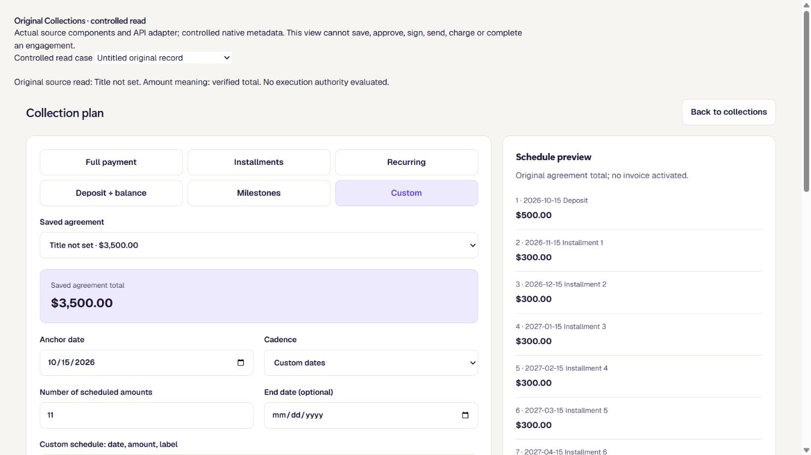
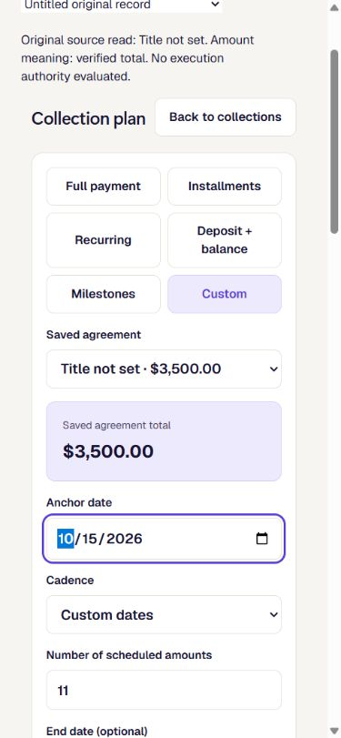

# Collections: keep fixed repayment previews bound to verified totals

UI_DELIVERY_EVIDENCE_VERSION: 1
FLOW_BY_FLOW: PASS: Existing owner request → scoped commercial read → original fixed-preview calculation → existing review state; ambiguous original amount semantics now require source verification. See the contract and proof below.
PAIGE_UI_DESIGN: PASS: Existing project five-module design skill applied to truthful status, original records and protected seams; no component, navigation, layout, motion or interaction container changes.
MATERIAL_FLOW_CHANGE: NO: Corrects the existing preview's source precondition using its established needs-input, refused and conflict states. No new user goal, mutation, navigation or execution route.
FLOW_PROTOTYPE: NOT_REQUIRED: Read-contract correctness repair with no new interface or interaction sequence. The separate deposit-preparation UI remains development work, not delivered by this change.
PURPOSE_AUDIENCE_PRIMARY_ACTION: PASS: An eligible SOLO owner asks for a finite deposit/installment proposal against the original commercial record; PAIGE must establish that the recorded amount is a total first.
VISUAL_DIRECTION: NOT_APPLICABLE: Original Sales and Chat interfaces and shared PAIGE design tokens are unchanged.
AUTOMATED_EVIDENCE: PASS: 145 focused cases in 11 files; original commercial SQL proof plus new amount-basis/negative/replay/source-drift checks and valid untitled-record continuity pass on isolated PostgreSQL 16. Commands and boundaries below.
STATIC_EVIDENCE: PASS: Scoped ESLint; original TypeScript ratchet baseline10/current6/no-new; web build and original entry-size guard pass (385 KiB within 520 KiB). This is not a clean full TypeScript compile.
RENDERED_EVIDENCE: PASS: Actual candidate881dc7bd API adapter and original CollectionPlanBuilder rendered the valid null-title RPC shape at1366x768 and390x844. The selected record shows Title not set and its unchanged3500 amount; exact controlled assets below. These are local component/adapter observations, not authenticated full-shell proof.
BEHAVIORAL_EVIDENCE: PASS: Actual isolated native calls distinguish a fixed total, per-cycle amount, per-installment amount and unverified legacy meaning. The original read-only Chat adapter's source/refusal tests pass; hosted behavior remains unverified.
AUTHENTICATED_RUNTIME: UNVERIFIED: Candidate native migration and Chat import closure are not deployed. Existing ordinary-owner preparation proof is different source and does not establish this repayment-read outcome.
KEYBOARD_FOCUS: PASS: Controlled original Saved agreement selector → Tab → Anchor date, visible focus at390px. No keyboard/focus handler changed; full-shell/role coverage remains unverified.
ZOOM_REFLOW: UNVERIFIED: Controlled390px viewport/document375px and1366px viewport/document1351px show no horizontal overflow. Browser zoom/full-shell matrix is not proven by these component observations.
REDUCED_MOTION: NOT_APPLICABLE: No animation or motion change.
STATE_COVERAGE: PASS: Original missing source/offer/economics, stale terms, inactive source, recurring conflict, malformed input and distinct readiness/refusal paths remain; legacy/periodic amount semantics and injected caller basis are covered.
TRUTHFUL_STATE_LABELS: PASS: Ready-for-review remains principal-only, authority not evaluated and execution not started. No signing, balance, financial settlement, notification or delivery completion is inferred.
SOLO_UI: YES: Declared backend-to-visible impact on existing SOLO conversational preview and shared agreement decoder, with no spatial UI change. All eligible present/future accounts use the same implementation.
SOLO_1536X770_PAIGE_CLOSED: UNVERIFIED: Candidate authenticated full-shell proof has not run; no layout change is claimed.
SOLO_1536X770_PAIGE_OPEN: UNVERIFIED: Candidate authenticated full-shell proof has not run; no layout change is claimed.
SOLO_1366X768_PAIGE_CLOSED: UNVERIFIED: Candidate authenticated full-shell proof has not run; no layout change is claimed.
SOLO_1366X768_PAIGE_OPEN: UNVERIFIED: Candidate authenticated full-shell proof has not run; no layout change is claimed.
SOLO_1024X768_PAIGE_CLOSED: UNVERIFIED: Candidate authenticated full-shell proof has not run; no layout change is claimed.
SOLO_1024X768_PAIGE_OPEN: UNVERIFIED: Candidate authenticated full-shell proof has not run; no layout change is claimed.
SOLO_900X1000_PAIGE_CLOSED: UNVERIFIED: Candidate authenticated full-shell proof has not run; no layout change is claimed.
SOLO_900X1000_PAIGE_OPEN: UNVERIFIED: Candidate authenticated full-shell proof has not run; no layout change is claimed.
UNVERIFIED: Hosted exact-head CI, release, native/Edge source parity, actual owner conversational retrieval/reload and two authorized ordinary SOLO contexts remain proof owed. Separate held signing/UI findings remain unresolved; no gate is waived by this record.

OWNER_INTENT: Preserve all twelve EXP04 outcomes while making the consultant's fixed deposit/installment proposal financially truthful. A recurring amount or legacy per-payment price must never silently become the engagement's finite principal.
MUST_NOT_HAPPEN: No amount multiplication, new debt, charge, signature, send, obligation, tenant/role activation, alternative financial store or approval bypass.
MUST_PRESERVE: Original commercial IDs, signed records, immutable creation operations, fixed calculation, writers, invoice/payment allocation, tenant/actor/client checks, bounds/cursor, read receipts and current security work.
ACCEPTANCE_CRITERIA: Native facts and exact original fixed-creation provenance establish a total; incompatible/unknown semantics cannot yield a fixed preview; an authorized later read retrieves the same original source. Hosted and full-Experience proof remain outstanding.
MOTION_PURPOSE: NONE: no motion change.
PROTECTED_SEAMS: Existing native reader's whole-definition inverse and ACL/config are proven; original operation store and exact creation writer are reused. Chat Root, admission, approval/risk, registry, provider, signing and mutation writers are unchanged.

INTERNAL_BUILD_IDENTITY: b849916ba8673eaa9ebd088d78a7445b9f70c8cc; deployment=NOT_DEPLOYED; environment=development; migrations=PROOF_OWED(candidate-native-read-production-parity); edge=PROOF_OWED(candidate-Chat-import-closure-production-parity); evidence=docs/evidence/ui-delivery/e04-collection-amount-basis.md
RELEASE_CHANNEL: development: Isolated source/native proof; no customer release or production activation.
RELEASE_CLASSIFICATION: patch: Correctness prerequisite for the existing fixed repayment preview and subsequent UI preparation.
CUSTOMER_RELEASE_IDENTITY: none: bounded source repair, no founder-accepted integrated Experience or announcement.
RELEASE_NOTE_REQUIRED: no: internal patch evidence only; any future customer announcement retains its separate authorization.
RELEASE_TRUTH_BOUNDARY: PROOF OWED: authenticated fixed repayment-read behavior and deployment. No new LIVE capability or completed EXP04 outcome is claimed.
RELEASE_RECOVERY: position=forward-only guarded migration, existing source/version reconciliation and safe ordinary release policy; reference=docs/doctrine/release-governance-and-customer-update-policy.md

## Canonical contract and ownership

This is **REPAIR/EXTEND** in the existing Sales/Collections family, owned by EXP04 (ANT-51), coordinated in ANT-161. It preserves current-main shared source reservations and all twelve outcome rows. No new capability registry, source-of-truth document, scheduler or evidence system is created.

- The original `list_sales_collection_agreements` projection gains `term_kind` and `agreed_amount_basis`. Its signature, whole remaining function body, security/search path, actor/tenant/client checks, sorting, limits, cursor and ACL are retained. The forward migration refuses an unreviewed function-body change and replays idempotently.
- One-time terms have a total; recurring terms are per-cycle. Catalogue installments with an original installment snapshot are per-payment. Negotiated installments are a verified total only when their original immutable `collection.create_commercial_terms` operation matches the current customer, offer, creator and all economic facts. Merely sharing a price or installment count is insufficient.
- The existing `paige_sales_collection_operations` remains the sole operation record. A partial index supports this bounded provenance lookup. No historical row, signed terms, payment allocation or obligation is rewritten.
- Older readers remain compatible: absent new facts are `unverified`, never guessed. New malformed or contradictory facts are refused. Both the closed Chat projector and existing UI decoder use one read-contract validator; no new financial calculation is introduced.
- `sales_collections.read` / `read_sales_collections` remains the registered Spine read and original caller-JWT/Rail route. Harness/Trust/Chat entry remains unchanged. No ActionAdapter or Layer C dispatch is required for an ordinary read and local preview; no read receipt is mistaken for executed financial work.
- The original `assembleFixedRepaymentSchedule` remains the only calculation. The existing `collection.save_terms` review/write/readback and separate signed-terms effectuation retain their existing high-risk authority. This change neither executes nor extends those actions.
- Provider/connection requirement: **none** for this read. Stripe and Communications readiness/authority are unchanged. No provider-registry change is appropriate.
- Binding Ledger, Harness map, specialist/Spine registry and Chat capabilities catalogue: no availability promotion or new registration; existing registered read is repaired. The new preparation UI is not made Live by these source tests.
- EXP09 consumes the original approved agreement/invoice/client contracts through ANT-163. This slice does not change Portal UI or grants, nor supply a new balance/settlement/completion record.

## Reproducible verification

Current receiving runtime: `b849916ba8673eaa9ebd088d78a7445b9f70c8cc`, based on main `e0263aac0646ff70b60c15ca807e68967640341d`. The unapplied forward migration is `20271115050004_sales_collection_amount_basis.sql`, after the incoming canonical Team lifecycle source. Its entire content is byte-identical to the original candidate; only its filename and the native proof reference changed. The later runtime repairs the existing UI decoder's rejection of a valid native `title:null`: it displays **Title not set** without changing the source title, identity, amount or terms. The actual reader test preserves named titles and rejects malformed title types. No title is invented or written to the agreement. Native proof and 145 cases pass on this union. The current Chat import closure remains identical to the earlier runtime whose exact-SHA native ratchet was 9 base / 9 head / no-new. Evidence-only commits must preserve these current runtime/test blobs.

1. `node node_modules/vitest/vitest.mjs run src/__tests__/sales-collection-amount-basis.test.ts src/__tests__/sales-fixed-repayment-read.test.ts src/__tests__/sales-collection-context.test.ts src/solo/sales/collections supabase/functions/_shared/sales-collections/model.test.ts supabase/functions/_shared/sales-collections/contract.test.ts` — **145 PASS / 11 files**.
2. `node scripts/sql/sales-commercial-create-proof.mjs <psql> 56347 <verified-isolated-data-directory> <local-proof-user>` — **PASS** on disposable loopback PostgreSQL16. This runner retains the original table constraints/common writer/governance/replay/receipt/concurrency checks and adds original whole-reader inverse, exact replay/ACL, periodic/legacy/changed-source/foreign-provenance/refusal cases. Auth resolver/autonomy/approval stamps are fixtures; this is **not hosted JWT/customer acceptance**. The original reader had no basis field before applying the forward migration; the guard also refuses a deliberate source drift.
3. Scoped ESLint on changed TypeScript and native runner — **PASS**. `node scripts/ci/tsc-ratchet.mjs` — **PASS**, unchanged baseline10/current6/no-new; six baseline errors remain outside this change.
4. `node node_modules/vite/bin/vite.js build` and `node scripts/ci/solo-entry-size-guard.mjs` — **PASS**, 385 KiB / 520 KiB and required lazy chunks present.

Failing-first record: before the preview repair, the new semantic tests had **7 failures / 11 passes**, reproducing the unsafe interpretation and missing verification. Initial module-absence, Windows psql textual newline and isolated fixture-column failures were separately retained and corrected; none is presented as production behavior or acceptance.

The valid-title continuity test also failed first through the actual `readAgreements` adapter: **1 failed / 16 passed**, with **Agreements could not be read** for the valid native null title. The corrected adapter, unchanged original RPC and original native null-title assertion now pass. This is bounded decoder/record-continuity proof, not authenticated UI acceptance.

### Controlled title-read visual checkpoint

The rendered source was exact `881dc7bd950abe7ae95bf90c3f6be9d634330448` on the original candidate branch. The local fixture replaces only the SDK read boundary, supplies a valid original one-time/null-title response and mounts the actual adapter, original form and shared styles. It performs no backend, provider, approval, signing or financial write. The selected original ID remains the same; no title is written. Desktop/narrow inspection found the explicit title label legible and original controls intact. The later C58 preparation UI, full shell, two legitimate contexts, role coverage, actual save and premium complete Experience are not established here.

## Algorithms, orchestration and remaining proof

ALG-01 reconciliation and ALG-12 exception detection remain **PARTIAL**. This slice supplies explainable source/refusal signals, not provider-event reconciliation or an autonomous exception worker. ALG-02 onboarding progression is **INCOMPLETE**. ALG-13 recommendation usefulness remains **UNVERIFIED**; no invented score or algorithm maturity promotion.

The requested action is a read-only proposal from Sales/Chat. Original commercial/operation identity supplies the data; existing caller/tenant/role authorization governs the read; original Rail records retrieval; the shared calculator returns principal-only readiness or a precise refusal/missing-source signal. No approval, durable financial work, provider effect, settlement or recovery receipt is fabricated. Later consequential review/execution remains its original governed path. No new activation is performed.

All O1–O12 and the consultant lifecycle additions remain open until their respective implementation, review, exact-head CI, deployment/readback, authenticated roles/continuity, authorized effects and final founder acceptance are actually proven. This candidate stays a draft while its required review and proof are completed.

## Current receiving checkpoint

The original final head `1fe9099a2e44308b68d24f94bc6f0e988f7ab84c` passed all thirteen hosted checks, including Preview. Those results are historical and do not stand in for the current head. Current-main Team seat/security source, CI, doctrine and original EXP04 suspended-owner negative test are preserved; only its fixture now restores the seat under a cleared synthetic caller. Current exact-head hosted gates and ordinary deployment remain owed. The formerly reported shared history mismatch was independently confirmed resolved by read-only metadata on October26; EXP04 made no history repair or production DDL. Protected Linear retains that evidence. Resolution of that leg does not waive Preview, source compatibility, release or customer-proof gates.

The separate local preparation UI also requires write-time source-semantic revalidation through the original native writer before activation. This read-only repair never claimed to establish that consequential write contract. All original execution/admission, customer/cohort and founder-acceptance gates remain in force.

### Current-main receiving

Receiving head `42bbba7fbaf238802b3ef515cea12f3732d01a6c` normally merges main `c4e2d13958` and preserves the incoming original Systems interruption/cancellation implementation and shared doctrine. Every original EXP04 runtime, native migration, test, proof and controlled screenshot blob remains identical to `f1499cb612115bb40f811489ae2b516437cb5286`; only the current-main receiving and this truthful history-state correction differ. Previous twelve successes and Preview history failure on f149 remain historical. Fresh exact-head hosted checks and the current Chat import-closure check are owed. This receiving performs no manual workflow retry, migration replay against production, activation or customer effect.
