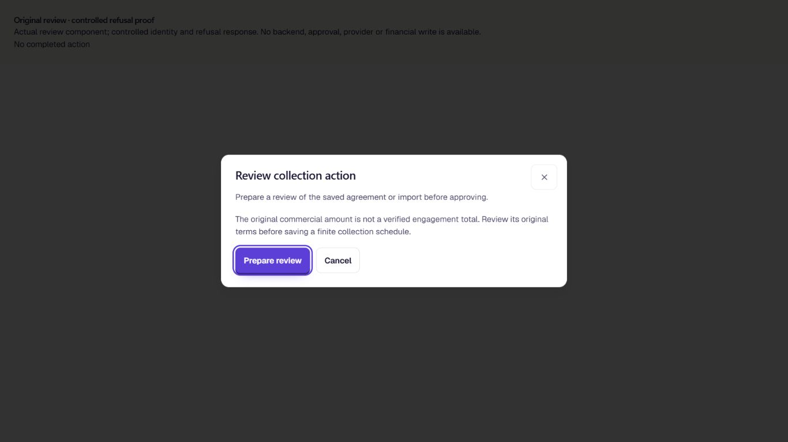
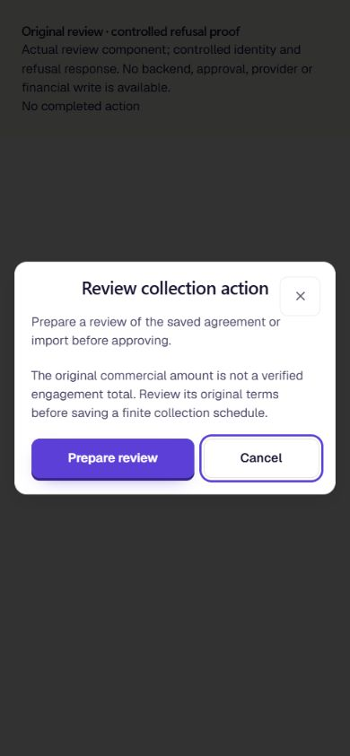

# Finite collection terms: current source revalidation and useful refusal

UI_DELIVERY_EVIDENCE_VERSION: 1
FLOW_BY_FLOW: PASS: Original commercial record → existing reviewed collection command → locked native revalidation → original save/receipt or truthful refusal → existing correction controls. No new writer or approval route.
PAIGE_UI_DESIGN: PASS: Existing project design modules applied to owner intent, source truth, responsive refusal, recovery and protected seams. Production review component/styles are unchanged.
MATERIAL_FLOW_CHANGE: NO: Repairs an existing save precondition and carries its refusal through the existing response/message state; no new user goal, navigation, approval container or execution route.
FLOW_PROTOTYPE: NOT_REQUIRED: Existing native validation and mounted refusal/cancel state are repaired. Controlled rendered verification uses the actual review component, not a replacement interaction design.
PURPOSE_AUDIENCE_PRIMARY_ACTION: PASS: An eligible SOLO owner saves a finite payment schedule only against a verified original total and receives a useful correction message when current source meaning is incompatible.
VISUAL_DIRECTION: PASS: Original PAIGE dialog, typography, focus ring, spacing and controls retained. No CSS/component-library changes; controlled renders linked below.
AUTOMATED_EVIDENCE: PASS: 148 cases/11 files; original isolated PostgreSQL16 common-writer/receipt/concurrency proof plus 36 accepted-source continuity assertions inside the original signing/effectuation runner. Guard/replay/source-lock/rollback/ACL and validator-drift checks pass; failing-first records retained.
STATIC_EVIDENCE: PASS: Scoped ESLint and strict diff; unchanged TypeScript ratchet baseline10/current6/no-new; web build/385KiB entry within520KiB; native compile comparison: Chat9/9/no-new, collection endpoint clean/clean.
RENDERED_EVIDENCE: PASS: Actual unchanged review component with controlled auth/API refusal, 1366x768 and390x844; assets/e04-fixed-source-refusal/desktop-refusal.png and narrow-refusal.png. These are not authenticated production renders.
BEHAVIORAL_EVIDENCE: PASS: Controlled native refusal appears in the original dialog; no approval/completion callback; Tab reaches Cancel and Enter closes; narrow dialog stays inside the390px viewport. Native two-session source-change race also refuses the save after the original lock.
AUTHENTICATED_RUNTIME: UNVERIFIED: Candidate native/Edge changes have not been deployed. Local auth/autonomy/approval resolvers and controlled HTTP responses are fixtures; no owner/customer financial operation is established.
KEYBOARD_FOCUS: PASS: Controlled initial/response focus at Prepare review; Tab→Cancel→Enter closes, with visible focus. Full signed-in shell/role focus coverage remains owed.
ZOOM_REFLOW: UNVERIFIED:390px fit/no overflow is observed; full browser zoom and authenticated shell/reflow matrix have not run on this candidate.
REDUCED_MOTION: NOT_APPLICABLE: No animation, transition, motion preference or styling change.
STATE_COVERAGE: PASS: Verified fixed save; unchanged recurring route; unknown/periodic/catalog/changed-source refusal; replay without another save; receipt rollback; private helper ACL and source/authority metadata drift; exact safe customer-message mapping and existing correction path.
TRUTHFUL_STATE_LABELS: PASS: Refusal is not approval or completion. Historical operation replay is not a new current-source success. No invoice, charge, signing, settlement, send or service completion is inferred.
SOLO_UI: YES: Declared backend-to-visible impact on the original SOLO collection review, shared by all eligible present/future accounts; no account-specific behavior.
SOLO_1536X770_PAIGE_CLOSED: UNVERIFIED: Candidate authenticated full-shell proof is not complete.
SOLO_1536X770_PAIGE_OPEN: UNVERIFIED: Candidate authenticated full-shell proof is not complete.
SOLO_1366X768_PAIGE_CLOSED: UNVERIFIED: Controlled dialog render is narrower evidence than an authenticated complete shell.
SOLO_1366X768_PAIGE_OPEN: UNVERIFIED: Candidate authenticated full-shell proof is not complete.
SOLO_1024X768_PAIGE_CLOSED: UNVERIFIED: Candidate authenticated full-shell proof is not complete.
SOLO_1024X768_PAIGE_OPEN: UNVERIFIED: Candidate authenticated full-shell proof is not complete.
SOLO_900X1000_PAIGE_CLOSED: UNVERIFIED: Candidate authenticated full-shell proof is not complete.
SOLO_900X1000_PAIGE_OPEN: UNVERIFIED: Candidate authenticated full-shell proof is not complete.
UNVERIFIED: Exact-head hosted CI, parent release/history reconciliation, deployment/readback, authenticated accepted-terms/source-revision continuity, actual owner/staff/client roles, legitimate SOLO cohorts, full-shell proof and founder acceptance remain open. Native accepted/effective principal continuity is proven only within the isolated scope below, not customer acceptance or readiness for all twelve outcomes.

OWNER_INTENT: Preserve the original engagement and approved economic meaning throughout the complete EXP04 relationship; never turn a periodic or ambiguous amount into a new finite debt.
MUST_NOT_HAPPEN: No new ledger, financial calculator, writer, approval channel, scheduler, provider, broad grant or activation. No source test presented as signed/paid/client-accepted evidence.
MUST_PRESERVE: Original record IDs, signed versions, existing recurring path, current permission/governance, operation replay, record lock, atomic write/readback and Rail. Preserve all incoming Team security/CI and other Experience work.
ACCEPTANCE_CRITERIA: A current original total survives native revalidation under the existing lock; original accepted/effective principal can establish meaning without a later creation operation; incompatible meaning refuses before save, replay remains exactly once, receipt failure rolls back, and the owner can see and recover from the refusal. Actual deployment and authenticated continuity remain release gates.
MOTION_PURPOSE: NONE: no motion change.
PROTECTED_SEAMS: Native reader/preview whole inverses and original executor identity; private invoker helper/ACL; original Edge admission/approval/execution and response branches; original review component; original financial model and signed terms remain intact.

INTERNAL_BUILD_IDENTITY:97f397fe3b18684224b735c17d45943d36f822d6; deployment=NOT_DEPLOYED; environment=development; migrations=PROOF_OWED(candidate-native-guard-parity); edge=PROOF_OWED(candidate-collection-command-parity); evidence=docs/evidence/ui-delivery/e04-fixed-source-save.md
RELEASE_CHANNEL: development: Isolated actual native proof and controlled existing-dialog verification, no production activation.
RELEASE_CLASSIFICATION: patch: Financial correctness prerequisite for the existing finite collection save and later preparation UI.
CUSTOMER_RELEASE_IDENTITY: none: held source candidate; integrated Experience founder evaluation has not occurred.
RELEASE_NOTE_REQUIRED: no: internal engineering evidence, no customer announcement authorized.
RELEASE_TRUTH_BOUNDARY: PROOF OWED: Current native/Edge deployment and authenticated accepted-source behavior and all complete Experience acceptance; no new LIVE capability.
RELEASE_RECOVERY:position=forward-only source reconciliation under normal required CI and release gates; reference=docs/doctrine/release-governance-and-customer-update-policy.md

## Contract and source ownership

**REPAIR/EXTEND**, existing EXP04 Sales/Collections family (ANT-51), reserved in ANT-161. Stacked on the original amount-basis read repair; no replacement source registry or engineering lane.

- Extract the parent's original amount-basis expression into one private `SECURITY INVOKER`/`STABLE` native helper. The original scoped reader and original native preview reuse it. Ordinary callers, including service-role RPC clients, cannot invoke that helper directly.
- Extend that same helper for older negotiated installment records using the ORIGINAL `_paige_accepted_commercial_payload` validation chain and original effectuation provenance, immutable operation and matching Rail receipt. Match the original tenant/client/offer/record/principal/currency, signed revision/digest and all ten effectuation command fields. A mutable status or provenance flag alone is insufficient. No new signing interpreter, legal-language parser or agreement store is introduced.
- This establishes **amount meaning only**. A permitted later draft schedule correction preserves the original accepted principal and signed version; it does not become newly signed, effective, invoiced or paid. Missing or contradictory original evidence remains unverified. Catalogue per-payment and recurring per-cycle meanings retain precedence.
- The existing executor already locks the original agreement and then calls this preview. Its entire definition stays byte-identical. Current finite-source verification therefore runs under the existing lock, with the original actor, tenant, role, approval/governance, idempotency, write/readback and receipt rules.
- Keep the original recurring-save path. Finite plans require a verified original total; ambiguous legacy/new periodic interpretations are refused. Existing immutable operation replay remains historical evidence and does not repeat the save.
- Guard the exact incumbent bodies and relevant language/return/security/volatility/config/ACL metadata, including delegated execute authority. Apply the forward migration transactionally and idempotently; drift refuses rather than overwrites a shared change.
- The existing Edge response adds the shared static correction message **only** for this exact native finite-total refusal. Unknown summaries, other actions and arbitrary backend diagnostics do not become that message. The unchanged mounted review already handles it, allows cancellation and does not present approval/completion.
- Reuse registered `sales_collections.save_terms` / `sales_save_collection_terms`, HIGH/confirm, original owner review, common native execution and Rail. Ordinary basis reads use `sales_collections.read` / `read_sales_collections`. No new Spine registration, ActionAdapter, Layer C runtime, authority store or receipt stream is needed. No Chat availability is promoted.
- Stripe, Communications, Portal/EXP09 (ANT-163), accepted signing records, invoices, payment allocation and Operations remain their original contracts. No provider is required or activated for this source verification. Binding Ledger/Harness/provider registry changes are not applicable to a new integration because none is created.

### Orchestration contract

| Required link | Actual contract and limit |
| --- | --- |
| Event or request | Owner requests a finite schedule save or corrects a draft schedule against the original commercial record. No signature event automatically triggers this act. |
| Entry surface | Existing Sales Collections review; registered Chat tool remains subject to its original shared admission. No Live or Team Hub caller is added. |
| Original record/capability | `tenant_client_agreements`; `sales_collections.save_terms` / `sales_save_collection_terms`; existing read is `sales_collections.read`. |
| Governed execution path | Existing Kit owner review → `sales-collection-command` → native preview/executor. This legitimate direct domain path is retained; no new Layer C adapter/runtime is introduced or claimed connected. |
| Authorization | Existing execution-time actor, expected tenant, ordinary role, client relationship and source version checks; private basis helper grants no caller authority. |
| Risk/approval | Existing HIGH/confirm and canonical governance/approval evidence. Original effectuation consent is evidence of amount meaning, never approval of a new save or payment. |
| Execution/work/Rail | Same operation UUID and parsed command, original locked writer/readback, append-only collection operation and canonical workspace Rail. No second execution or receipt store. |
| Provider/reconciliation/replay | No provider effect. Exact original operation replay stays historical; accepted-source reconciliation uses original validators, exact operation and receipt. |
| Refusal/interruption/recovery | Unknown/contradictory source refuses; stale source after the original lock refuses; Rail failure rolls back. Existing uncertain-outcome/readback handling remains unchanged. No unsafe retry promise. |
| Visible result | Original dialog displays known refusal and Cancel/correction controls, or existing save receipt/version followed by refresh. No signature, issued invoice, notification, collected payment or accepted service is inferred. |

EXP09 continues consuming its existing approved client-scoped agreement/invoice/status records through ANT-163; no Portal source or permission contract is expanded. PAIGE/MERIT may explain only the original recorded status. Capabilities catalogue/registry maturity stays unchanged until its actual deployed and authenticated outcome is proven.

## Verification and limitations

Runtime `97f397fe3b18684224b735c17d45943d36f822d6`, received parent `881dc7bd950abe7ae95bf90c3f6be9d634330448` through normal merge `f367f383e018bb6e6d7ff42e2a40555c322e2b5d`. Evidence-only commits must preserve its runtime/test blobs. The parent includes valid-null-title continuity. Native compile proof ran on `135a432cd6e32501993a6bca8f92b51bb228c061`; the later native compatibility work changes no TypeScript/Edge implementation. Current original reader/preview/executor and accepted-validator metadata were inspected read-only; no hosted migration or data was changed.

1. Original `scripts/sql/sales-commercial-create-proof.mjs` on a directory-verified unique loopback PostgreSQL16 database: **PASS**. Uses original schema CHECK/FKs, common writer/governance/receipt bodies and canonical exact signed-term router. Adds helper ACL, read/preview inverse and whole-executor preservation, fixed save, historical replay once, recurring preservation, periodic/catalog/legacy/source-change refusal, actual two-session row-lock race, receipt rollback, source and authority-metadata drift negatives. Auth/autonomy/approval resolution remains a fixture; not hosted customer proof.
2. Focused Collections/closed-read/model tests: **148 PASS /11 files**. Includes exact actual endpoint refusal mapping (no approval or writer call), arbitrary-message negatives, valid-title continuity and actual original review refusal/cancel behavior.
3. Scoped ESLint/strict diff; original type ratchet **10 baseline /6 current /no-new PASS**, not a clean full compile. Web build and original entry guard **PASS**,385KiB/520KiB.
4. Original Deno2.9.6 two-function exact-source ratchet: **Chat9/9/no-new; collection command clean/clean PASS**. Chat retains its existing diagnostics; no compiler or CI weakening.
5. `node scripts/agreements/signer-preparation-integrity-proof.mjs <psql> <loopback-port> proofrunner <verified-isolated-directory> repaired --checked --document-preparations --commercial-document-preparations --accepted-commercial --effective-commercial --collection-source-continuity` — **PASS**, including **36 added continuity assertions**, original signer44/checked75/document408 nested checks, real native effectuation and original49-row catalogue. These nested counts overlap and are not summed. Actual native signature/accepted validators and original governed save run against synthetic identity/approval and file metadata. This is not actual client consent, a rendered completed seal, hosted authorization or payment acceptance.

The continuity cases cover: predecessor unverified → original accepted/effective total; no later creation operation; exact customer/offer/tenant/principal/currency; missing or changed operation/signing/digest/version/receipt; withdrawn signer/consent/seal evidence; current catalogue/recurring meaning; permitted draft timing changes; one canonical save and exact replay; retained original accepted payload/effectuation version; unchanged invoice/payment/signing-event counts; later scoped read. Partial effective provenance is refused by the original native constraint, rather than disabling that constraint to force a decoder result. All three original accepted-validator source/security/search-path/ACL drift negatives pass.

Failing-first: actual current canonical native preview accepted a finite schedule after the source became periodic; the new assertion failed before the guard. The actual endpoint initially omitted the correction message; one new test failed before mapping. A test-only raw count under the service role was correctly denied; the proof now resets to its isolated fixture role before inspecting counts, without granting table access. Raw failures and commands remain local; no customer data or actual tenant credentials are in these controlled assets.

**Release holds remain:** parent native Preview/history reconciliation; current exact-head CI/review; deployment/readback; complete authenticated roles/cohorts/reload/recovery. The isolated accepted/effective-source prerequisite is now proven for the described original contract, including draft corrections without changing accepted terms. Unsupported or unverifiable historical records remain explicitly unverified; no signature is reconstructed or authority backfilled. Actual customer continuity remains unverified before activation of this stricter save path or the new UI.

**Known compatibility hold:** the accepted-total branch currently supports negotiated installment records. Existing deposit/custom-quote records remain unverified even when their original accepted producer can retain an explicit finite total. A separate bounded continuation must carry matching original accepted/effectuated evidence into the closed read validator before widening that eligibility. Neither a `total` label alone nor this candidate's passing installment proof resolves that gap. Keep the stricter save/new preparation activation held until that contract and its negative proof are complete.

ALG-01 and ALG-12 remain **PARTIAL**; these tests extend source/replay/exception evidence, not provider reconciliation. ALG-02 remains **INCOMPLETE**, ALG-13 usefulness **UNVERIFIED**. All O1–O12 and consultant lifecycle additions remain open; founder **NOT_ACCEPTED**. Actual normal merge/release/readback and canonical shipped closeout are owed, not claimed.

Review correction: the migration pins the unchanged original executor body/authority metadata and original accepted-validator chain as well as the reader and preview. Native revalidation relies on the existing lock/call order and established accepted-record evidence. Actual source/security/config/grant drift negatives pass. No original executor or signing-validator implementation was changed. The shared native history and actual authenticated acceptance holds remain unresolved.
