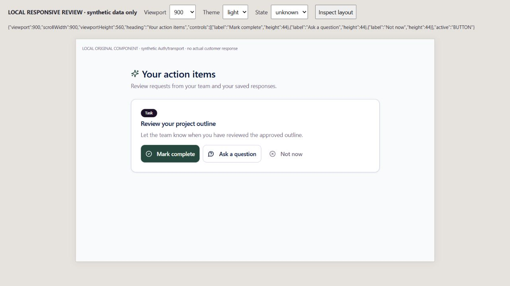
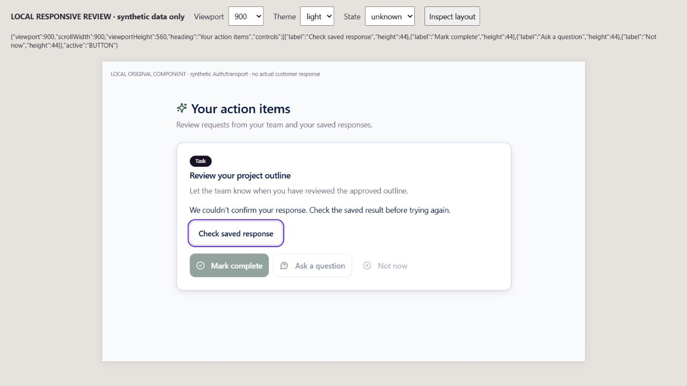
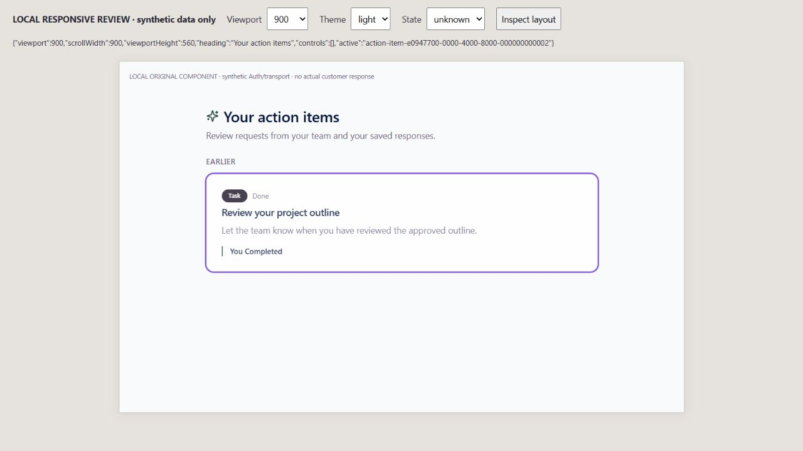
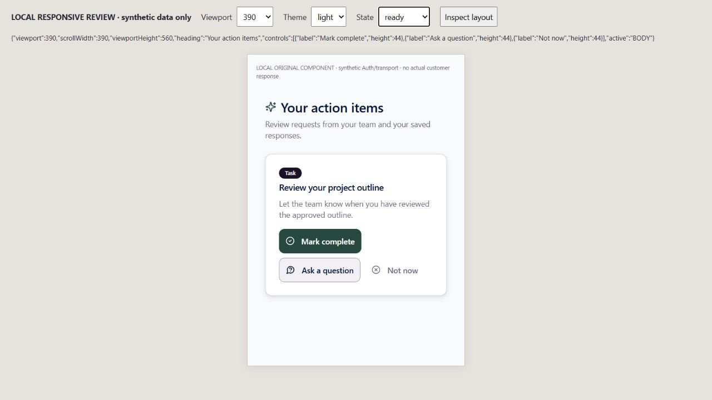
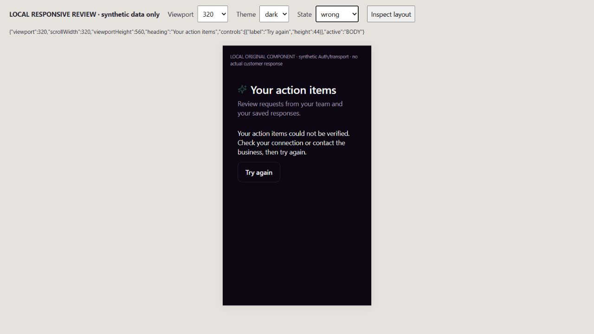

# EXP09 — selected-business Action Items

UI_DELIVERY_EVIDENCE_VERSION: 1
FLOW_BY_FLOW: PASS: ten pre-edit routing answers and original domain-response contract in docs/delivery/e09-customer-actions-business-scope.md.
PAIGE_UI_DESIGN: PASS: original Action Items, typography, cards, tenant accent, shared controls, question/exit guards and canonical response history retained. Local quiet controls reuse original Progress/Sessions muted/foreground tokens.
MATERIAL_FLOW_CHANGE: NO: restore the existing selected-business/assigned-work response and interrupted-result workflow; no new goal, permission, approval, signing or financial action.
FLOW_PROTOTYPE: NOT_REQUIRED: existing approved flow restoration; actual original-component interactive rendering below is verification, not claimed pre-implementation approval.
PURPOSE_AUDIENCE_PRIMARY_ACTION: PASS: authorized customers inspect their selected business's assigned work and explicitly respond, returning to the same original saved status/response without duplicate writes.
VISUAL_DIRECTION: PASS: original design and shell preserved. Installed Impeccable4.3.1 craft/operate checks applied to hierarchy, phone fit, legible interaction, primary touch targets, truthful states and focus.
AUTOMATED_EVIDENCE: PASS:150 final tests/eight Actions, Progress and Home suites, including16 new selected-business Action Items cases and original version/response/attribution/unknown/draft/exit controls. Earlier133/99 runs overlap, not additional282 tests. Native94/current-head hosted checks pending, not included in150.
STATIC_EVIDENCE: PASS: changed hook/test/page ESLint0 errors, diff and original migration guard1390 PASS. Native profile/response bodies, ACLs and three-argument INVOKER compatibility wrapper unchanged; no migration/dependency/provider/shared Edge/Spine/C0b/owner Chat edits.
RENDERED_EVIDENCE: PASS: actual original ActionItems and changed hook at900x560 light assigned/unconfirmed/recovered focus,390x560 light assigned/quiet hover and320x560 dark foreign-relationship refusal. Five PNGs under assets/e09-actions-business-scope/. Synthetic Auth/transport/branding and unrelated ActivityFeed stub; not actual joined customer/device proof.
BEHAVIORAL_EVIDENCE: PASS: keyboard Return on Mark complete gave synthetic lost acknowledgment, disabled duplicate responses and focused Check saved response. Return on that read-only control reconciled original saved status/response, focused its card and showed Response saved, with no second write. Question Cancel restored Ask focus. No actual customer/provider effect.
AUTHENTICATED_RUNTIME: UNVERIFIED: synthetic Auth/transport. Native94, actual owner/client/two-business/revoked/interrupted/returning journey, other domain/Edge/global identity bindings and whole Experience remain owed.
KEYBOARD_FOCUS: PASS: actual Return, question Cancel, unconfirmed Check and saved-card focus observed; original unit draft/in-flight/exit/scope controls retained. Primary response/check/retry targets measured44px. Assistive-technology certification not claimed.
ZOOM_REFLOW: PASS: observed viewport equals document scroll width at900/390/320; key states fit560px iframe height. No physical phone/Safari/full-shell/400-percent zoom certification.
REDUCED_MOTION: NOT_APPLICABLE: no motion added/changed; incumbent spinner already uses motion-reduce:animate-none. No OS preference drive claimed.
STATE_COVERAGE: PASS: loading/empty/populated, failed/foreign/expired/version refusal, sign-out, actor/business A-to-B-to-A, unsent preflight, in-flight/unconfirmed saved or unsaved, readback success, retry, draft/exit/returning tested. Assigned/unconfirmed/recovered/foreign states rendered. New approval/signing/payment states N/A.
TRUTHFUL_STATE_LABELS: PASS: native acknowledgment alone cannot become saved success. Exact original response/status/actor readback required; unknown never automatically replays. Native Auth/CRM/RLS authorize, never route/header/cached session/display name/frontend role.
SOLO_UI: NO: existing external-customer /app/actions and hook/projections. Owner SOLO/PAIGE panels and shared design components untouched.
UNVERIFIED: Native94/required current-head CI/deployment and actual signed-in joined customer acceptance pending. Ancillary original shared-toast close measured24px height, outside this page lease; no blanket44px or full accessibility certification. ActivityFeed binding remains separate.
OWNER_INTENT: Complete CURA's seven-pillar two-way customer journey using canonical authorized PAIGE business systems; preserve owner COO and private client conversation boundaries.
MUST_NOT_HAPPEN: Foreign/stale rows or callbacks, wrong-version responses, borrowed other-actor token, duplicate uncertain write, private owner context, second ledger/runtime/sender or new grant.
MUST_PRESERVE: Original safe profile/RLS filters, exact action version and actual actor, original response IDs/history/audit/activity/notifications, explicit customer permission, unknown hold and original global identity guard.
ACCEPTANCE_CRITERIA: Captured actor/business applies per original SDK builder only. Scope transitions synchronously hide old rows/retire intents. Original saved result settles uncertain response through readback without duplicate write; same-business rechecking retains its hold.
MOTION_PURPOSE: None added.
PROTECTED_SEAMS: Original useMyActions, local ActionItems quiet styles, tests and rolled-back native fixture only.2401/2546 shared Edge/Spine/C0b and2557/2560/2561 EXP04 preserved; native compatibility wrapper stays INVOKER.
INTERNAL_BUILD_IDENTITY: implementation=bf6a85ccef0bc88228bdd3122b6ae48da18cf2cc; final-ui=bb90284524f85b3a65a162d1ee3bb920e0834625; deployment=NOT_DEPLOYED; environment=development; migrations=NOT_APPLICABLE; edge=NOT_APPLICABLE; evidence=docs/evidence/ui-delivery/e09-actions-business-scope.md
RELEASE_CHANNEL: development: isolated original-component/SDK tests; future-shape native fixture rolls back, never run in production or managed Preview.
RELEASE_CLASSIFICATION: internal-only: original assigned-work scope/recovery prerequisite, not completed multi-business Portal.
CUSTOMER_RELEASE_IDENTITY: none: no owner-authorized customer version/announcement.
RELEASE_NOTE_REQUIRED: no: bounded internal repair; sole Master/Brain closeout follows actual production readback.
RELEASE_TRUTH_BOUNDARY: PARTIAL: original Portal with bounded local source/browser proof. PROOF OWED: native94, final required CI/production and real joined customer journey; no capability/algorithm/full Experience LIVE claim.
RELEASE_RECOVERY: position=compatible original-consumer forward correction/revert, preserving canonical records/authority/unknown holds; reference=docs/delivery/e09-customer-actions-business-scope.md

## Rendered review and confirmation

Installed Impeccable4.3.1 / [canonical skill](https://github.com/pbakaus/impeccable/blob/main/.claude/skills/impeccable/SKILL.md) applied as bounded inspect/fix/confirmation. Original Ask outline hover was unreadable in light theme; local quiet-button hover now reuses muted/foreground and final390px image confirms legibility. Primary tenant accent unchanged. Sequential author finish review is LOWER ASSURANCE, not non-author review.

The review host is1280x720, its iframe exactly560px high. Real changed hook/page, original controls/Toaster and MemoryRouter are mounted; Auth/transport/branding and unrelated ActivityFeed are synthetic. Only fully rendered frames retained; initial inactive background iframe is not evidence. Original shared toast dismissal's24px height is an ancillary inherited refinement, not a new primary-control claim. Actual native/provider/customer/device/full-shell/400-percent/assistive-technology proof is not inferred.

## Orchestration and four-dimensional boundary

Original Portal request -> actual actor/client/business -> native safe profile/RLS -> exact-version original response writer -> original response/status/activity/notification/audit -> native saved-result readback. Existing direct customer-domain execution stays valid; no Layer C ActionAdapter, scheduler, approval system, alternate receipt stream, inbox or CURA runtime. Uncertain outcome stays held, never automatically retried. Future authorized EXP08 Team Hub consumes original work references; no private CURA/unauthorized finance exposure.

Functional:150 local checks; native94/required CI/production pending. Visual: original design, bounded responsive/dark/touch and corrected hover; ancillary/device/accessibility limits explicit. Experiential: keyboard, unknown-result readback, history/draft/exit under synthetic transport; real joined journey owed. Founder Acceptance: one complete integrated live evaluation, not requested per PR.

Final source review found an old refresh incremented the read sequence before refusing its retired scope; this could interrupt a newer business load. The scope check now precedes that counter, with the sixteenth scoped case verifying the current read still completes. Final sourcebf6a85ccef0bc88228bdd3122b6ae48da18cf2cc passes150 tests. This correction changes no native authority or rendered composition.
