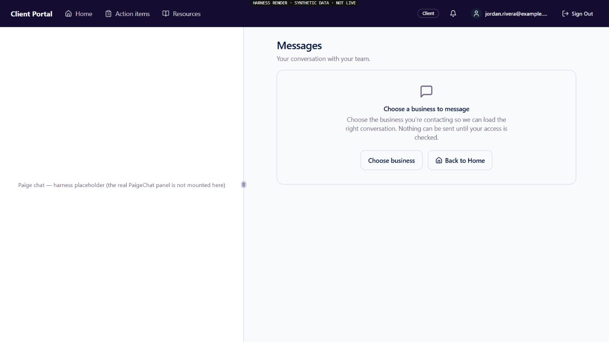
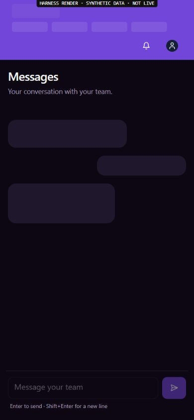
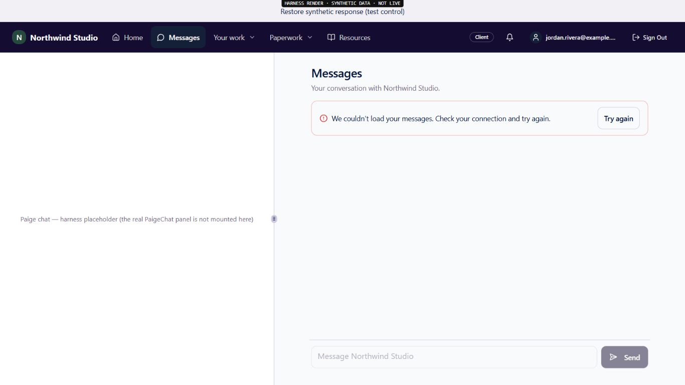
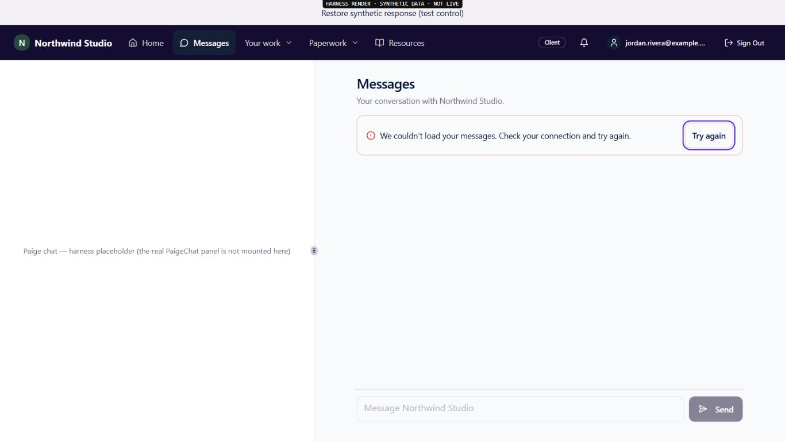
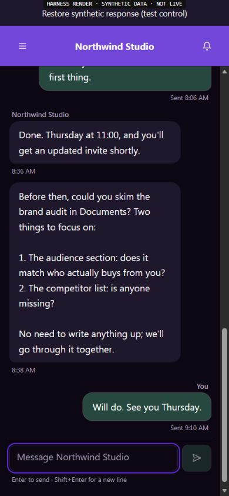
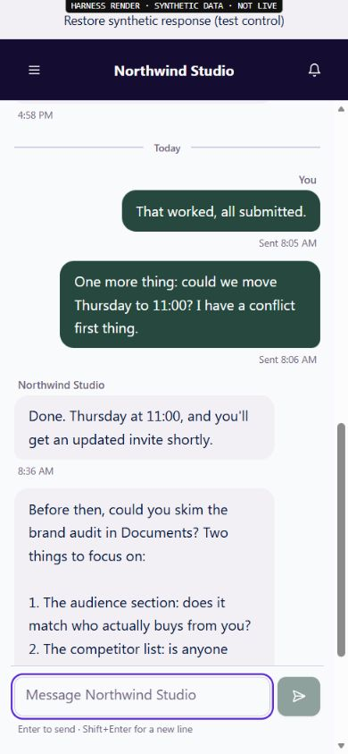

# EXP09 — recover the correct business conversation

UI_DELIVERY_EVIDENCE_VERSION: 1
FLOW_BY_FLOW: PASS: original ANT-163/9b8d2b73 and ANT-161/ea0882f6 pre-edit packet; original Messages/Support, chooser, scope and native-reader contracts traced.
PAIGE_UI_DESIGN: PASS: existing page, native business chooser, brand, typography, tokens, navigation and 44px actions retained; PAIGE UI and Impeccable hardening/finish guidance applied.
MATERIAL_FLOW_CHANGE: NO: restore the already shipped native chooser entry and normal keyboard recovery of an existing read; no new membership selector, customer action, authority, confirmation or writer.
FLOW_PROTOTYPE: NOT_REQUIRED: bounded restoration of existing flows; original-component synthetic rendering verifies changed states, not a replacement application or shell.
PURPOSE_AUDIENCE_PRIMARY_ACTION: PASS: an external customer reaches the correct business conversation and can recover a refused read deliberately, without sending or gaining access from a route hint.
VISUAL_DIRECTION: PASS: incumbent customer composition and theme; wrapping spaced recovery actions, current error treatment and visible original focus ring.
AUTOMATED_EVIDENCE: PASS: failing-first baseline 40 passed / 5 failed; first implementation 67 passed / 1 failed exposed an invalid null-to-resolved-business focus fence; corrected final source 88/88 across six existing page/draft/scope/access-gate suites. Reports retained in local outputs/e09-conversation-recovery-*-20261030.json.
STATIC_EVIDENCE: PASS: four changed TSX files ESLint zero errors; whitespace clean; original PlatformSupportDesk body and parent strict history decoder byte-identical. Full app/build checks remain exact-head CI obligations.
RENDERED_EVIDENCE: PASS: actual original Messages page/hook/AppNav in the existing synthetic transport harness, 1366x768 light and390x844 dark/light; six original captures and exact source pins in assets/e09-conversation-recovery/.
BEHAVIORAL_EVIDENCE: PASS: ambiguity has the exact original same-tab chooser href and no composer; failed keyboard retry retains Try again focus; explicit fixture restoration plus Enter recovers ten messages and original composer focus without typed text or Send interaction.
AUTHENTICATED_RUNTIME: UNVERIFIED: designated ordinary external-client profile is not connected. No owner-as-client or synthetic authorization substitute.
KEYBOARD_FOCUS: PASS: rendered desktop/narrow Enter recovery focuses portal-message-body. Unit negatives cover moved focus, pointer retry, read refusal, subsequent polling, scope retirement including A-to-B-to-A and unmount. No physical keyboard or assistive-technology drive claimed.
ZOOM_REFLOW: PASS: observed document width equals1366/390 without horizontal overflow; both narrow business-choice actions44px high. Physical iPhone, device keyboard, OS scaling and400% zoom remain unverified.
REDUCED_MOTION: NOT_APPLICABLE: no animation or motion change.
STATE_COVERAGE: PASS: first read/error/success/ambiguous/denied/cached-brand error, selected/changed identity, drafts/outbox/unknown outcome and native CustomerAccessGate chooser regressions in original suites; successful second-business production membership is not proved.
TRUTHFUL_STATE_LABELS: PASS: a failed read stays failed; known ambiguity requests an authorized business selection rather than claiming absence of selection support. No customer-read, delivery, provider or authorization inference.
SOLO_UI: NO: external-customer Messages/Support projection; owner SOLO shell and shared PAIGE Chat/Live untouched.
UNVERIFIED: exact-head hosted checks, merge/deployment/source readback, real external-client return/multi-business/revocation, physical iPhone, full seven pillars and founder evaluation remain separate.

OWNER_INTENT: customers communicate with the right business, recover a temporary failure and retain their own history within the complete original EXP09 assignment.
MUST_NOT_HAPPEN: no platform support substitution for business help, stale focus after actor/business change, auto send/replay, new identity/selector/inbox/runtime, provider activation, customer-data transmission or permission grant.
MUST_PRESERVE: original native relationship admission, full-navigation unsaved-work guard, canonical message/request IDs, strict page decoder, scoped drafts/outbox and the entire platform help desk.
ACCEPTANCE_CRITERIA: known ambiguity reaches the existing chooser entry; errors outrank cached branding; only a successful current deliberate keyboard retry restores composer focus; failure or changed intent/context never steals focus. Production and full-Experience acceptance remain owed.
MOTION_PURPOSE: NONE: recovery and focus continuity only.
PROTECTED_SEAMS: no Root, Spine, Harness, Trust, Fabric, C0b, Knowledge, Communications sender/case, native database, Calendar, Billing or private CURA history change.

INTERNAL_BUILD_IDENTITY: implementation=47e89b03abc6b650e018cfd42e46cb5b689ed349; deployment=NOT_DEPLOYED; environment=development; migrations=NOT_APPLICABLE; edge=NOT_APPLICABLE; evidence=docs/evidence/ui-delivery/e09-conversation-recovery.md
RELEASE_CHANNEL: development: reviewed local source and synthetic original-component proof; normal exact-head release gates remain required.
RELEASE_CLASSIFICATION: internal-only: bounded conversation recovery restoration, not complete EXP09 or external-launch approval.
CUSTOMER_RELEASE_IDENTITY: none: no customer announcement or version.
RELEASE_NOTE_REQUIRED: no: internal reliability increment; one integrated founder evaluation later.
RELEASE_TRUTH_BOUNDARY: PARTIAL: source/test/render proof; PROOF OWED: exact-head checks, normal release and authenticated useful result.
RELEASE_RECOVERY: position=forward-fix original customer route/focus behavior while preserving native history; reference=docs/delivery/e09-customer-messages-business-scope.md

## Render provenance and finish review

The existing local harness mounts the real Messages page/hook/AppNav with explicitly synthetic transport and Auth. The left CURA panel is a labelled placeholder. Production AppShell and native CustomerBusinessChoice are not mounted; the exact chooser href and original access-gate tests are supporting source evidence, not a two-business signed-in result. All six screenshots are unedited, source-pinned and contain only fictional data. No generated raster is used; incumbent DESIGN.md and sidecar remain unchanged.

Impeccable hardening/finish checks covered truthful failures, recoverable ambiguity, clear next action, native focus continuity, responsive wrapping, theme consistency and touch reachability. Actual rendering exposed adjacent recovery controls; spacing was corrected before final captures. No material defect remains in these bounded rendered states. One screenshot request timed out before any interaction; a subsequent actual page observation established the actions had not run. That failed capture is excluded. An initial dark-mode row-count selector did not match the DOM and is explicitly excluded from count claims; the later correct desktop/narrow-light selectors both observed ten original messages. This was a measurement defect, not missing product history. Temporary browser viewport was reset and only the owned preview tab/server closed.

Functional:88 focused source cases pass; release/customer proof owed. Visual: desktop/narrow theme and action states inspected. Experiential: native selection entry and deliberate read retry restore continuity; customer authentication and whole-journey persistence remain owed. Founder Acceptance: NOT_REQUESTED/NOT_ACCEPTED, unchanged one final integrated evaluation.
