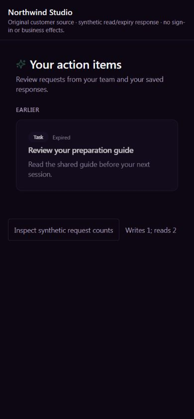

# EXP09 — original customer response expiry

UI_DELIVERY_EVIDENCE_VERSION: 1
FLOW_BY_FLOW: PASS: pre-edit ten-question contract in ANT161 comment319f019e-fb6a-41e9-aad9-a7c9e8500de9; causal original-body proof and narrow native reservation574ee0a7-5595-46c3-9562-3d2e68d372bb. Existing Auth/relationship/version -> original response -> original saved records, not another execution path.
PAIGE_UI_DESIGN: PASS: project overlay and its five modules read for this ongoing assignment; existing ActionItems, useMyActions, branded tokens, controls, error/refusal/reload and private-history separation preserved. No production UI source changes.
MATERIAL_FLOW_CHANGE: NO: correct the existing post-lock expiry predicate for the already-approved response/refusal flow. No new goal, state, action, permission, confirmation, navigation or commercial effect.
FLOW_PROTOTYPE: NOT_REQUIRED: same original approved customer-response flow and existing refusal/reload states; actual-source rendering below verifies the correction's visible contract.
PURPOSE_AUDIENCE_PRIMARY_ACTION: PASS: a legitimate customer responds to current work in the selected business; expired work refuses without saving a misleading response or completion.
VISUAL_DIRECTION: PASS: existing customer page and original components/styles, without a new shell or design language. Installed Impeccable4.3.1 craft/operate/finish checks applied to current-state honesty, recovery, primary-control fit and inherited presentation.
AUTOMATED_EVIDENCE: PASS: original fenced native proof53 retained PASS with4 causal expiry-wait RED on the observed production body; candidate65 PASS (original53, eight source/replay/refusal controls, four real two-session wait cases). Separate70 original hook/customer-page/owner-component tests across four suites PASS. Full-schema consumer suite adds16 assertions through four elapsed-expiry cases; required hosted replay remains pending.
STATIC_EVIDENCE: PASS: exact one-span native definition comparison for both full-schema and observed-production predecessors, unchanged function owner/definer/search_path/ACL, exact replay and unknown-forward-source refusal; source syntax and scoped migration checks are recorded in exact-head PR receipts. No dependency, baseline, workflow, shared guard or protected runtime changes.
RENDERED_EVIDENCE: PASS: six actual-source JPEG frames under assets/e09-customer-response-act-time/ show assigned, refused and reloaded-expired states at900x770 light and requested390x844 dark (actual image390x843). Existing hook/page/controls/router/Toaster execute; Auth/SDK/brand/shell identity are explicit synthetic ports and ActivityFeed is absent. Current-source hashes are in native-proof.json. Older original action screenshots have different source hashes and are supporting history only.
BEHAVIORAL_EVIDENCE: PASS: Enter on Mark complete receives the synthetic native-shaped ACTION_EXPIRED refusal, disables further responses and shows honest original error feedback. Enter on read-only Try again shows Expired, no response saved and no remaining response controls. Both flows have exactly one response attempt and two reads, no replay. Native causal refusal and zero effects are separately proved by PostgreSQL.
AUTHENTICATED_RUNTIME: UNVERIFIED: current customer profile disconnected; owner will reconnect later. Chrome's connected extension also requires update. No copied identity, alternate browser-control or owner-session substitution. Ordinary customer/owner/two-business/device/full Experience proof remains owed.
KEYBOARD_FOCUS: PASS: locator Enter drives existing response and recovery controls; original70 cases retain draft/exit/confirmation/scope coverage. No claim of automatic error focus or full natural Tab-loop/AT certification: after refusal focus is body, first Tab reached the synthetic footer. Existing recovery remains a native enabled button.
ZOOM_REFLOW: PASS: observed document scroll width equals900/390 viewport widths, primary response targets44px high; narrow refusal and expired result fit. Physical iPhone, browser zoom, full shell and accessibility certification remain unverified.
REDUCED_MOTION: NOT_APPLICABLE: no motion source changes; existing pending spinner retains motion-reduce handling. No new OS-preference test claimed.
STATE_COVERAGE: PASS: original valid completion/acceptance/decline/question, expired, wrong subject/business, inactive/merged relationship, suspended business, missing/stale viewed version, closed state, invalid text, audit rollback, concurrent same-version response and unknown-result recovery controls retained. New four late-expiry cases independently observe the actual row wait and after-expiry release.
TRUTHFUL_STATE_LABELS: PASS: failed expiry cannot save a response, status, audit, notification, linked output or Rail row. Saved response still requires original readback; no task completion, delivery, read receipt, provider or algorithm claim follows from a native acknowledgment.
SOLO_UI: NO: native external-customer /app/actions response correction. Owner SOLO shell, PAIGE panels and shared UI untouched.
UNVERIFIED: required exact-head hosted replay/CI, Preview, production migration/web readback and ordinary customer testing pending. All42 approved outcomes/seven pillars, owner assignment preparation/admission/recovery, physical phone, full natural keyboard/AT/zoom and founder acceptance remain open.

OWNER_INTENT: complete reliable, isolated CURA customer work using original business records; preserve the full seven-pillar Experience and one final integrated founder evaluation.
MUST_NOT_HAPPEN: late expired response accepted after waiting; wrong/revoked relationship authority, stale version, duplicate uncertain response, private CURA exposure, competing action ledger, provider activation or owner identity substituting for a customer.
MUST_PRESERVE: original function ABI/owner/ACL/search_path, identity/relationship/state/version guards, response kinds/text, canonical actions/responses, owner notification/audit and incumbent linked-action/Rail tails; all valid earlier releases.
ACCEPTANCE_CRITERIA: current request succeeds normally; actual row wait across expiry refuses all four response kinds without any durable effect. Replay is harmless, unexpected source refuses, and original UI reload shows the genuine expired state without another response attempt.
MOTION_PURPOSE: None added.
PROTECTED_SEAMS: only existing four-argument customer response and original local/full-schema tests. file_action/advance_action, E04 decline/signing/billing, E03 sender, E05 Work, Root/C0b, Chat/Live, consent, Knowledge and original grants are unchanged.
INTERNAL_BUILD_IDENTITY: 468e50f6461517e43e5381ae2c2423332cf818cd; supporting exact main base, candidate content hashes in native-proof.json and final head in PR review; deployment=NOT_DEPLOYED; environment=development; migrations=PROOF_OWED(20271114110009); edge=NOT_APPLICABLE; evidence=docs/evidence/ui-delivery/assets/e09-customer-response-act-time/native-proof.json
RELEASE_CHANNEL: development: local real PostgreSQL sessions and actual-source synthetic browser proof; reviewed required green checks precede ordinary production release/readback.
RELEASE_CLASSIFICATION: internal-only: bounded native correctness repair, not a complete Portal or newly activated capability.
CUSTOMER_RELEASE_IDENTITY: none: no customer version or announcement proposed.
RELEASE_NOTE_REQUIRED: no: internal correction with source proof and later authenticated boundary.
RELEASE_TRUTH_BOUNDARY: PARTIAL: native/source correction verified locally; production and ordinary authenticated customer results PROOF OWED. clients.portal maturity unchanged; no full algorithm or Experience LIVE claim.
RELEASE_RECOVERY: position=guarded forward repair preserving all existing restrictive controls and records; reference=20271114110009_e09_customer_response_act_time.sql, exact source/replay/refusal proof and normal deployment pipeline. Never restore transaction-start expiry, rewrite history or use include-all.

## Native contract and evidence

The original writer already locks the action, then the active business/relationship. Its expiry gate follows those locks but used PostgreSQL transaction-start `now()`. Only that clock changes to `pg_catalog.clock_timestamp()`. Response/status/audit/notification/linked-action/Rail text remains exact; no new writer or effect is added.

The migration accepts only the two independently reconciled original bodies: full-schema `ae38f2c63729317d003cb8936ef2a6bb` and observed production `e1095a18ee344a3b1528e7320d33fdd9`. They differ in two STEP4 comments. Their exact new bodies are `3ef4c14c7e0545af4103f724b445ea8a` and `3e5b6bc2a80879db33ceb837c1ec7c15`. Replay accepts only those known corrected bodies; an unknown forward body refuses without overwrite. Metadata is compared independently of the body.

The original disposable loopback runner reconstructs the real current body with the unchanged original S7 block. Each causal response begins before expiry; a separate session locks the original action; native blocking-PID/wait metadata proves the wait; the server clock passes expiry before releasing it. Original body returns success and changes durable state in all four cases. Corrected body returns ACTION_EXPIRED with all six durable projections unchanged. Both owned clusters stop through the original finally. This is not production impersonation or authenticated customer evidence.

Existing direct customer native response remains the legitimate path. New Spine registration, LayerC adapter, provider, durable job, approval inbox, scheduler and Model Fabric work are N/A. New owner assignments still require the original Action Bus/permission/consent/recovery integration; this repair does not claim it. Existing Binding Ledger clients.portal remains PARTIAL; Integration Registry/tier/Brain capability contracts are unchanged. Actual merged identities will be added only to the sole Master§4.0 and original Brain through the existing collision-safe closeout queue.

## Visual finish and limitations

[Installed Impeccable guidance](https://github.com/pbakaus/impeccable/blob/main/.claude/skills/impeccable/SKILL.md) was applied as a bounded existing-flow inspection: hierarchy and states remain original, primary44px targets and900/390 reflow verified, error blocks another write, readback displays Expired. Original transient toast overlays the top on narrow screens; automatic error-focus/full natural Tab behavior is a retained accessibility refinement, not certified here. Pinned offline Impeccable4.1.0 detection of the two unchanged original source files exits0 with0 blocking findings and one inherited10px badge type-ramp advisory. No layout/style source was edited or general premium-completion claim made.

An initial source-hash comparison correctly refused reuse of older screenshots as current renders. Fresh actual-source frames were captured instead. The first IAB navigation timed out while creating the tab; its observed existing tab was rebound, without opening duplicates or touching owner/customer sessions. Captured JPEG bytes were named with the correct `.jpg` extension after format inspection; requested844px produced843px images, explicitly recorded. Temporary tab/viewport and own preview process were cleaned up. The initial private hash calculation needed CRLF normalization before reproducing the exact known native hash; the production source guard was never weakened.

