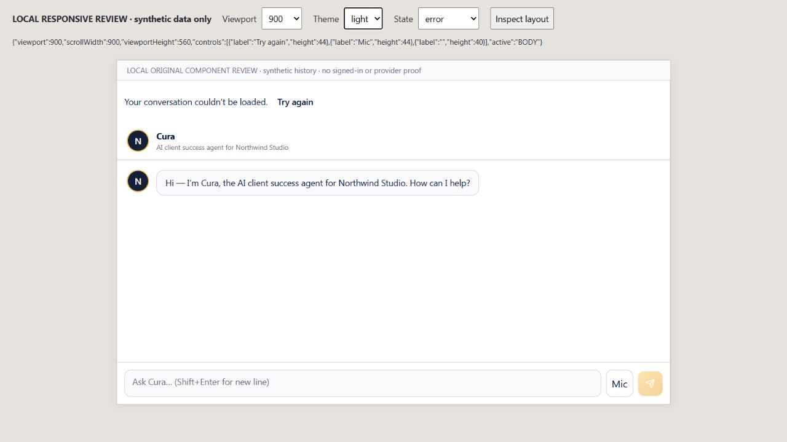
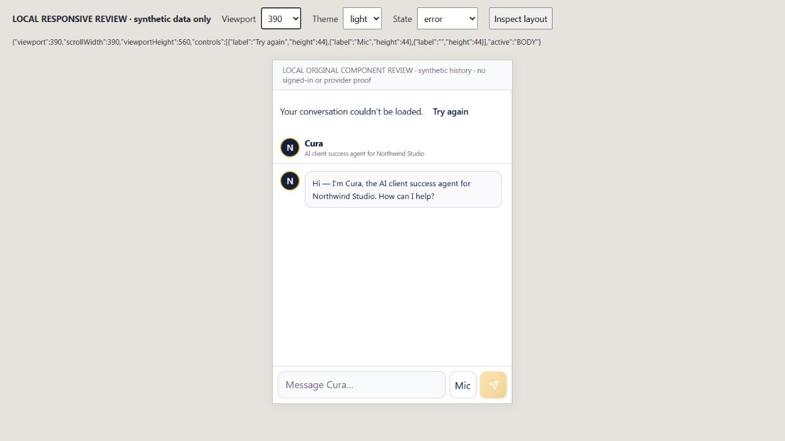
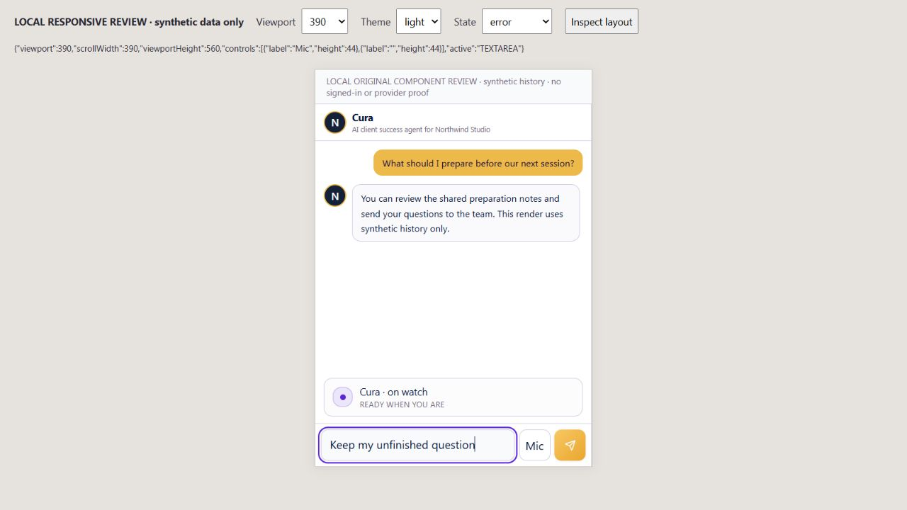
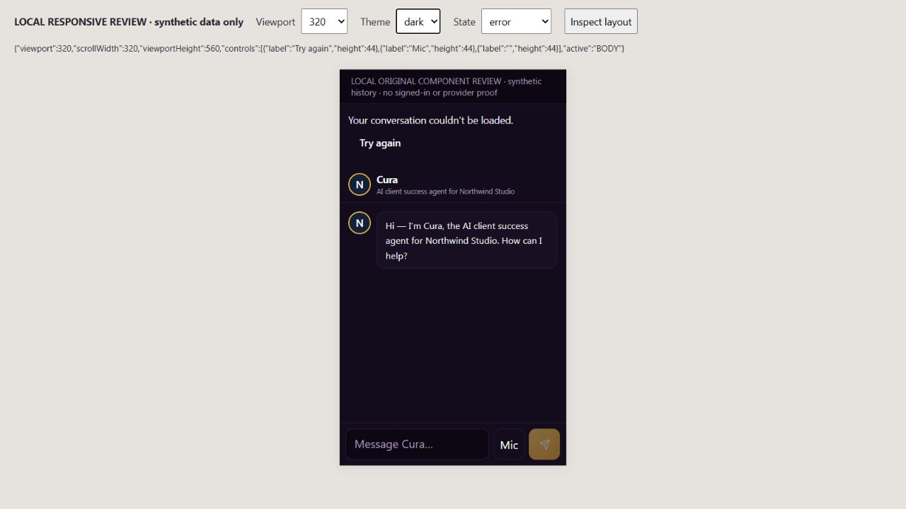

# EXP09 — CURA private-history recovery

UI_DELIVERY_EVIDENCE_VERSION: 1
FLOW_BY_FLOW: PASS: ten pre-edit routing answers in docs/delivery/e09-customer-relationships.md; restore the original canonical history/retry flow without another store, executor or provider.
PAIGE_UI_DESIGN: PASS: preserve original customer Chat, business identity, shared tokens, transcript/composer and original retry control. No new shell, navigation or visual system.
MATERIAL_FLOW_CHANGE: NO: correct interrupted/empty states in the existing private-conversation workflow; no new user goal, step, permission or action.
FLOW_PROTOTYPE: NOT_REQUIRED: bounded restoration of existing states, with actual original-component renders below; no new multi-step flow is introduced.
PURPOSE_AUDIENCE_PRIMARY_ACTION: PASS: authorized external customers return to their current private conversation and explicitly retry an interrupted read without losing their unsent draft.
VISUAL_DIRECTION: PASS: incumbent customer Chat/tokens retained. Impeccable responsive, interaction, truthful-state and touch-target checks applied; findings and final confirmation below.
AUTOMATED_EVIDENCE: PASS:180 tests/10 focused original Chat, Knowledge, privacy, frame and scroll suites passed.53 history/component tests confirmed cancellation, retry focus and draft preservation;38 final component/scroll tests passed after truthful-readiness correction. Counts overlap; not218 unique tests. Required exact-head hosted checks remain separate.
STATIC_EVIDENCE: PASS: changed-source/test ESLint has0 errors and two pre-existing effect-dependency warnings outside the changed recovery effect; diff check passes. No dependency, native migration, grant, shared Edge/Spine or owner Chat source change.
RENDERED_EVIDENCE: PASS: actual original PaigeChat component in isolated synthetic-transport harness; complete900x560 light error,390x560 light error/recovered-draft and320x560 dark error images under assets/e09-history-recovery/. These are iframe dimensions, not exact SOLO-shell viewport or iPhone/Safari proof.
BEHAVIORAL_EVIDENCE: PASS: actual keyboard Return on original Try again recovered synthetic saved history, retained typed draft and moved focus to Message Cura. Native/server tests are inherited prerequisites, not replaced by the harness. No model send, Auth credential or provider call was exercised.
AUTHENTICATED_RUNTIME: UNVERIFIED: no signed-in external-client session in this render harness. Full selected-business Edge/domain propagation, original global relationship admission and authenticated returning/revoked/interrupted history remain separately owed.
KEYBOARD_FOCUS: PASS: explicit successful retry returns focus to the retained composer; actual browser keyboard Return and component regression verified. Scope/unmount aborts old reads and withholds late results.
ZOOM_REFLOW: PASS: measured viewport width equals document scroll width at900,390 and320; final screenshot states fit560px height with reachable composer. Full browser zoom400%, assistive technology and exact SOLO closed/open matrix are not claimed.
REDUCED_MOTION: NOT_APPLICABLE: no animation, transition or shared motion component was added/modified; existing motion behavior preserved, no OS reduced-motion drive claimed.
STATE_COVERAGE: PASS: original loading, error/retry, genuine empty and populated history, timeout, canceled/late Auth/read, lost access, changed business, draft preservation and unmount retirement covered by focused tests; error and recovery states rendered. No approval/external execution state is fabricated.
TRUTHFUL_STATE_LABELS: PASS: no READY WHEN YOU ARE strip while customer history is unavailable/loading, and quick actions remain disabled until genuine readiness. Empty canonical history uses the existing business greeting; errors do not invent an empty success.
SOLO_UI: NO: original external-customer Chat consumer; owner Chat/Live and shared owner dashboard untouched.
UNVERIFIED: exact-head CI, production browser deployment/readback, real external-client/private-history/selected-business proof, Safari/device keyboard, screen reader and full seven-pillar/founder acceptance.

OWNER_INTENT: CURA serves the business's authorized customer using genuine records and private history; PAIGE remains the owner's COO.
MUST_NOT_HAPPEN: No stale successful transcript, late canceled identity opening a conversation, scope escape, owner context, duplicate history, autonomous send, provider action or new approval/runtime/ledger.
MUST_PRESERVE: Original actor/client/business checks, customer-private thread/turn identity and RLS, canonical idempotent thread reuse, actual Auth/frame readback, existing composer draft, owner Chat and surrounding shell.
ACCEPTANCE_CRITERIA: Native requests receive the same caller AbortSignal and cancellation is checked after Auth/native awaits. A20-second absolute UI deadline offers original explicit retry; a late result cannot revive retired state. A successful empty transcript replaces old text, while the same authorized draft survives retry. Genuine production acceptance remains a separate evidence class.
MOTION_PURPOSE: None added.
PROTECTED_SEAMS: Own original app/PaigeChat and customer-chat library only. Active2401/2546 owner Chat/Spine/Edge source is unchanged. Parent private-history request binding remains PR2555.

INTERNAL_BUILD_IDENTITY: implementation=c69a43d24e2e217c4d478bfed014f7ef75137e3b; deployment=NOT_DEPLOYED; environment=development; migrations=NOT_APPLICABLE; edge=NOT_APPLICABLE; evidence=docs/evidence/ui-delivery/e09-history-recovery.md
RELEASE_CHANNEL: development: controlled original-component and SDK transport tests.
RELEASE_CLASSIFICATION: internal-only: original private-history recovery prerequisite, not complete Portal/Chat execution or multi-business release.
CUSTOMER_RELEASE_IDENTITY: none: no announcement.
RELEASE_NOTE_REQUIRED: no: bounded recovery repair.
RELEASE_TRUTH_BOUNDARY: PARTIAL: source/browser recovery; PROOF OWED: exact-head hosted CI, native-parent release, production and actual customer journey.
RELEASE_RECOVERY: position=forward-fix through original conversation service without deleting history; reference=docs/delivery/e09-customer-relationships.md

## Bounded Impeccable finish review

The first original-component narrow render found the incumbent retry target was40px and an idle ready strip remained visible during history failure. Corrected only the original retry's minimum height to44px, withheld that strip and quick actions until ready, and restored composer focus after explicit successful retry. Final confirmation at390/320 shows44px retry/composer controls, no horizontal overflow, clear error/retry hierarchy and no false ready claim.900px complete desktop render preserves the original layout. No decorative redesign or shared DESIGN.md change; no separate non-author design review claimed.

## Orchestration and four-dimensional boundary

Original customer event: return/retry private history. Interface Portal; specialist CURA. Actual Auth and original verified customer/business frame authorize. No approval, provider, budget or Layer C ActionAdapter is appropriate for this ordinary read. Original paige_chat_thread_create owns idempotent locked reuse; original thread/turn IDs are the durable result. A canceled/unknown read offers explicit recovery; it does not write a turn, send, retry a payment or execute a model. Original shared Conversations and future Team Hub receive no access to this private transcript.

Functional: bounded recovery and source regressions verified locally, production owed. Visual: original responsive token system preserved and material retry/readiness findings corrected in rendered states. Experiential: recovery/draft/focus continuity verified under synthetic transport; whole Edge/domain/identity journey unfinished. Founder Acceptance: pending one complete integrated live Experience evaluation.
