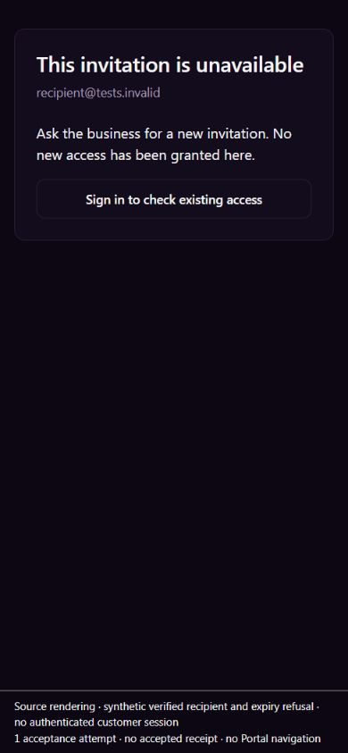

# EXP09 — customer invitation deadline and recovery

UI_DELIVERY_EVIDENCE_VERSION: 1
FLOW_BY_FLOW: PASS: pre-edit ten-question routing and narrow original-consumer source contract in ANT161/90341452-7201-4b8c-82fd-c5297e40b979 and8bb5ab0a-00a1-4790-bd13-3352025f35f2. Verified recipient -> original token/contact/business locks -> current deadline -> original relationship and receipt. No new invitation or identity system.
PAIGE_UI_DESIGN: PASS: existing project overlay and five routed modules read for this ongoing assignment. Original ConsumerInvitation, customer-entry sizing, shared tokens/buttons and native refusal/reconciliation preserved. Only the local outline-button hover ink is corrected; shared Button and other Chat work untouched.
MATERIAL_FLOW_CHANGE: NO: restore the existing invitation deadline at the admission boundary and readable recovery controls. Same original customer goal, signup/confirmation, acceptance, reconciliation, refusal and sign-in exits. No new state, question, navigation, permission, provider or legal requirement.
FLOW_PROTOTYPE: NOT_REQUIRED: no material flow change; actual original-source interaction and refusal rendering below verify the existing approved workflow.
PURPOSE_AUDIENCE_PRIMARY_ACTION: PASS: the actual invited customer enters the correct business; delayed expired acceptance must refuse without granting access. An uncertain response is checked before any subsequent write.
VISUAL_DIRECTION: PASS: established customer entry card, business branding, type/spacing and44px physical targets. Installed Impeccable4.3.1 checks applied to hierarchy, reflow, meaningful feedback, keyboard focus, recovery and contrast. No new shell, design system or specialist identity.
AUTOMATED_EVIDENCE: PASS: original fenced PostgreSQL runner retains35 historical-stage controls; actual-current original body adds4 valid/recipient/expiry/revocation controls. Baseline39 PASS/3 causal deadline FAIL. Candidate47 PASS, including all prior39, five exact-source/metadata/inverse/replay/refusal controls and three real blocked admission cases. Separate60 tests/four original customer-entry/invitation suites PASS. Full-schema suite adds11 elapsed-deadline assertions; hosted replay remains owed.
STATIC_EVIDENCE: PASS: exact body transform and inverse, unchanged function owner/definer/path/ACL/ABI, all non-consumer bytes and original canonical effects preserved. Node syntax, scoped migration lint zero warnings and diff checks pass. Offline pinned Impeccable4.1.0 detection exits0. No dependency, runtime baseline, guard, workflow, source pin or provider change.
RENDERED_EVIDENCE: PASS: six fresh actual-source JPEGs in assets/e09-invitation-act-time/ show ready, refused and reconciled-unavailable at900x900 light and requested390x844 dark (actual images recorded in native-proof.json). Original component/CSS/shared controls/router/Helmet execute; SDK is an explicit synthetic verified recipient/refusal port. The fixed fixture disclosure does not create document scrolling. No authenticated customer session or production request is used.
BEHAVIORAL_EVIDENCE: PASS: Tab/Enter invokes acceptance once, original native-shaped P0001 refusal shows Check your invitation and no accepted receipt/navigation. Tab/Enter on Check acceptance performs read-only reconciliation and shows unavailable/no new access. Reload regression remains unavailable without another acceptance call or profile/navigation read. Database refusal and zero durable effects are independently proved, not inferred from the UI.
AUTHENTICATED_RUNTIME: UNVERIFIED: customer profile disconnected; owner will reconnect later. Connected Chrome extension also requires update. No copied session, alternate browser-control, new identity or owner credential substitution. Ordinary owner/customer/two-business/device acceptance remains owed.
KEYBOARD_FOCUS: PASS: natural Tab/Enter reaches acceptance and recovery; original h1 receives focus after each state transition at both tested widths. All actionable entry controls retain44px minimum height. Full screen-reader/assistive technology certification is not claimed.
ZOOM_REFLOW: PASS: actual DOM scroll widths900 and390 equal tested viewport widths. Narrow ready/refusal/unavailable controls fit,44px observed; no horizontal overflow. Physical iPhone, browser zoom and full authenticated shell remain unverified.
REDUCED_MOTION: NOT_APPLICABLE: no new motion; original pending spinner retains motion-reduce handling. No OS-preference test claimed.
STATE_COVERAGE: PASS: original signup, verified recipient, token/client/role/pointer binding, wrong recipient, expired/revoked token, exact receipt, replay, session interruption and returning acceptance controls retained. New native cases observe the actual token/contact/business waits and release after deadline. A local inverse-helper output-format mismatch was corrected before final47/0; production source guards were never weakened.
TRUTHFUL_STATE_LABELS: PASS: refusal cannot persist a customer link, role, token use, acceptance audit or workspace pointer. Native acknowledgment is not provider delivery, customer read or full onboarding completion. Original uncertain-result reconciliation stays read-only; no automatic resend or repeated acceptance.
SOLO_UI: NO: original external-customer invitation entry. Owner SOLO shell/PAIGE panels and shared runtime untouched.
UNVERIFIED: required exact-head hosted CI/full schema/Preview, production migration/web readback and ordinary customer result remain owed. All42 outcomes/seven pillars, actual assignment admission, communications Rail producer, physical phone, file chooser, Knowledge/customer proof, complete algorithms and founder acceptance remain open.

OWNER_INTENT: one complete reliable CURA customer experience through canonical PAIGE identity/business records; preserve the complete mandate and one final integrated founder evaluation.
MUST_NOT_HAPPEN: expired customer access granted after waiting, wrong recipient/business/CRM link, duplicate uncertain acceptance, staff identity substitution, role/pointer expansion, private CURA disclosure, another invitation sender or provider activation.
MUST_PRESERVE: original verified-recipient and CRM binding, single use/revocation, consumer role and staff-pointer invariants, audit/token records, function identity/owner/ACL/search_path and every non-consumer byte; all earlier valid releases.
ACCEPTANCE_CRITERIA: ordinary verified invitation joins once; real wait across deadline refuses at each existing lock boundary with zero canonical effects. Known replay is harmless, changed source refuses without overwrite, and existing visible readback never claims accepted access after a refusal.
MOTION_PURPOSE: none added.
PROTECTED_SEAMS: only original accept_tenant_invite CONSUMER block, its original tests and invitation-local outline hover ink. Staff/agency/owner branches, Auth configuration, governed sender, Root/C0b/Chat/Live, Work, E03 Communications and E04 billing/signing are unchanged.
INTERNAL_BUILD_IDENTITY: 204db1be3dcd819ec73776bb252bf1676cd44a4f; stacked source parent#2803, final reviewed head in PR; deployment=NOT_DEPLOYED; environment=development; migrations=PROOF_OWED(20271114120009); edge=NOT_APPLICABLE; evidence=docs/evidence/ui-delivery/assets/e09-invitation-act-time/native-proof.json
RELEASE_CHANNEL: development: controlled local PostgreSQL and actual-source synthetic rendering; reviewed green required CI/Preview precede ordinary production release/readback.
RELEASE_CLASSIFICATION: internal-only: invitation admission/recovery correction, not a complete Portal or activated capability.
CUSTOMER_RELEASE_IDENTITY: none: no customer version or announcement proposed.
RELEASE_NOTE_REQUIRED: no: bounded correction with source proof and separate authenticated acceptance.
RELEASE_TRUTH_BOUNDARY: PARTIAL: local native/source proof passes; production and ordinary authenticated outcome PROOF OWED. Existing clients.portal status and capability/algorithm maturity unchanged.
RELEASE_RECOVERY: position=guarded forward correction retaining all prior restrictions; reference=20271114120009_e09_consumer_invite_act_time.sql, exact source/inverse/replay/refusal proof and normal original pipeline. Preserve migration history; never restore transaction-start deadline semantics, use include-all or send a duplicate invitation.

## Original native contract

The observed production and original full multi-business source are exactly body543bb36574e23f05c20838b7ee56413f. The original function checks expiry with transaction-start now(), locks the exact contact, writes its link/role/audit, then locks/checks the active business before consuming the token. The correction moves that SAME business gate immediately before the first consumer effect and adds clock_timestamp() expiry there. Original token -> contact -> business lock order is preserved. New consumer body is99b75b7f65d50cc4971c12dca4bef74e. Prefix and entire non-consumer tail remain byte-exact; no new writer, authority or business effect is added.

The original loopback-only runner loads the current full definition verbatim and asserts its production fingerprint. Earlier35 cases deliberately remain historical-stage supporting evidence, not proof of the entire current schema. Four new current-body valid/refusal controls and three genuine two-session lock witnesses follow. Each transaction starts before expiry, actually blocks on the original token/contact/business row, and resumes only after the server clock passes its deadline. All three original cases accept late; the correction refuses P0001 with the original link/role/token/audit/pointer snapshot unchanged. The original finally stops each owned cluster. The new full-schema inverse independently restores543bb before the incumbent exact membership inverse restores10316; it does not accept an arbitrary predecessor or replace an integrity check.

## Orchestration and source boundaries

Request/event: ordinary recipient acceptance of an existing canonical invitation. Entry: original /join entry. Specialist/capability: CURA customer access / existing clients.portal; customer acceptance is not a new Chat tool. Actor/business/client: verified Auth recipient, original token's exact tenant/contact, no owner privilege. Authorization: original recipient, token, CRM, active-business and native transaction gates; no additional approval engine. Execution: legitimate existing direct native acceptor; ActionAdapter/LayerC N/A for this local identity transaction. Result/receipt: original clients link, client role, invite use and attributable audit, read through original invite-status/self-profile. Recovery: reconcile saved status before retry; expiry refuses before effects. Original dashboard/Chat/eligible Live governed sender and Communications delivery stay separate and untouched. ALG01/12 have bounded reconciliation/exception support only; no complete production algorithm, retention or first-value benefit claim. Team Hub/private history remain separate.

## Design finish

[Mandatory Impeccable guidance](https://github.com/pbakaus/impeccable/blob/main/.claude/skills/impeccable/SKILL.md) informed this bounded existing-flow review. Actual rendered light recovery hover initially produced dark ink rgb(4,20,57) on dark fill rgb(26,17,39). Invitation-local CSS now uses the existing paired secondary-foreground token: actual hover rgb(250,250,250) on the SAME fill, without editing shared Button. Current fresh frames retain original hierarchy, branding and focus behavior. Source rendering and DOM color observations are explicit synthetic transport evidence; no physical iPhone, AT or founder acceptance is claimed.

The initial fixture placed its disclosure below the original full-height entry, adding artificial vertical scrolling. Its disclosure was fixed outside document flow, and all six captures were regenerated; final DOM has no horizontal overflow at900/390. IAB navigation initially timed out but its observed existing tab was rebound without duplication. Images are unedited JPEG captures; actual dimensions/hashes, source hashes and cleanup are recorded in native-proof.json. Own temporary tab, viewport and exact verified Vite process were closed/stopped. No real owner/customer session was touched.

