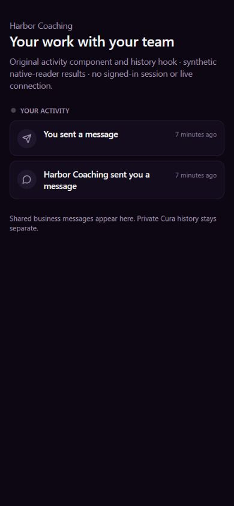

# EXP09 — shared Portal messages appear in original activity

UI_DELIVERY_EVIDENCE_VERSION: 1
FLOW_BY_FLOW: PASS: ten-question pre-edit routing ANT161/b3cf9be0-4b6c-4646-95cb-450001f70068; source-matched causal proof and narrow native reservation54be3a24-bfb2-4905-ab15-791302a5c800. Original shared message -> existing native transaction -> original Rail/reference -> original redacted client history -> original Your activity. No new inbox or execution system.
PAIGE_UI_DESIGN: PASS: project overlay/five modules read for the ongoing assignment. Existing ClientActivityFeed/useRailEvents, branded identity, cards, typography, states and scope guard remain unchanged; actual source rendering below. No new application shell, design library or production UI edits.
MATERIAL_FLOW_CHANGE: NO: connect the promised activity projection of the existing shared-message workflow. Same original message action, return/reload, privacy and permission states; no new user goal, action, approval, navigation or source authority.
FLOW_PROTOTYPE: NOT_REQUIRED: original approved messages/activity flow and states retained. Native causal proof and actual original-component rendering verify the missing integration.
PURPOSE_AUDIENCE_PRIMARY_ACTION: PASS: the authorized customer sees that a shared message or business reply actually saved, and can return to the same permitted history. Private Cura exchanges are separate and never copied.
VISUAL_DIRECTION: PASS: original customer-facing source and existing design tokens; business names its own reply, customer is You, Cura stays the private specialist. Installed Impeccable4.3.1 checks applied to hierarchy, truthful status, context/branding, responsive fit, empty/failure recovery and inherited accessibility limits.
AUTOMATED_EVIDENCE: PASS: original fenced runner baseline39 PASS/2 missing-message-activity failures, with35 explicitly historical invitation controls and4 current message save/replay controls. Candidate58 PASS includes original current writers, original role retirement/customer-scope Rail patches, source/metadata/replay/refusal guards, native zero-duplicate/atomic rollback/isolation, original redacted history/reload/paused refusal and privacy. Separate25 original hook/history/feed tests across3 suites PASS. Original63 full-schema S1 assertions preserved plus20 new, plan83; hosted replay remains owed.
STATIC_EVIDENCE: PASS: exact five-line Rail insertion per original RPC and independent ABI/owner/path/ACL equality; existing Rail body06927b and original reader8bea/access predicate70261 unchanged. Node syntax, diff and scoped migration lint0 warnings pass. Pinned offline Impeccable4.1.0 detection exits0; no dependency, shared guard/baseline/workflow/pin or runtime edits.
RENDERED_EVIDENCE: PASS: eight fresh original-source JPEGs in assets/e09-message-activity/ show saved/reloaded900x770 light, saved/recovered390 dark and original loading/empty/forbidden/unavailable states. Requested390x844 captures843px height, explicitly recorded. Actual ClientActivityFeed, useRailEvents history/coercion/scope logic and disabled self-resolver execute; SDK transports the ACTUAL synthetic native client-lens rows, branding is a neutral display port and channel reports CLOSED. No live connection or authenticated identity is implied.
BEHAVIORAL_EVIDENCE: PASS: original hook displays You sent a message and Harbor Coaching sent you a message; reload returns the same two saved events, no duplicated rows. Loading never says empty; successful empty read says Nothing yet. Original forbidden/outage states share an honest failure view distinct from empty; returning to a successful read restores history. Native permission and durable-state behavior are proved separately by actual PostgreSQL callers, not from UI labels.
AUTHENTICATED_RUNTIME: UNVERIFIED: protected customer disconnected, reconnection deferred by owner; Chrome extension update also required. Actual owner/customer message-to-activity/live stream/two-business/physical iPhone and full Experience acceptance remain owed. No copied session, browser-policy bypass, new identity or owner impersonation.
KEYBOARD_FOCUS: NOT_APPLICABLE: unchanged read-only feed has zero actionable/focusable controls in this isolated render. Original hook/feed tests25 retain state/scope/identity controls. Full shell navigation, screen reader, natural Tab loop and AT certification are not claimed.
ZOOM_REFLOW: PASS: actual DOM widths900/390 equal viewport widths, narrow rows fit358.4px available space and wrap the business headline. Native source frames show readable saved/failure/empty states. Physical iPhone, zoom and full authenticated shell are unverified.
REDUCED_MOTION: NOT_APPLICABLE: no motion source changes; original live-dot is disconnected and no live animation is claimed. OS-preference inspection not performed.
STATE_COVERAGE: PASS: original63 message/Support/canonical inbox/provider-isolation/rate/paging/role/customer negatives retained. New source drift/replay, correct recipient tuples, changed request conflict, paused access, missing kind/audit rollback, original client-lens withheld fields and wrong-customer denial tested locally. Original loading, empty, failure and saved-history states rendered without synthesizing customer completion.
TRUTHFUL_STATE_LABELS: PASS: Portal outbound delivered remains the incumbent in-app saved state, never email/provider delivery or read. Activity references the genuine original message and original Rail receipt; replay never files another activity. Private AI history, message body, departments/internal refs and staff identity remain withheld by the original client reader. No specialist execution or algorithm success is fabricated.
SOLO_UI: NO: original external customer activity projection; business Portal reply transaction reused. Owner SOLO shell/PAIGE panels and shared UI untouched.
UNVERIFIED: required final-head CI/full-schema83/Preview, production native/web readback, real client activity/live subscription and original complete42/seven/Teach/CAP/ALG/founder acceptance remain owed. No customer verification or provider activation follows from local proof.

OWNER_INTENT: one coherent customer relationship in the existing architecture, with real saved messages, truthful activity and private Cura separation; one complete founder evaluation later.
MUST_NOT_HAPPEN: second message history/Rail store, message/private AI body copied to activity, wrong-business/paused access, duplicate uncertain send/activity, provider send or role expansion, fabricated delivery/read/specialist completion, title-based permissions revived.
MUST_PRESERVE: original message requests/nonce idempotence/current actor/business/customer/open-access guards, canonical inbox/thread/notifications/paging/rate/retained history and original source ABI/ACL. All other valid releases and shared Root/C0b/Chat/Work/provider sources stay exact.
ACCEPTANCE_CRITERIA: one saved shared message produces one existing Rail event/ref and native audit in the SAME transaction; identical retry returns its original message without a second event/notice. Failure to file the original Rail/audit rolls back original message and notice. Original redacted client reader returns durable history and denies other/paused relationships; full original schema suite remains green.
MOTION_PURPOSE: none added.
PROTECTED_SEAMS: only client_portal_send_message(text,uuid,text,uuid) and comms_portal_reply(uuid,uuid,text,uuid) final new-message tails and original S1 tests. record_rail_event, event registry/readers/Realtime, private Cura, identity, Root/C0b/Chat, E03 providers/sender and E04 money/signing remain read-only.
INTERNAL_BUILD_IDENTITY: 39565ce6332517c81a91d6f266502d9aa9bf191d; composes invitation5ed/current mainc55, final exact review head in PR; deployment=NOT_DEPLOYED; environment=development; migrations=PROOF_OWED(20271114130009); edge=NOT_APPLICABLE; evidence=docs/evidence/ui-delivery/assets/e09-message-activity/native-proof.json
RELEASE_CHANNEL: development: local actual native writers/readers and original UI with explicit synthetic transport; reviewed required green CI/Preview precede ordinary production readback.
RELEASE_CLASSIFICATION: internal-only: complete the existing shared-message activity connection; full Portal/specialist activation not claimed.
CUSTOMER_RELEASE_IDENTITY: none: no customer version or announcement proposed.
RELEASE_NOTE_REQUIRED: no: internal integration correction with separate authenticated acceptance owed.
RELEASE_TRUTH_BOUNDARY: PARTIAL: original native/source integration passes locally; production and ordinary customer/live history PROOF OWED. Existing clients.portal, seven Capabilities and ALG maturity unchanged.
RELEASE_RECOVERY: position=guarded forward correction retaining original restrictive sources and canonical messages; reference=20271114130009_e09_portal_message_activity.sql, exact body/metadata/replay/refusal and atomic-rollback proofs. Preserve history; never repeat a message after an uncertain result, rewrite migrations or use include-all.

## Canonical/orchestration contract

Original request/event: legitimate customer Portal message/help or authorized business-owner Portal reply. Entry: existing Messages/Support or business canonical inbox. Capability: existing clients.portal/Communications, no new public tool or specialist runtime. Actor/tenant/customer: original verified subject and exact canonical relationship; staff reply still requires the original current-workspace admin gate. Approval: original deliberate human post, no new Trust inbox or implicit provider permission. Execution: the original native message transaction legitimately remains direct; LayerC/ActionAdapter N/A for this local in-app write/read. Each NEW saved message calls the SAME original record_rail_event with the existing comms.inbound/outbound kind, original actor/tenant/contact and messages/ref_id. Kind visibility/audience policy is consumed as configured, not overwritten.

Canonical result: original message row/request receipt and original Rail/event audit; business reply keeps its SAME customer notification. Existing exact request-ID replay returns before the new call; original concurrent unique-request winner returns its original row. Missing event kind or Rail audit failure propagates and rolls back message/event/audit/notice atomically; no provider or automatic retry. Original get_client_rail client lens withholds staff identity/departments/payload/refs; tenant/team consumers keep original authorized work state. Private Cura history is never copied to a team surface. This is bounded ALG01/12 reconciliation/exception support, not production verification of retention, first-value or recommendation algorithms.

## Source and native proof

Observed/current original sender0a0c835abd6fca8973068ea5c2640f83 becomesd30a77a8908d3ddab03fd17b882b6d0b; original replye59afbaaa5d3f9003c2e26f1403b3729 becomes12123877ad1df9570869815aca0666bc. Exactly five source lines are inserted before each final new-row return; all earlier ordinary/replay/refusal/notification logic remains exact. Migration guards pin original/corrected source, refuse unrecognized predecessors/forward changes and replay without overwrite. The two edits are one native transaction; a second-function guard failure rolls back the first edit. No grants change.

Actual Rail06927b300c0a9645bae072a0a6aee2af is reconstructed from the original202612010008 definition, canonical20270504000000 title-role retirement helper and original20271108150000 customer-scope patch. Initial missing-source and omitted-retirement fixture attempts were INVALID and stopped before comparison/customer posts; neither authorizes relaxing the production fingerprint or reviving coach permissions. Current original reader8bea2322c29c2b0c5651ff4f5dc2244f and access predicate70261d0136e175f37ac4f8370306be08 match actual production and execute unchanged. Local Auth/scope/realtime/schema ports are synthetic; full threads/triggers are NOT reconstructed, so the83-case existing full-schema suite remains mandatory. Both valid baseline/candidate clusters stopped through the original finally.

## Design/interaction finish

[Mandatory Impeccable guidance](https://github.com/pbakaus/impeccable/blob/main/.claude/skills/impeccable/SKILL.md) was applied to actual saved-state honesty, branding, loading/refusal/empty distinctions, narrow wrapping and context/privacy. The unchanged component is a six-row glance with the original bounded history and receive-only channel, not a new complete activity ledger. Same native-reader rows pass through the REAL history hook and existing projection to the visible original feed. SDK contact identity is a neutral display fixture, never authentication. The synthetic channel remains CLOSED; actual Realtime delivery remains unverified.

Inherited findings: compact11px section/time text; generic permission/outage copy and no in-place retry button (a new read/reload recovers). These are recorded for later polish, not falsely certified as premium full-shell/AT completion. Eight unedited JPEG captures show900x770 light/requested390x844 dark, actual narrow843. No overflow; read-only feed has no focusable controls. IAB navigation timeout was recovered by rebinding its observed existing tab, without duplicates. Temporary tab/viewport and exact verified own Vite process were cleaned up. No owner/customer browser or real message was used for the render.

