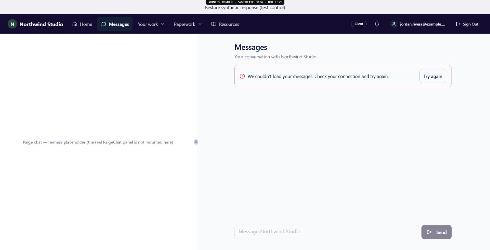
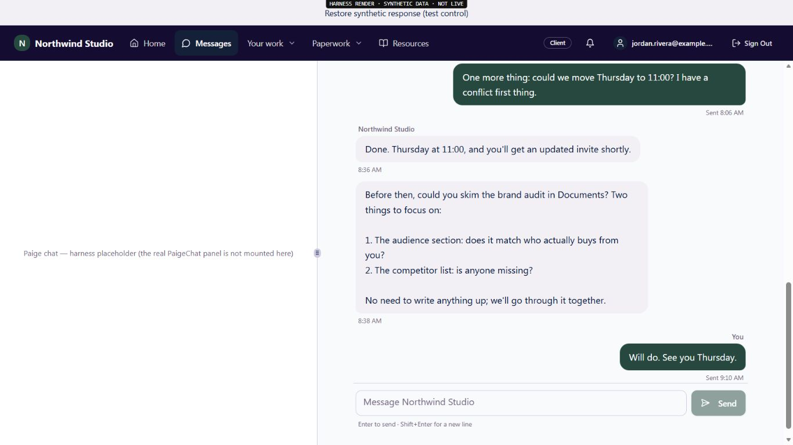
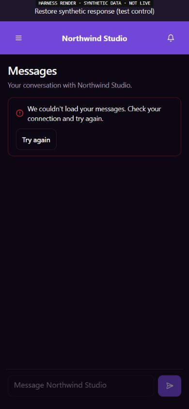
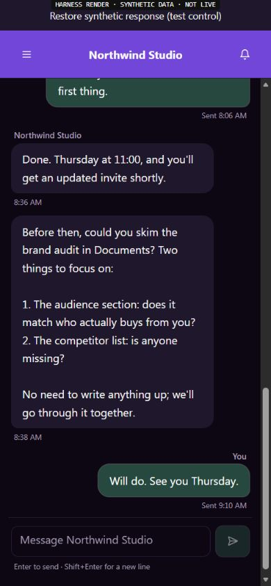

# EXP09 — truthful Messages history and recovery

UI_DELIVERY_EVIDENCE_VERSION: 1
FLOW_BY_FLOW: PASS: original pre-edit contract in ANT-163/9b8d2b73 and ANT-161/ea0882f6; current source and protocol traced in docs/delivery/e09-customer-messages-business-scope.md, October 30 section.
PAIGE_UI_DESIGN: PASS: existing customer Messages page, native error/Try again, brand, typography, tokens, composer and navigation preserved. Project paige-ui-design and Impeccable hardening/review guidance applied.
MATERIAL_FLOW_CHANGE: NO: repair malformed-response classification through the already existing error/recovery path; no new customer action, markup, confirmation, navigation or side effect.
FLOW_PROTOTYPE: NOT_REQUIRED: original component and recovery remain; real-hook synthetic renders verify restored behavior without a redesigned flow.
PURPOSE_AUDIENCE_PRIMARY_ACTION: PASS: an authorized external customer reads their selected business conversation and can deliberately retry an unreadable read without losing uncertain work.
VISUAL_DIRECTION: PASS: incumbent customer design system, existing error treatment and 44px recovery control. No design-system or shell change.
AUTOMATED_EVIDENCE: PASS: 14 failing-first regressions reproduced; final 91/91 original hook/scope/page/draft tests. Saved local report outputs/e09-message-history-decoding-tests-20261030.json; exact-head hosted checks remain required.
STATIC_EVIDENCE: PASS: changed hook and tests ESLint zero errors; whitespace check clean. Native protocol catalogue read confirms original body eed501929d60ad5999770191795905bb and timestamp shape. Full app/build proof is delegated to required exact-head CI, not claimed locally.
RENDERED_EVIDENCE: PASS: actual original Messages page/hook in the existing synthetic harness at1366x768 light and390x844 dark. Four captures and render-observations.json under assets/e09-message-history-decoding/; no production/device claim.
BEHAVIORAL_EVIDENCE: PASS: malformed/partial pages produce visible original failure, do not show an empty-conversation claim or partial row and cannot enable an initial send. Explicit synthetic-source recovery plus keyboard Enter on Try again restores original history; no send button was used.
AUTHENTICATED_RUNTIME: UNVERIFIED: designated ordinary customer profile is not connected. No owner-as-client substitute. Native source/read proof and synthetic UI are not customer acceptance.
KEYBOARD_FOCUS: PASS: existing retry is reachable and Enter completes recovery. Minor incumbent finding: its successful removal leaves focus on BODY; no focus trap, but restoration remains a whole-Experience refinement. No screen-reader drive claimed.
ZOOM_REFLOW: PASS: observed document width exactly1366 and390 respectively; no horizontal overflow, narrow retry target44px. Physical iPhone, OS scaling,400% zoom and device keyboard unverified.
REDUCED_MOTION: NOT_APPLICABLE: no motion, animation, component style or preference change.
STATE_COVERAGE: PASS: valid, genuinely empty, null/no relationship, missing/array envelope, invalid business/messages/paging, malformed rows/kind/time/identity, duplicates, refresh, earlier-page recovery, current selected business, foreign/changed actor, stale callbacks and preserved uncertain-send identity through existing suites.
TRUTHFUL_STATE_LABELS: PASS: unreadable data is a read error, not empty or partial success. Only complete canonical history may reconcile an uncertain outbox item; no recipient-read, delivery or provider inference.
SOLO_UI: NO: original external-customer Portal Messages/Support projection; owner SOLO UI, PAIGE/Live and shared Chat untouched.
UNVERIFIED: exact-head hosted checks, merge, production web/source readback, actual external-client return/revocation/isolation, physical iPhone and full seven-pillar/founder evaluation remain separate.

OWNER_INTENT: Secure, durable two-way customer/business Messages and Support within the complete original EXP09; source failure must not invent an empty history or clear unresolved work.
MUST_NOT_HAPPEN: No partial-page success, false outbox settlement, unknown-send replay, foreign history, new sender/inbox/Knowledge/runtime, role grant, provider activation or customer-data transmission.
MUST_PRESERVE: Native actor/relationship authorization, original canonical messages/request IDs, help kind, keyset paging, genuine empty/null distinctions, selected business, Auth fences, draft/outbox recovery and existing UI.
ACCEPTANCE_CRITERIA: Valid history works; malformed first/refresh/older reads show existing recoverable failure and withhold invalid data; a complete retry restores saved history without another send. Production/customer proof remains owed.
MOTION_PURPOSE: NONE: no motion change.
PROTECTED_SEAMS: Original Messages hook/tests only; E03 messages/support/provider writers, shared Root/Spine/Fabric/Chat, Knowledge, billing, Calendar, permissions, consent, native SQL and private CURA history unchanged. All61 active PR file lists checked before edit.

INTERNAL_BUILD_IDENTITY: implementation=e424b1d497e49cc0541545d9d8ad5c281add9125; deployment=NOT_DEPLOYED; environment=development; migrations=NOT_APPLICABLE; edge=NOT_APPLICABLE; evidence=docs/evidence/ui-delivery/e09-message-history-decoding.md
RELEASE_CHANNEL: development: source tests and original-component synthetic render only.
RELEASE_CLASSIFICATION: internal-only: bounded Messages read/recovery repair, not a completed Portal or customer release train.
CUSTOMER_RELEASE_IDENTITY: none: no announcement or customer version.
RELEASE_NOTE_REQUIRED: no: internal reliability increment; founder evaluates one complete integrated Experience later.
RELEASE_TRUTH_BOUNDARY: PARTIAL: local source/test/render proof; PROOF OWED: exact-head CI and production/customer outcome.
RELEASE_RECOVERY: position=forward-fix the original decoder with canonical history retained; reference=docs/delivery/e09-customer-messages-business-scope.md

## Render provenance and limits

The existing `portal-messages-customer-mount` renders the real Messages page/hook/AppNav with synthetic source/Auth. Its left conversation panel is an explicitly labelled placeholder, not live CURA or a mounted production AppShell. Only the stub transport and fixture repair button are test controls; production component markup/CSS are unchanged. No image generation or customer image/data is used.

The first restricted local server was live but inaccessible; loopback EACCES and browser timeouts are retained as environment failures, not product failures. Only that owned server was stopped and relaunched with scoped loopback access. Header-only curl returned200, then the reconnected Edge browser loaded the same existing tab and completed both drives. Temporary viewport override was reset and the owned preview tab/server closed. No peer tabs were navigated or stopped.

## Proportionate finish review

Impeccable hardening checks: truthful empty/error separation, partial-data refusal, recovery control reachability, input state, responsive width and unchanged theme treatment. Both captures preserve primary/secondary hierarchy; the error is readable and retry44px. No material visual defect identified in these bounded states. Minor retry-focus restoration is explicitly retained above. This author review is lower assurance, not a distinct designer review. DESIGN.md and its sidecar remain unchanged.

Functional:91 local cases PASS; release gates owed. Visual: actual source renders inspected on desktop/narrow. Experiential: deliberate read recovery preserves original history and uncertain work; actual customer continuity still owed. Founder Acceptance: NOT_REQUESTED/NOT_ACCEPTED; one complete integrated evaluation remains the target.
