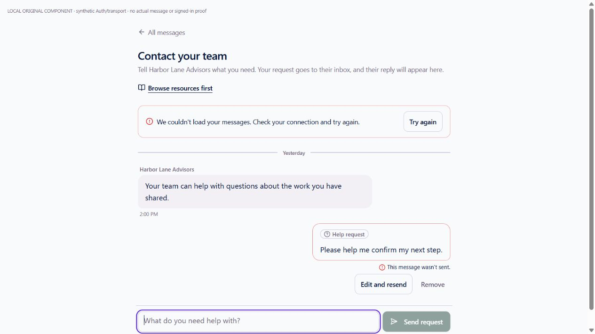
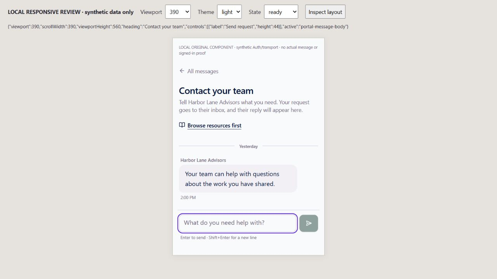
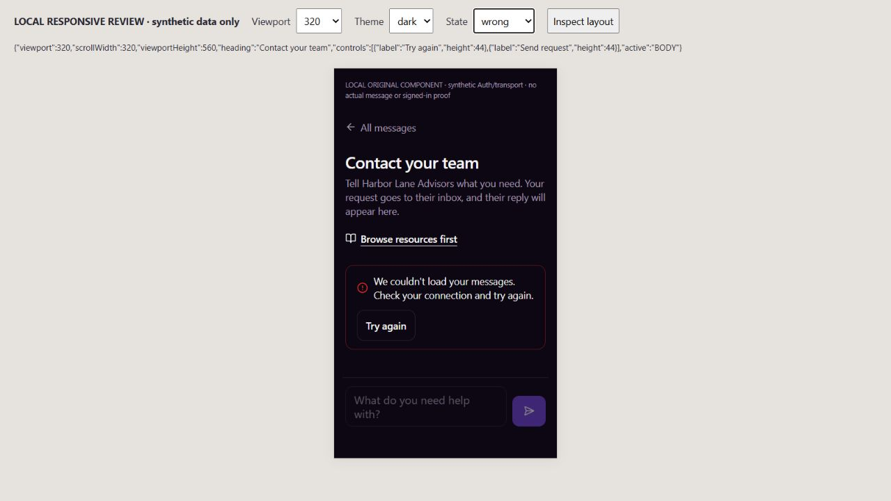

# EXP09 — original Messages/Support business and actor binding

UI_DELIVERY_EVIDENCE_VERSION: 1
FLOW_BY_FLOW: PASS: docs/delivery/e09-customer-messages-business-scope.md records all ten pre-edit routing answers and original native/Conversations ownership.
PAIGE_UI_DESIGN: PASS: existing customer Messages/Support component, business branding, tokens, draft/paging/retry controls and shell are preserved; no component markup or style change.
MATERIAL_FLOW_CHANGE: NO: bind the existing native business argument and Auth session to the already verified frame; restore existing wrong-scope/unsent/recovery behavior without a new step, permission, inbox or application.
FLOW_PROTOTYPE: NOT_REQUIRED: bounded existing-contract repair; actual original-component renders and controlled actions below verify existing states, not a newly invented flow.
PURPOSE_AUDIENCE_PRIMARY_ACTION: PASS: external customers message or request help from the business whose authorized portal they selected.
VISUAL_DIRECTION: PASS: original PAIGE customer design system and tenant branding; no new layout, navigation, model runtime or shared component.
AUTOMATED_EVIDENCE: PASS:93 tests/6 focused original Messages, draft/page, scope, actor-capture and real-SDK transport suites; final ESLint0 errors and diff check. Existing native scope suite adds10 original Conversations cases,72 total; hosted execution separately required and no72-case success claimed.
STATIC_EVIDENCE: PASS: selected native p_tenant_id and per-builder business/captured bearer; exact captured JWT is verified by original Auth rather than cached Session.user. Original native functions/schema/ACL/sender/Spine/Edge unchanged. Final exact-head hosted type/build/native CI remains required.
RENDERED_EVIDENCE: PASS: actual original Messages page plus changed hook with synthetic Auth/transport; desktop preflight refusal,390x560 light own-business Support and320x560 dark wrong-business refusal images under assets/e09-messages-business-scope/. Iframe sizes and synthetic inputs are explicit; no iPhone/Safari or full authenticated shell proof.
BEHAVIORAL_EVIDENCE: PASS: local original Support form rejects a changed-login preflight, shows the existing unsent card and retains the request for recovery. Wrong-business response reveals no foreign history and leaves composer disabled. These are local controlled transports, not actual native customer actions.
AUTHENTICATED_RUNTIME: UNVERIFIED: original global identity/acceptance and remaining domain/Edge integration unfinished; no actual customer message, login/token custody, impersonation, new business/account or provider effect.
KEYBOARD_FOCUS: PASS: original component retains labeled composer, visible focus and44px buttons; actual local typing/refusal returns focus to composer and original DOM/page regressions pass. Cross-business generation retires old callbacks/results/drafts; full assistive-technology drive unverified.
ZOOM_REFLOW: PASS: actual390/320 documents have scrollWidth equal viewport width,44px controls, reachable original form and no horizontal overflow. Desktop original contained layout inspected. Exact SOLO closed/open matrix,400% zoom and device keyboard are not claimed.
REDUCED_MOTION: NOT_APPLICABLE: no new/modified motion, styles or animation; no OS setting drive claimed.
STATE_COVERAGE: PASS: selected A/B, current/wrong/ignored native business, paged foreign reply, Auth/session/token mismatch, signed-out, A→B→A callbacks, late old reads, definite preflight-unsent, genuinely dispatched unknown outcome, same-business interruption/reconciliation and original regressions. Native pause/revocation cases await hosted replay.
TRUTHFUL_STATE_LABELS: PASS: original canonical message acknowledgment alone confirms send; no read/email delivery claim. A failed preflight is unsent, dispatched uncertainty stays unconfirmed with original request identity, unknown/foreign history never becomes empty success. Only native ambiguity gets the multiple-business state.
SOLO_UI: NO: original external-customer Messages/Support projection. Owner inbox, provider work and owner Chat/Live unchanged.
UNVERIFIED:72-case native replay, exact-head CI, normal production/source readback, genuine external-client two-business/revoked/interrupted/return evidence and whole seven-pillar/founder acceptance.

OWNER_INTENT: One genuine customer/business Conversation and original durable results; CURA private history remains separate.
MUST_NOT_HAPPEN: No borrowed later-login bearer, wrong-business data, stale callback resend, fabricated native success, duplicate send, second inbox/CRM, service-role reader or owner permission.
MUST_PRESERVE: Original native actor/relationship locks and author attribution, canonical message/request IDs, help-kind, pagination order, consent/provider restrictions, exact unknown-outcome recovery and original page.
ACCEPTANCE_CRITERIA: Selected business narrows original native reads/sends/retries; captured bearer verifies as the intended actual actor. Scope/Auth change withholds old work; native business mismatch cannot enable a send. Same-business unknown work reuses its original receipt identity without automatic resend. Full customer proof remains separate.
MOTION_PURPOSE: None added.
PROTECTED_SEAMS: EXP09 hook/request helper/test/doc lease in ANT-161; E03 original writer/provider/inbox untouched. No shared Edge/Spine/c0b change, Layer C adapter or activation.

INTERNAL_BUILD_IDENTITY: implementation=0246b35aa1ff2e65dada4d3d1a6079b88f3a675a; deployment=NOT_DEPLOYED; environment=development; migrations=NOT_APPLICABLE; edge=NOT_APPLICABLE; evidence=docs/evidence/ui-delivery/e09-messages-business-scope.md
RELEASE_CHANNEL: development: original source/SDK and isolated rendered synthetic transport.
RELEASE_CLASSIFICATION: internal-only: bounded domain-request binding, not full multi-business admission or complete Experience.
CUSTOMER_RELEASE_IDENTITY: none: no announcement or customer version.
RELEASE_NOTE_REQUIRED: no: original request-binding prerequisite.
RELEASE_TRUTH_BOUNDARY: PARTIAL: local source/transport/page verification; PROOF OWED: native72, exact-head CI, production and actual customer journey.
RELEASE_RECOVERY: position=forward-fix original Messages/native integration without deleting canonical history; reference=docs/delivery/e09-customer-messages-business-scope.md

## Proportionate Impeccable review

Applied responsive hierarchy, truthful-state, control reachability and input/focus checks to the unchanged original component. Desktop unsent request remains distinct from a received business message.390px own-business Support and320px dark wrong-business refusal fit without horizontal overflow; buttons retain44px targets, disabled composer cannot imply a successful read. No material visual finding in these bounded rendered states. No decorative redesign or DESIGN.md change; no separate non-author design review claimed. Brand/menu and Auth/transport in the local harness are synthetic, never production evidence.

Functional:93 focused browser/source tests; native/production gates owed. Visual: original design-system interface preserved, bounded actual renders inspected. Experiential: same-business recovery and cross-scope retirement source-verified, whole customer/domain/identity journey unfinished. Founder Acceptance: pending one complete integrated live Experience evaluation.
