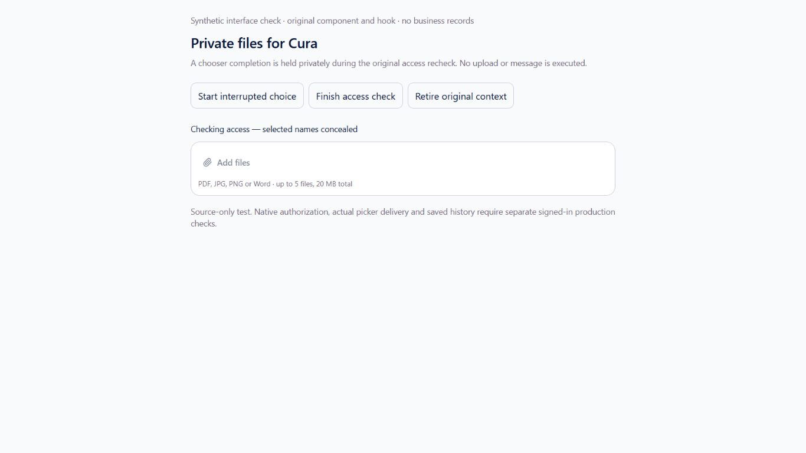
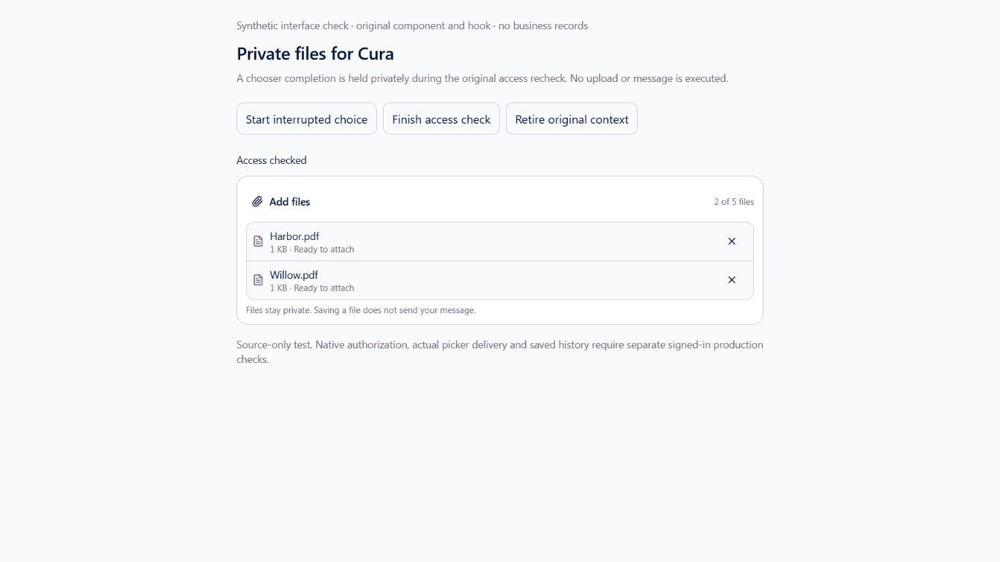
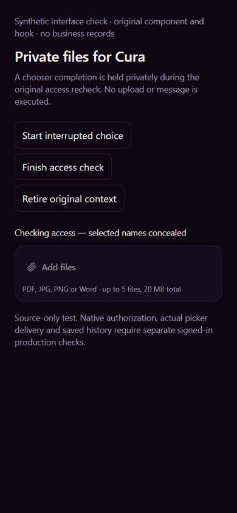
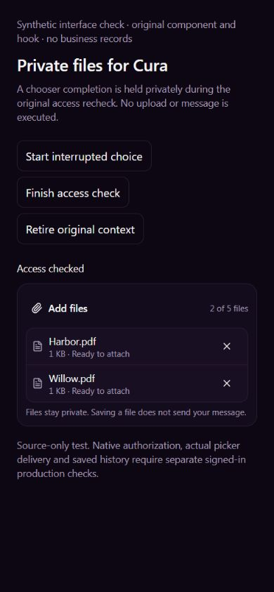
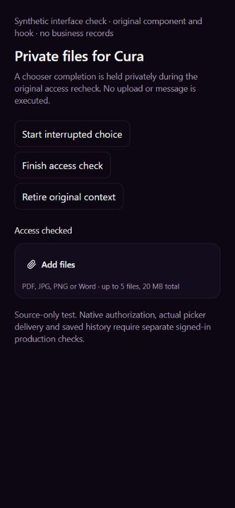

# EXP09 — preserve a private file choice while access is rechecked

UI_DELIVERY_EVIDENCE_VERSION: 1
FLOW_BY_FLOW: PASS: original ANT163/9b8d2b73 and ANT161/ea0882f6 receiving/pre-edit packets; original private Documents, composer and native authority traced.
PAIGE_UI_DESIGN: PASS: existing CustomerChatAttachments, design tokens, typography, private-file labels and44px controls retained; existing PAIGE UI/Impeccable hardening guidance applied.
MATERIAL_FLOW_CHANGE: NO: restore the existing private picker/local draft continuity through a same-context recheck. No new upload service, permission, external action, product shell or approval.
FLOW_PROTOTYPE: NOT_REQUIRED: bounded restoration of an existing flow; actual original component/hook rendered with explicitly synthetic ports.
PURPOSE_AUDIENCE_PRIMARY_ACTION: PASS: an authorized external customer selects private files for Cura, sees them again after valid access returns, and deliberately sends through the existing native flow.
VISUAL_DIRECTION: PASS: incumbent component composition and light/dark tokens; no presentation redesign or duplicated design system.
AUTOMATED_EVIDENCE: PASS: true baseline25PASS/4FAIL (including absent picker-capture API), first fix29PASS, added interruption counterexample29PASS/1FAIL corrected; final31/31 is INCLUDED in broader156/156 across nine existing selection/native-file/access suites. A review counterexample9PASS/1FAIL exposed the legacy fallback; it is restricted to admitted tickets and rechecked. Initial unsupported minWorkers flag ran zero tests and is excluded.
STATIC_EVIDENCE: PASS: focused TypeScript check0; five changed TypeScript files lint0errors with3 unchanged host warnings; whitespace clean. Native Documents and shared staff uploader unchanged.
RENDERED_EVIDENCE: PASS: actual original private hook/component,1366x768 light and390x844 dark, five unedited captures and nine exact source/style/fixture pins in assets/e09-private-picker-recheck/.
BEHAVIORAL_EVIDENCE: PASS: keyboard-started synthetic chooser completion stays concealed while original native access is masked; after valid same-context return the two original files reappear ready to attach. Retiring the original epoch before return discards both files. No upload or model call occurs in these source frames.
AUTHENTICATED_RUNTIME: UNVERIFIED: changed picker repair not deployed. Separate ordinary-client invoice answer/private history/Payments reload passed in protected ANT52; the original native two-PDF picker visibly lost its selection. Neither result proves the repaired upload/read/history path.
KEYBOARD_FOCUS: PASS: Enter drives the rendered fixture controls; removing Harbor with Enter focuses Remove Willow.pdf from message. Native picker focus, physical keyboard and assistive technology remain separate.
ZOOM_REFLOW: PASS: actual DOM widths1366/390 equal viewport widths, no horizontal document overflow; every inspected control44px. This is not physical iPhone or OS zoom proof.
REDUCED_MOTION: NOT_APPLICABLE: no new animation or motion change.
STATE_COVERAGE: PASS: ready/held/restored/retired selection, unavailable chooser, changed business/thread and ABA, partial upload, late completion, unknown-outcome inspection, bulk limits and native Documents authorization regressions. Actual populated-file customer reading remains owed.
TRUTHFUL_STATE_LABELS: PASS: local selection is not upload, model reading, sharing or a send receipt; interrupted dispatch requires checking the original upload and never auto-starts the next file.
SOLO_UI: NO: external-customer private Cura attachment consumer only; owner Chat/Live and shared staff upload remain unchanged.
UNVERIFIED: exact-head hosted checks, normal merge/deployment/readback, actual repaired native picker/upload/document reading/private history reload, real multi-business/revocation/cohorts, iPhone/AT and complete seven-pillar/founder acceptance.

OWNER_INTENT: reliable private bulk document intake into the existing customer Cura conversation without widening business knowledge or customer permissions.
MUST_NOT_HAPPEN: no stale file choice after identity/business/thread retirement, display during unverified access, automatic upload/send/retry, duplicate file store, private-history sharing or source/algorithm maturity promotion.
MUST_PRESERVE: original actor/profile/business native verification, Documents epoch/Storage/request identities, every file/status/finish permission, unknown-outcome recovery and exact accepted-message manifest.
ACCEPTANCE_CRITERIA: a chooser admitted under current access may finish into a concealed local choice during the SAME original Documents lifetime; files become available only after current access returns. Changed or retired lifetimes reject it, including ABA. Interrupted dispatched uploads remain check-required, not saved or automatically resumed.
MOTION_PURPOSE: NONE: local preparation continuity only.
PROTECTED_SEAMS: all original Documents/native/Storage writers, actual Auth/tenant/client checks, Root/Spine/Harness/Trust/Fabric, owner/staff upload, Knowledge publication, CURA history, financial and Calendar systems.

INTERNAL_BUILD_IDENTITY: implementation=4fff19ccdb12da927972539b7f4bc7c4d1af0f23; deployment=NOT_DEPLOYED; environment=development; migrations=NOT_APPLICABLE; edge=NOT_APPLICABLE; evidence=docs/evidence/ui-delivery/e09-private-picker-recheck.md
RELEASE_CHANNEL: development: bounded reviewed source/render evidence; exact-head CI and normal release remain required.
RELEASE_CLASSIFICATION: internal-only: reliability repair within the complete original EXP09 assignment.
CUSTOMER_RELEASE_IDENTITY: none: no announcement or version.
RELEASE_NOTE_REQUIRED: no: internal reliability increment; one complete integrated founder evaluation later.
RELEASE_TRUTH_BOUNDARY: PARTIAL: source/test/render proof; customer upload/read/history and release PROOF OWED.
RELEASE_RECOVERY: position=forward-fix the original private picker/controller; reference=docs/delivery/e09-customer-files-business-scope.md

## Original execution contract

Portal file choice is ordinary local preparation, so Layer C/ActionAdapter is not invoked unnecessarily. Cura remains the specialist. The original native Documents consumer alone verifies actor, business, client relationship and private thread, reserves the original client_files/client-files identity, transfers, inspects and finishes. Existing authorization/consent and message acceptance remain mandatory; a captured chooser callback grants no native permission.

Only the existing local selection lifetime is retained through a masked same-context recheck. The original native epoch and positive scope retire changed identity/business/contact/thread. A one-use picker completion is bound to that lifetime. Plain paste/drop still require current access. No customer action is executed on access restoration. Existing prepare/save/recover use the same original file identity and receipt; an interrupted dispatched operation becomes check-required even if its promise finishes before the recheck effect. Results return to the same private composer and original accepted-message history, never another inbox.

ALG-01/12 support is deterministic original identity/unknown-outcome reconciliation in useCustomerChatAttachments prepare/save/recover; no algorithm maturity, ALG-02/04/13 usefulness or production activation is promoted by this repair. Full original42/eight areas/seven pillars remain open.

## Render provenance and finish review

The loopback-only fixture mounts the actual hook/component and original stylesheet. Native Documents ports are explicitly synthetic; transfer/check/retrieve throw if invoked, paste/drop adapters are deliberately outside this picker-only frame, and connect-src none prevents backend/provider calls. It does not mount production AppShell or test a real native chooser. After the legacy review repair, all five captures were repeated against the final source. Five screenshots are unedited; no generated raster or real account data is included. Actual clean customer evidence remains private in protected QA.

Observed desktop/narrow states conceal names while checking, restore two ready-to-attach files, and discard a retired pending choice. Keyboard removal keeps focus on the next file. Source frames contain no material visual defect or horizontal overflow; full-shell/device/zoom/AT remains owed. Initial non-shared preview connections timed out and produced no counted source render. The isolated localhost server was then made reachable through the ordinary tool permission path, with its backend-blocking policy unchanged. Own Edge preview closed, viewport reset and own server stopped. Failed unmarked IAB tab is left to normal ephemeral cleanup after its data-error page prevented an explicit claim/close; no security bypass.

Functional:156 controlled assertions PASS; release and repaired customer proof owed. Visual: original desktop/narrow interface inspected. Experiential: local preparation survives only a valid original-lifetime return, with no automatic execution. Founder Acceptance: NOT_REQUESTED/NOT_ACCEPTED; one complete final evaluation unchanged.
