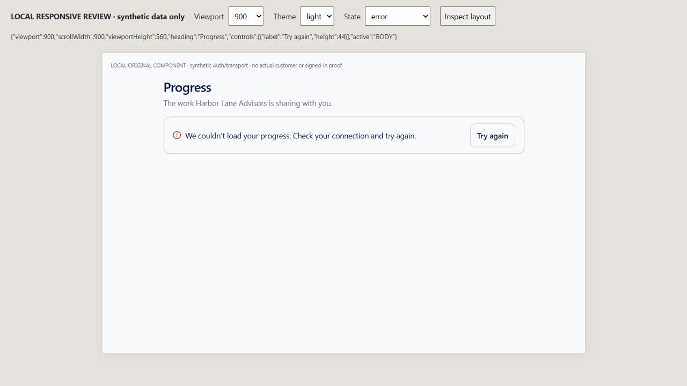
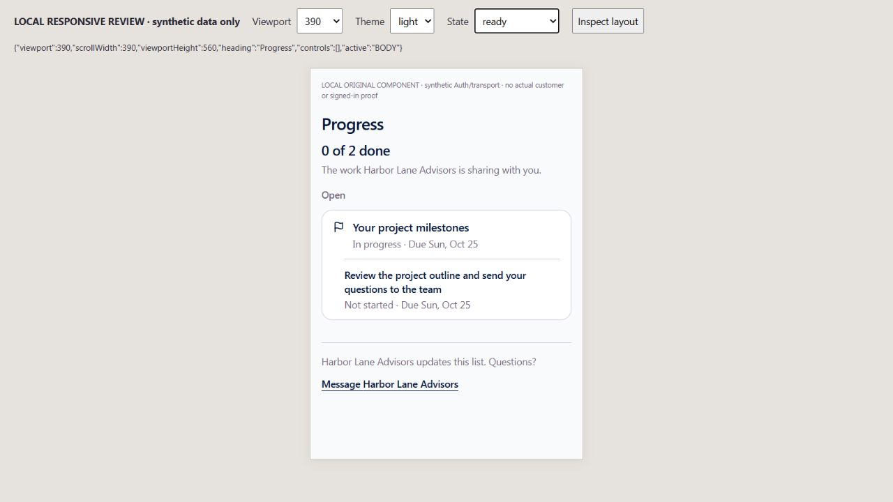
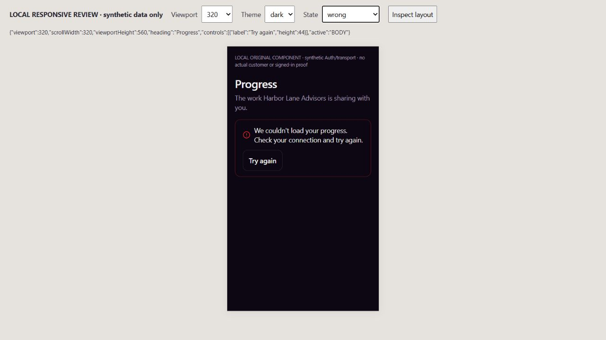
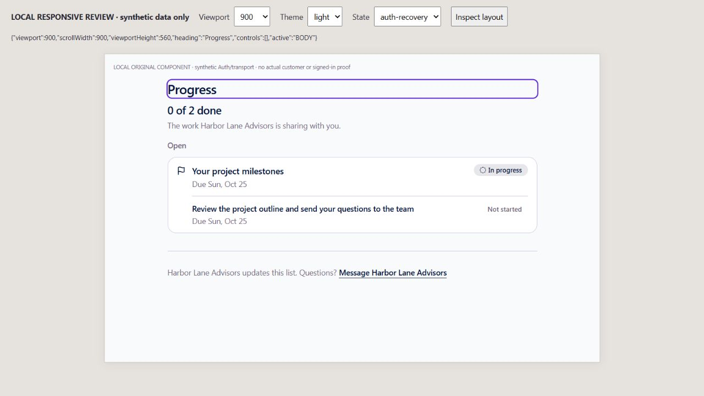
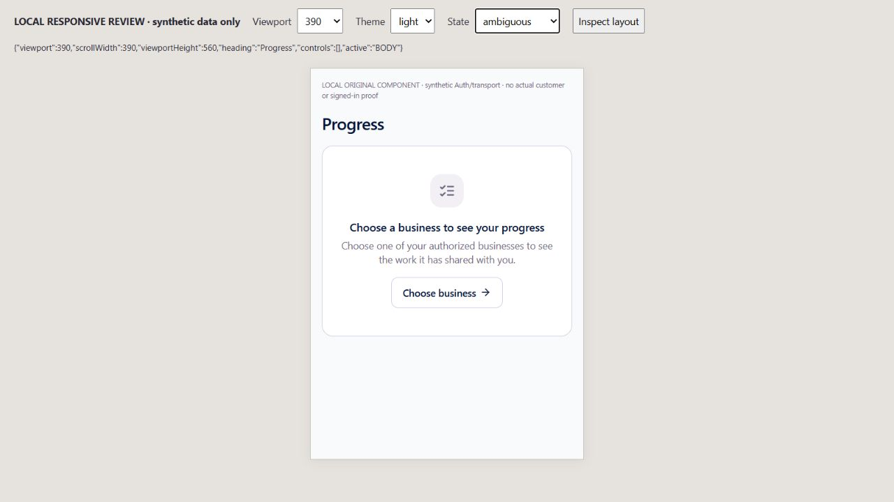

# EXP09 — selected-business Progress and recovery

UI_DELIVERY_EVIDENCE_VERSION: 1
FLOW_BY_FLOW: PASS: ten named pre-edit answers and original action/read contract in docs/delivery/e09-customer-progress-business-scope.md. Original customer Progress/Home reads and explicitly shared Planning records retained.
PAIGE_UI_DESIGN: PASS: incumbent Progress layout, typography, tokens, shared EmptyState/Button, milestones, dates and business Messages exit preserved. No new shell/design system or owner interface.
MATERIAL_FLOW_CHANGE: NO: bounded restoration of the existing business-selection/Progress workflow and its unavailable/interrupted states; no new user goal, step, permission, write or approval.
FLOW_PROTOTYPE: NOT_REQUIRED: this restores an existing approved flow; actual original-component interactive responsive review is recorded below, without claiming pre-implementation prototype approval.
PURPOSE_AUDIENCE_PRIMARY_ACTION: PASS: authorized customers inspect the selected business's explicitly shared work, recover a failed read or return to the original verified business chooser.
VISUAL_DIRECTION: PASS: preserve the established customer design. Impeccable craft/operate checks applied to hierarchy, error recovery, phone fit, keyboard focus, touch targets and truthful states; no decorative redesign or shared DESIGN.md rewrite.
AUTOMATED_EVIDENCE: PASS:99 checks across five original Progress, scoped hook and Home/Payments suites.16 scoped cases include captured actor/business transport, first-render/late/retained A-to-B-to-A refusal, sign-out, Auth bootstrap/postcheck, bounded timeout, explicit Retry, native refusal/null and Home summary. Three page focus controls cover success, retired scope and background updates. Native fixture82 and exact-head CI are pending, not included in99.
STATIC_EVIDENCE: PASS: changed source/tests ESLint0 errors, diff check and original migration-version guard1389 PASS. No migration, native function/ACL, provider, dependency, shared Edge/Spine or owner Chat source change. Full hosted verification remains binding.
RENDERED_EVIDENCE: PASS: actual original Progress component at900x560 light error/recovered focus,390x560 light shared work/business choice and320x560 dark wrong-business refusal. Five images under assets/e09-progress-business-scope/. These are synthetic-transport iframe dimensions, not exact SOLO shell or iPhone/Safari proof.
BEHAVIORAL_EVIDENCE: PASS: actual keyboard Return on original Try again after synthetic initial Auth interruption recovered shared work. Review found lost focus when Retry disappeared; corrected and re-driven to focused Progress heading. Foreign page withheld, original chooser href inspected, no native/provider effect executed.
AUTHENTICATED_RUNTIME: UNVERIFIED: render harness has synthetic Auth/transport. Original global identity/recipient acceptance, all selected domain/Edge bindings and actual signed-in returning/revoked/two-business customer journey remain unfinished.
KEYBOARD_FOCUS: PASS: browser Return restores work and focuses the heading using existing ring tokens. Unit negatives prevent a retired retry from focusing another business and background refresh from stealing focus. Original44px Retry and native chooser anchor remain reachable. Screen-reader certification is not claimed.
ZOOM_REFLOW: PASS: visible review reports viewport width equal to document scroll width at900,390 and320; changed states fit560px height. Whole-shell closed/open matrices,400-percent browser zoom and physical-device proof are not claimed.
REDUCED_MOTION: NOT_APPLICABLE: no motion/transition behavior added or changed; no OS preference drive claimed.
STATE_COVERAGE: PASS: loading, empty, populated, initial/refresh error, explicit retry, permission/ambiguity, null/revoked access, canceled/timed-out/late read, sign-out, business change and returning actor covered by focused original tests. Error, foreign response, populated, chooser and recovered focus rendered. Approval/payment/provider execution states N/A for this read.
TRUTHFUL_STATE_LABELS: PASS: no failed read becomes zero progress, selected URL/header/cache is not authority, private work never enters projection, no read is claimed as executed work or production customer acceptance.
SOLO_UI: NO: changed visible surface is the existing external-customer /app/progress inside the original shell; SOLO owner/PAIGE panels and shared design components are untouched.
UNVERIFIED: native82 replay and final hosted CI/deployment pending; actual customer cohort, Safari/mobile device, assistive technology/full zoom and complete joined seven-pillar acceptance owed. Separate Action Items and other domain/Edge selection bindings remain explicit dependencies.
OWNER_INTENT: Complete CURA's existing seven-pillar Portal with canonical authorized records, business isolation and reliable returning sessions.
MUST_NOT_HAPPEN: foreign/stale work or private Planning fields shown, customer acquiring owner permissions, false empty/success, another progress store/executor, provider action or premature multi-business activation.
MUST_PRESERVE: original client_portal_progress, CRM/open-access/per-item sharing, owner plan_item_set_client_share, closed projection/grouping/date order, private CURA and shared Conversations boundaries, original global linkage guard and original shell.
ACCEPTANCE_CRITERIA: native SDK requests bind verified actor/business without global header mutation; original Auth is rechecked before return. Interrupted reads finish within20 seconds; late results and callbacks retire. Home uses the same original reader with limit1. Explicit successful Retry restores keyboard position; native ambiguity uses existing chooser.
MOTION_PURPOSE: None added.
PROTECTED_SEAMS: original Progress hook/page/Home tests and rolled-back native fixture only;2401/2546 shared Edge/Spine/C0b and2557 EXP04 agreement source remain outside this lease. Original native body/ACL hashes unchanged.

INTERNAL_BUILD_IDENTITY: implementation=0e8caf6060db3435b76edbd04018d90bdf0c9b27; deployment=NOT_DEPLOYED; environment=development; migrations=NOT_APPLICABLE; edge=NOT_APPLICABLE; evidence=docs/evidence/ui-delivery/e09-progress-business-scope.md
RELEASE_CHANNEL: development: original-component rendering and isolated synthetic SDK/native fixture tests.
RELEASE_CLASSIFICATION: internal-only: selected Progress read/recovery prerequisite; not completed multi-business Portal or customer release.
CUSTOMER_RELEASE_IDENTITY: none: no owner-approved customer publication or version.
RELEASE_NOTE_REQUIRED: no: bounded internal repair; canonical release closeout follows verified production.
RELEASE_TRUTH_BOUNDARY: PARTIAL: existing Portal with bounded local source/browser proof only. PROOF OWED: native82, exact-head CI/production and authenticated customer journey; no LIVE customer or algorithm promotion.
RELEASE_RECOVERY: position=compatible original-consumer forward correction/revert, preserving native data/permissions; reference=docs/delivery/e09-customer-progress-business-scope.md

## Rendered review and final confirmation

Impeccable [canonical skill](https://github.com/pbakaus/impeccable/blob/main/.claude/skills/impeccable/SKILL.md) and installed4.3.1 craft/operate applied. Sequential author finish review is LOWER ASSURANCE; no non-author visual review claimed. Error hierarchy, no false-ready/empty state, no horizontal overflow and44px Retry were inspected. Actual keyboard recovery exposed the disappearing-control focus defect; the final image and three regression controls confirm the correction. Existing token system and original layout remain; no material visual finding remains within this bounded render.

The wrapper occupies a1280x720 host; its iframe is exactly560px high.900px desktop is complete;390/320 are width/reflow evidence, not mobile browser chrome/keyboard/device coverage. Actual Auth, native service and private source are replaced only in the untracked local review harness. Evidence contains neutral synthetic businesses and no personal identities, tokens or customer records.

## Four-dimensional boundary

Functional:99 focused checks and original-source lease; native82/required CI/production pending. Visual: bounded rendered responsive/dark/state evidence and original design conformity; no full-shell/device/accessibility certification. Experiential: selected business, stale/returning/interrupted/sign-out controls and keyboard recovery verified under synthetic transport; original actual owner/client journey remains owed. Founder Acceptance: one final integrated live Experience evaluation, not requested for this increment.
