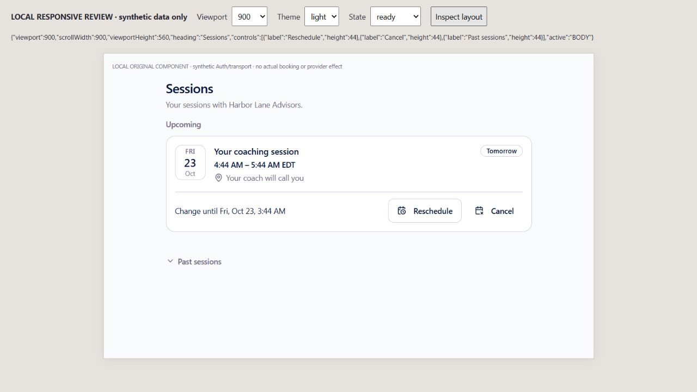
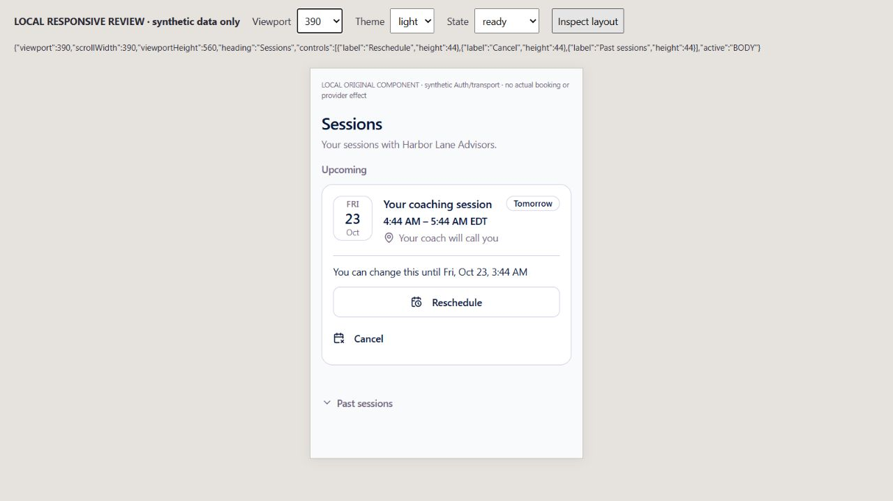
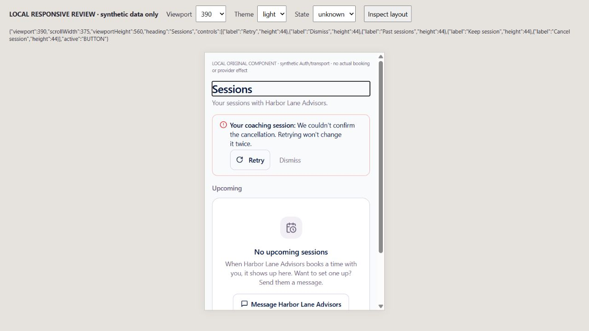
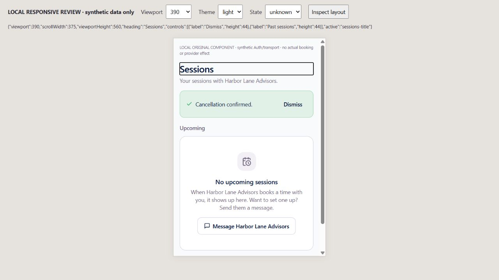
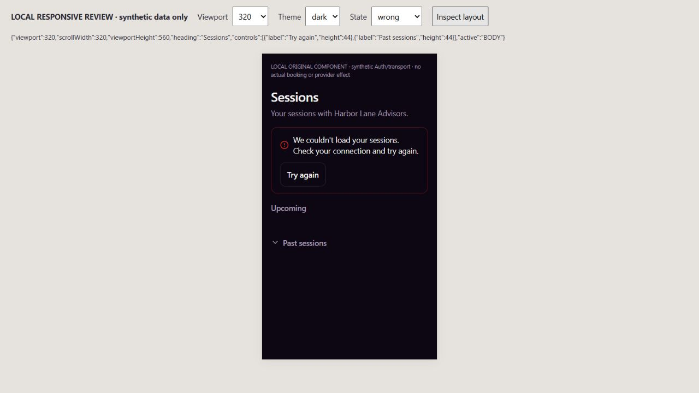
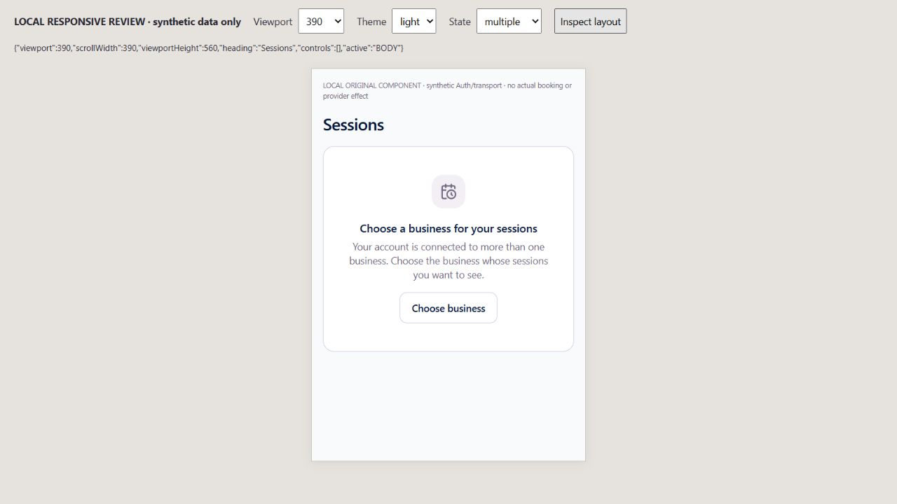
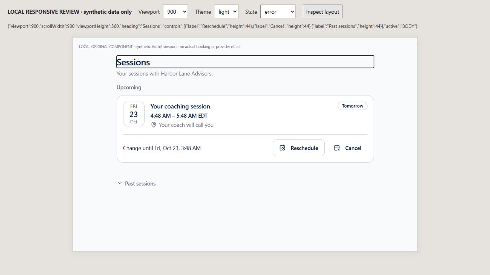

# EXP09 — original Sessions scope and recovery

UI_DELIVERY_EVIDENCE_VERSION: 1
FLOW_BY_FLOW: PASS: ten named pre-edit answers and original orchestration contract in docs/delivery/e09-customer-sessions-business-scope.md; original booking engine, not a new scheduler.
PAIGE_UI_DESIGN: PASS: original Sessions composition, typography, tokens, EmptyState, Button, Sheet and AlertDialog retained. Existing customer shell and branding unchanged.
MATERIAL_FLOW_CHANGE: NO: restoration of original selected-business read/change/recovery behavior and missing replay feedback; no new user goal, permission, confirmation gate or scheduler.
FLOW_PROTOTYPE: NOT_REQUIRED: restores an existing approved flow. The installed skill was read; original-component interactive render review below is not described as pre-implementation founder approval.
PURPOSE_AUDIENCE_PRIMARY_ACTION: PASS: invited customers inspect their selected business's own sessions and explicitly cancel/reschedule only through original permitted booking admission, or recover the same original request.
VISUAL_DIRECTION: PASS: preserve existing customer design. Impeccable craft/operate checks cover hierarchy, form fit, truthful errors/results, narrow/dark states, keyboard continuity and touch controls.
AUTOMATED_EVIDENCE: PASS:137 focused checks/five Sessions/Home suites, including23 selected-business/actual Auth/SDK/interruption cases and five explicit-recovery/focus controls. Original notice, pagination, conditional change, lost acknowledgment and replay regressions retained. Native111 is pending hosted execution, not included in137.
STATIC_EVIDENCE: PASS: changed-source/test ESLint0 errors/warnings and diff check. Actual app-project TypeScript reports the same six known baseline errors and missing shared @mdxeditor/editor; no changed Sessions diagnostic, no full local type-check PASS claimed. Exact-head required hosted type ratchet remains binding. No native migration/function/ACL, shared Edge/C0b/Spine or provider change.
RENDERED_EVIDENCE: PASS: actual original Sessions at900x560 light populated/recovered focus,390x560 light populated/unconfirmed/replayed/business-choice and320x560 dark foreign-business refusal. Seven images under assets/e09-sessions-business-scope/. Synthetic Auth/transport; no actual booking/provider action or full signed-in shell/device certification.
BEHAVIORAL_EVIDENCE: PASS: original confirmation driven by keyboard, simulated lost acknowledgment held the original change, explicit Retry replayed it and showed confirmation, with focus on Sessions. Original Past sessions then read the retained cancelled booking. Read Retry recovered the original list. Rendered review exposed missing replay feedback and disappearing-control focus; both corrected and re-driven.
AUTHENTICATED_RUNTIME: UNVERIFIED: synthetic Auth/transport replaces only local service I/O. Actual customer booking change, business owner projection, provider notification/delivery, global identity transition and complete returning/revoked/two-business journey remain owed.
KEYBOARD_FOCUS: PASS: original confirmation default Keep session, Tab/Return confirmation, explicit recovered read/change focus, retired-scope and background-focus negatives. Observed primary/quiet change controls are44px. No screen-reader certification is inferred.
ZOOM_REFLOW: PASS: visible local measurements show no horizontal overflow at900/390/320; populated and recovery states fit or vertically scroll inside560px. Scrollbar may reduce document width by15px; no horizontal clipping. Full-shell closed/open matrices,400-percent browser zoom and iPhone/Safari proof remain unverified.
REDUCED_MOTION: NOT_APPLICABLE: no animation or motion added; original motion-reduce spinner/transition controls remain. No OS preference drive claimed.
STATE_COVERAGE: PASS: original loading/empty/populated/past/paging, initial/refresh/Auth error, exact ambiguity, permission/revocation, sign-out/business/actor retirement, deadlines before and after dispatch, same-business recheck, unsent failure and uncertain original-request replay covered. Actual render includes populated/read recovery/foreign/chooser/unconfirmed/replayed. New approval/payment states N/A.
TRUTHFUL_STATE_LABELS: PASS: foreign/failed reads do not become empty availability or another business; unsuccessful preflight is unsent; dispatched uncertainty is held; confirmation requires the original engine answer. A native admission read never claims a booking was changed.
SOLO_UI: NO: original external customer /app/sessions and Home consumer only; SOLO owner and PAIGE panels untouched.
UNVERIFIED: native111 execution, final exact-head CI/deployment and real protected external-customer/provider/whole-Experience acceptance pending. Original global linked-user guard remains; future-shaped CI fixtures never certify multiple-business production admission.
OWNER_INTENT: Finish the existing complete secure CURA customer journey, retaining canonical business records and useful recovery.
MUST_NOT_HAPPEN: another actor/business dispatching an old change, false unsent/completed state, duplicate request after uncertain outcome, owner authority granted to customer, or another calendar/execution/approval system.
MUST_PRESERVE: original client_portal_sessions, client_portal_session_change_admit, booking-manage/public-booking, notice/slot/CRM/access checks, original request/audit identity, canonical internal_bookings and existing customer shell.
ACCEPTANCE_CRITERIA: scoped original native SDK reads and per-invoke captured actor/explicit business; retired callbacks and late results withheld. Existing Home uses the same original one-item reader. Bounded original preflight/read/change recovery, no automatic new request. Explicit same-request success and read recovery restore focus; original verified business chooser replaces obsolete platform-support exit.
MOTION_PURPOSE: None added.
PROTECTED_SEAMS: ANT161 lease covers original hook/page/tests, original native rolled-back fixture and own evidence. Original server booking/notification, shared Edge/C0b/Spine/owner Chat and EXP04 signing/money sources are unchanged.

INTERNAL_BUILD_IDENTITY: implementation=754faeef78c457f618fd73a4caf179990a7d4f19; deployment=NOT_DEPLOYED; environment=development; migrations=NOT_APPLICABLE; edge=NOT_APPLICABLE; evidence=docs/evidence/ui-delivery/e09-sessions-business-scope.md
RELEASE_CHANNEL: development: local original-component and synthetic Auth/transport proof only.
RELEASE_CLASSIFICATION: internal-only: original Sessions selection/recovery prerequisite, not whole Portal or multi-business activation.
CUSTOMER_RELEASE_IDENTITY: none: no customer release name or publication.
RELEASE_NOTE_REQUIRED: no: bounded internal repair; canonical factual release closeout follows production readback.
RELEASE_TRUTH_BOUNDARY: PARTIAL: local original-consumer proof. PROOF OWED: native111, exact-head CI/production and actual customer/provider journey. No LIVE algorithm or catalogue promotion.
RELEASE_RECOVERY: position=compatible original-consumer forward correction/revert preserving original data, native authority and uncertain request identity; reference=docs/delivery/e09-customer-sessions-business-scope.md

## Rendered finish review

Installed Impeccable4.3.1 [canonical skill](https://github.com/pbakaus/impeccable/blob/main/.claude/skills/impeccable/SKILL.md) craft/operate checks applied. Sequential author finish review is LOWER ASSURANCE, not non-author review. Original design remains legible on inspected light/dark widths. The first render review found missing replay confirmation and lost keyboard position after disappearing change controls; final original interaction was re-driven after correction. No material visual finding remains within these bounded states.

The wrapper is1280x720; iframe900/390/320x560 is genuine rendered width evidence, not physical phone/browser chrome/keyboard/assistive-technology or full signed-in customer proof. Neutral synthetic businesses only; no credentials, personal data or real provider effect. Unused failed/blank/pre-fix captures are not committed as proof.

Functional:137 focused checks and bounded local source proof; native111/required hosted CI/production pending. Visual: seven inspected original-component responsive/light/dark/state images, unchanged design system. Experiential: source-backed recovery logic with original request, actual SDK transport and keyboard continuity under synthetic service I/O; real joined owner/client journey still owed. Founder Acceptance: one final integrated live evaluation, not requested for this increment.
