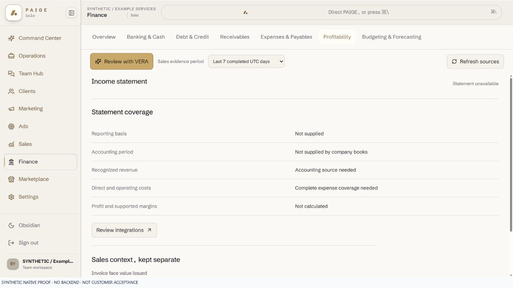
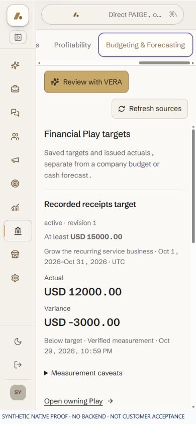

# EXP02 Finance keeps the selected evidence window on return

UI_DELIVERY_EVIDENCE_VERSION: 1
FLOW_BY_FLOW: PASS: ANT138/54624cb5 ten-point pre-edit packet; select Sales window -> original Finance tab -> full reload -> Back/Forward -> same window and original evidence.
PAIGE_UI_DESIGN: PASS: original five project modules, incumbent Finance Operate layout, native selector, seven routes, typography and scroll owners retained.
MATERIAL_FLOW_CHANGE: NO: repair the existing view filter and return behavior; no new screen, choice, confirmation, authority or consequence.
FLOW_PROTOTYPE: NOT_REQUIRED: unchanged existing Finance navigation/filter flow, not a new review or execution workflow.
PURPOSE_AUDIENCE_PRIMARY_ACTION: PASS: an eligible SOLO owner can inspect the same Sales reporting window after returning to Finance.
VISUAL_DIRECTION: PASS: preserve Mineral/Obsidian, Schibsted, original VERA attribution and Finance hierarchy; no markup, style, copy or motion change.
AUTOMATED_EVIDENCE: PASS: original component baseline42PASS; causal7FAIL/51PASS ->58PASS; adjacent shell caught actor/business reset1FAIL/114PASS, corrected without weakening it. Fresh isolated exact-lock124PASS/six original suites including provisioning8, retaining all incumbent assertions and explicit foreign-view reset before reads.
STATIC_EVIDENCE: PASS: scoped ESLint0, pinned Impeccable4.1.0 detector0, parity SP1-SP5/all original hostile and legitimate controls, whitespace/UIguard. Initial stale-dependency type failure retained; isolated exact current-lock install then unchanged type ratchet PASS baseline10/current6/no-new. Prior/shared folders, lock and guard conserved; final hosted gates remain separate.
RENDERED_EVIDENCE: PASS: original full SoloApp/Finance native captures at all8 prescribed CSS configurations and390x844, same Schibsted/VERA/scroll, no document overflow. Separate action/capture calls verify actual open/folded state; native1536 DOM raster1535x770 and390 DOM raster390x843 retained without resizing. Neutral desktop/narrow images below.
BEHAVIORAL_EVIDENCE: PASS: actual local week -> Forecast -> full reload -> native Back retains week; fresh source address and visible selector agree. Native Forward/Back preserve synthetic unsent value/focus/caret.390px keyboard End reaches Forecast with selected visible focus ring. These are original-shell synthetic transports, not customer acceptance.
AUTHENTICATED_RUNTIME: UNVERIFIED: actual released predecessor exposed week -> month context loss in protected ANT52/c6825652. This local repair is not deployed or customer accepted.
KEYBOARD_FOCUS: PASS: original focus/arrow/history/Chat/form/source-sheet controls retained; actual native Forward/Back preserves synthetic discussion value/focus/caret,390px selected Forecast is reachable and visibly focused. Full reload starts at BODY, not claimed focus restoration. Full AT conformance unverified.
ZOOM_REFLOW: UNVERIFIED: all8 CSS viewports and390px reflow measured separately; native200-percent and full AT remain owed through supported controls.
REDUCED_MOTION: NOT_APPLICABLE: no motion, transition, timing or reduced-motion contract changed.
STATE_COVERAGE: PASS: strict four-range allowlist; absent/empty/unknown/uppercase/duplicate/untrusted input falls back to original month; object query/hash/state retained; inline mode and actor/business reset conserved; original loading/refusal/error/source/target/invoice states unchanged.
TRUTHFUL_STATE_LABELS: PASS: same authorized Metric/Evidence reader, original financial dates/currencies/coverage and VERA controls; saved Play periods and bank source dates remain independent. No provider, prediction, approval or completion claim added.
SOLO_UI: YES: original FinanceWorkspace for every eligible current/future SOLO account; no customer-specific source, account allowlist or provisioning change.
SOLO_1536X770_PAIGE_CLOSED: PASS: stable-1536x770-closed.jpg, exact DOM/native1535x770; week filter, original full shell/no document overflow.
SOLO_1536X770_PAIGE_OPEN: PASS: stable-1536x770-open.jpg, exact DOM/native1535x770, original side rail/neutral unsent discussion.
SOLO_1366X768_PAIGE_CLOSED: PASS: stable-1366x768-closed.jpg, exact DOM/native1366x768, readable original Finance view and filter.
SOLO_1366X768_PAIGE_OPEN: PASS: stable-1366x768-open.jpg, exact DOM/native1366x768, original side rail and preserved synthetic draft.
SOLO_1024X768_PAIGE_CLOSED: PASS: stable-1024x768-closed.jpg, exact DOM/native1024x768, original collapsed navigation/source view.
SOLO_1024X768_PAIGE_OPEN: PASS: stable-1024x768-open.jpg, exact DOM/native1024x768, original overlay; fold before operating covered Finance.
SOLO_900X1000_PAIGE_CLOSED: PASS: stable-900x1000-closed.jpg, exact DOM/native900x1000, original Finance source and own scroll.
SOLO_900X1000_PAIGE_OPEN: PASS: stable-900x1000-open.jpg, exact DOM/native900x1000, original overlay; covered background not claimed operable.
UNVERIFIED: final-head hosted review/CI/build, native200-percent/full AT, merge/deployment/readback and both legitimate customer cohorts; all19/nine/eligible Live/founder acceptance remain open.
OWNER_INTENT: preserve source-backed business context while completing the original19 outcomes through cohesive releases.
MUST_NOT_HAPPEN: carrying a selected view across actor/business changes, losing unsent Chat, changing metric authority/math, inventing cash/profit/forecast figures or activating an action.
MUST_PRESERVE: Overview landing, original seven tabs and canonical route registry, source-currentness/expiry and sheet dismissal, VERA handoff, keyboard focus, permissions and original receiving domain records.
ACCEPTANCE_CRITERIA: same authorized view survives tab navigation/full reload/BackForward; other actor/business resets before reading; malformed range defaults safely; no Chat or business record mutation.
MOTION_PURPOSE: NONE: no animation or motion added.
PROTECTED_SEAMS: original Finance URL/history/filter and actor/business/Chat adjacency tested. Unaffected: shared shell/router implementation, Auth/provisioning/RLS, Trust/approvals, Spine/Harness/LayerC execution, domain writers, Rail, provider/network, Memory/Knowledge, Chat runtime/transcript/Live and protected monthly fixture. Synthetic transports never prove those authorities.

## Scope, source and review

REUSE the original React Router, `tierBranches` paths, Finance controls and
`useSalesPerformanceMetrics`/Metric-Evidence issuer. EXTEND the original view
address with one allowlisted `range`; REPAIR reload/history loss and preserve
actor/business reset. No NEW registry, navigation engine, persistence service,
metric reader or capability. A private history marker scopes a view preference,
never permission; direct bookmarks still use original authorization. Replacing
the filter adds no Back entry; tab clicks use normal canonical navigation.

Source ownership is original EXP02 Finance consumer/test plus its own matrix and
this record. EXP03/04 Sales writers and EXP11 sources remain authoritative.
Existing E05 -> E04 -> E02 Master closeout lease is respected, no shared edit.
Local proof reuses `scripts/live-drive/harness/finance-review-mount` unchanged.
Private logs in outputs/e2-finance-window-* retain failures as well as passes.

## Rendered and interaction proof

`outputs/e2-finance-period-proof/stable-frames.json`, `interaction.json` and
`image-metadata.json` bind the actual original-shell source43286b3a, CSS dimensions,
native raster hashes and native reload/Back/Forward/keyboard observations. The
only later changes are this evidence/matrix and two exact neutral image copies;
product inputs remain identical. Original optional source fixtures deliberately
remain synthetic and cannot establish issuer/provider/permission readiness.

Transport timeouts/detachment before the settled result remain excluded, not
erased. An initial proof-driver assumption treated Direct PAIGE as a fold toggle;
its mislabeled and same-call compositor-stale frames are INVALID. The actual
original Fold PAIGE control and separate action/capture calls produced the eight
verified stable-* frames. A responsive duplicate-label selector was narrowed to
the original header control after fresh inspection. No source repair, security
override, synthetic customer or alternative browser engine was used. Native full
reload initially timed out obtaining its frame tree; the settled original page
was then actually read and Back showed week, not the predecessor's month.
Viewport reset and only the owned proof tab closed; peer tabs untouched.

Applied Flow-by-Flow audit/build/verification and installed Impeccable harden,
craft-floor and separate finish inspection. Canonical reference:
https://github.com/pbakaus/impeccable/blob/main/.claude/skills/impeccable/SKILL.md.
The stale design sidecar is mention-only, outside this repair; no upgrade.

## Orchestration, algorithms and catalogue

Read-only `analytics.metric_read` and original Sales/Finance/Play readers retain
their actor/tenant/currentness contracts. This view change has no MUTATION_VERB,
approval, job, domain action or new Rail receipt. Navigation is not execution.
Original retained financial and strategic periods remain authoritative.
ALG03/06/11/12 stay Partial, ALG13 Unverified; no predictive claim. All nine
catalogue states remain3ComingSoon/3Limited/3Unverified/allAccessUnverified.

Functional: LOCAL correction124PASS/type-ratchetPASS. Visual: unchanged renderer,
actual eight-view/narrow native proof. Experiential: causal predecessor FAIL,
local full-reload/return/draft/caret proof only. Founder Acceptance: OPEN, one
complete integrated evaluation.
Historical9PASS/0FAIL and12PASS/0FAIL/4BLOCKED remain; monthly
UNKNOWN/UNRETRIED/UNINSPECTED. Original3018P1 and Sales return finding remain open.

INTERNAL_BUILD_IDENTITY: db8807a11f29db2ca3bd2d2ce4b60ea9bfcf2c0d; identity-role=receiving main; candidate=Git exact-head review; deployment=none; environment=local; migrations=NOT_APPLICABLE; edge=NOT_APPLICABLE; evidence=docs/evidence/ui-delivery/e2-finance-period-continuity.md
RELEASE_CHANNEL: development: local bounded Finance view repair, not customer acceptance.
RELEASE_CLASSIFICATION: internal-only: no new capability or customer announcement.
CUSTOMER_RELEASE_IDENTITY: none: original complete Experience acceptance remains unearned.
RELEASE_NOTE_REQUIRED: no: internal repair evidence only.
RELEASE_TRUTH_BOUNDARY: PARTIAL: original exact-lock tests/types and native synthetic shell/reload/return; final hosted release/native200-percent/AT/customer proof remains PROOF OWED.
RELEASE_RECOVERY: position=original reviewed forward correction or revert, no business work replay; reference=docs/delivery/e2-customer-experience-integration-matrix.md
