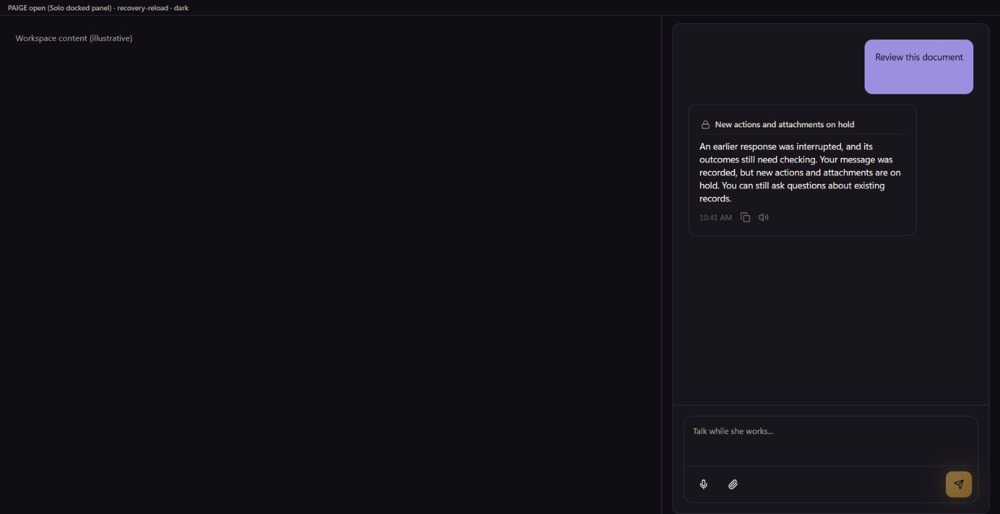

# EXP05 — retain an explicitly unprocessed attachment

UI_DELIVERY_EVIDENCE_VERSION: 1
FLOW_BY_FLOW: PASS: original held #2401 continuation, current-main refusal -> retain only the unchanged in-memory file -> deliberate new Send or explicit removal -> permitted read question; unknown outcomes never replay. Existing request fences and canonical history remain authoritative.
PAIGE_UI_DESIGN: PASS: reuse the original alert, attachment status/removal, composer and tokens; no navigation, new layout system, sender or document parser.
MATERIAL_FLOW_CHANGE: YES: the unprocessed file remains inspectable/removable; a deliberate new intent must not be swallowed by the completed send latch.
FLOW_PROTOTYPE: UNVERIFIED: the original actual-component local harness now renders after isolating its optimizer cache. Native desktop saved refusal, keyboard read-only continuation and original refusal reload were observed at source cea14727997758458880e3324bc0cc9d9b7b40f5. The current connected Chrome chooser explicitly rejects local-file access; no file was uploaded and the complete retention/removal/new-Send flow remains owed. No alternate upload or control bypass.
PURPOSE_AUDIENCE_PRIMARY_ACTION: PASS: all eligible existing/future SOLO owners receive truthful recovery after the exact known server refusal, with their file preserved only in the original unchanged composer.
VISUAL_DIRECTION: PASS: existing compact PAIGE Chat alert and file chip, one contextual removal instruction. No illustration, motion, banner or cosmetic shell.
AUTOMATED_EVIDENCE: PASS: final serial five-file run200PASS/0FAIL, original assertions retained (upload41, attachment16, scope66, ASK25, turn-view52). ReportSHA256730f9772f199d10a34a2ec96f73a012c431280f1c2032043d4bfe7aa556b00a6. Earlier current-main49/8, repaired199/1, isolated guard1PASS/51skipped and deliberate-send0PASS/1FAIL/15skipped remain actual distinct checkpoints. Initial cache failure and subsequent worker-start failure ran zero assertions and are INVALID, never PASS. No source guard, test timeout or assertion was weakened; final run uses one worker to avoid local startup contention.
STATIC_EVIDENCE: PASS: final scoped lint/diff clean, pinned Impeccable4.1.0 detector0 anti-patterns/six unchanged font advisories. Strict original/candidate both exit2 with24 raw diagnostic lines and zero new diagnostic signatures; only locations are normalized and raw outputs retained, not a clean compile. All four candidate files restored byte-for-byte. Current main35fff3a8 is fast-forwarded with all seven tested file hashes unchanged; fresh strict base/candidate35fff both24 raw diagnostic lines/zero new signatures, exact candidate restoration. Exact-head review/CI remain owed; native/Root/C0b/permission source is unchanged.
RENDERED_EVIDENCE: PASS: bounded native desktop light and dark actual-component captures at1536x791 are linked below. This is the isolated illustrative mount with synthetic history/transport, not a complete SOLO shell, narrow view, production upload or completed material-flow proof. Original #2401 captures remain historical.
BEHAVIORAL_EVIDENCE: UNVERIFIED: native saved refusal -> deliberate file-free read question -> offline truthful answer -> reload of the original refusal was observed. The fixed local history does not persist that new answer and is not customer persistence evidence. File selection -> retention -> deliberate new Send -> removal remains held by the actual chooser permission. The source200 cases do not replace that missing native proof.
AUTHENTICATED_RUNTIME: UNVERIFIED: no production upload, conversation, approval, document processing/publication or business action was performed. The available signed-in session and prior live read-only release checks do not prove this unreleased repair.
KEYBOARD_FOCUS: UNVERIFIED: native textarea -> voice -> attachment -> Clear -> Send traversal and keyboard read-question submission were observed; Clear returns to the textarea after settling. Keyboard Send left body focused after settling, a finish finding retained for correction/review, not a passing focus result. Actual attachment-removal focus remains owed.
ZOOM_REFLOW: UNVERIFIED: actual desktop1536x791 has no horizontal document overflow. Requested390x844 viewport override returned no error but actual DOM and raster stayed1536x791; it was reset and is INVALID as narrow proof. Narrow/200-percent inspection remains owed.
REDUCED_MOTION: NOT_APPLICABLE: no motion is added or changed.
STATE_COVERAGE: UNVERIFIED: exact409/code/message_accepted=true is distinct from missing/contradictory/wrong-code/other-status uncertainty. Restoration is fenced by original scope/epoch/generation/lifetime and newer selection/removal/processing. Unknown responses retain no-replay handling. Final source and native traversal remain owed.
TRUTHFUL_STATE_LABELS: PASS: accepted message is not a processed document, saved Knowledge or completed business action. No automatic resend or synthetic completion receipt.
SOLO_UI: YES: shared PaigeAIChat/upload hook, no customer/account predicate or provisioning change. Existing paige.workspace binding/catalogue maturity remains PARTIAL/PROOF OWED; no capability is promoted Live.
SOLO_1536X770_PAIGE_CLOSED: UNVERIFIED: no new current full-shell capture.
SOLO_1536X770_PAIGE_OPEN: UNVERIFIED: no new current full-shell capture.
SOLO_1366X768_PAIGE_CLOSED: UNVERIFIED: no new current full-shell capture.
SOLO_1366X768_PAIGE_OPEN: UNVERIFIED: no new current full-shell capture.
SOLO_1024X768_PAIGE_CLOSED: UNVERIFIED: no new current full-shell capture.
SOLO_1024X768_PAIGE_OPEN: UNVERIFIED: no new current full-shell capture.
SOLO_900X1000_PAIGE_CLOSED: UNVERIFIED: no new current full-shell capture.
SOLO_900X1000_PAIGE_OPEN: UNVERIFIED: no new current full-shell capture.
UNVERIFIED: final exact-head review, real material-flow prototype/finish, exact-head required CI, merge/deployment/readback and authenticated recovery; full EXP05 ten outcomes/E5-CV1–9/Builder/ZION/owner-away/cohorts/Live and founder acceptance remain open.
OWNER_INTENT: complete the original EXP05 recovery correction without displacing Operations or starting future EXP13.
MUST_NOT_HAPPEN: no unknown-outcome replay, automatic file resend, foreign-composer restoration, replacement of newer work, fabricated processing/Knowledge claim, new provider call or weakened approval/admission.
MUST_PRESERVE: canonical Spine/Harness/Trust/Rail, current actor/tenant/thread/session fences, original history, typed/Live distinction, domain writers and OpenAI-primary/Anthropic fallback.
ACCEPTANCE_CRITERIA: a known unprocessed refusal preserves the file only in its eligible composer; only deliberate new Send creates one new intent; removal permits a file-free read question; reload reads original refusal without persisting/replaying unsent file bytes; unknown and stale responses cannot restore/replay.
MOTION_PURPOSE: NONE.
PROTECTED_SEAMS: client-only restoration and original dispatch latch; no server/native policy, Root/risk/C0b, scheduler, registry, provider, approval or effect activation.
INTERNAL_BUILD_IDENTITY: source=2ab4496d6130f70959224cca7a888b9cefca922f; base=d08a2f206d479c3727898cb68466758075382898; deployment=NOT_APPLICABLE; environment=development; migrations=NOT_APPLICABLE; edge=NOT_APPLICABLE; evidence=200 source assertions with recorded original dd6496 inputs, current35fff strict comparison zero-new diagnostics, actual cea147 native partial captures. Incoming E08 source is preserved; no full-tree test or full material-flow proof is relabeled.
RELEASE_CHANNEL: development: isolated source correction, NOT_MERGED and NOT_DEPLOYED.
RELEASE_CLASSIFICATION: internal-only: continuation of original refused-input recovery, not Knowledge ingestion or customer launch.
CUSTOMER_RELEASE_IDENTITY: none: no customer release, deployment or owner acceptance.
RELEASE_NOTE_REQUIRED: no: unreleased development correction.
RELEASE_TRUTH_BOUNDARY: PARTIAL: source/protected fixture proof only; current visual, release and authenticated proof are held rather than inferred.
RELEASE_RECOVERY: position=original accepted request/history and exact no-processing refusal; reference=original #2401. Unknown business effects require authoritative original-operation reconciliation, never a fresh replay.

## Orchestration and ownership

The entry is the existing ordinary Chat request and original saved turn. This
slice does not run an ActionAdapter. The exact server refusal is evidence of a
held request, not a domain record or Rail execution receipt. Current approvals,
native identity/idempotency, Layer C and effect recovery remain unchanged.
ALG-01 gains bounded local state/no-repeat recovery only; complete authenticated
algorithm acceptance is owed. No ALG-12/13 maturity is claimed:
NO VERIFIED SUPPORTING ALGORITHM IDENTIFIED — GAP OR VERIFICATION OWED
for new anomaly detection or next-action intelligence in this slice.

The original eight-page PDF incident, exact recovery refusal, absent saved
Knowledge record and one-file-per-message limitation remain historical evidence,
preserved in [original #2401](https://github.com/Paige-Agent-AI/Paige-Agent-AI/pull/2401).
Future EXP13 owns multi-document upload, safe extraction, understood-content
review, approved canonical Knowledge publication, later cited retrieval and
document permissions/recovery. It is not activated here. EXP09 retains its
client-specific CURA Knowledge; EXP01 source/panel split and E09's shared Root
window are preserved. This is not a separate BUG lane.

Functional: development correction with200 assertions against the recorded original source inputs, unchanged product/test bytes and disclosed test-only cache correction on current main; no release. Visual: existing
design system and bounded actual desktop captures retained; native finish UNVERIFIED. Experiential: the complete
recovery loop remains native-proof owed. Founder Acceptance: NOT_ACCEPTED;
one complete integrated EXP05 evaluation remains.

[Impeccable](https://github.com/pbakaus/impeccable/blob/main/.claude/skills/impeccable/SKILL.md)
clarity, honest states and existing-control craft checks apply; a source detector
or simulated fixture does not replace the held rendered/interaction finish.

## Native partial prototype — October26 UTC

These two screenshots are isolated, synthetic actual-component observations at
source cea147; their SHA256 values and exact scope are in the companion JSON.
No customer document, provider request, approval or canonical business mutation
was performed. Current browser permission and invalid narrow override remain
explicit holds. The complete flow is not approved or ready for release.

