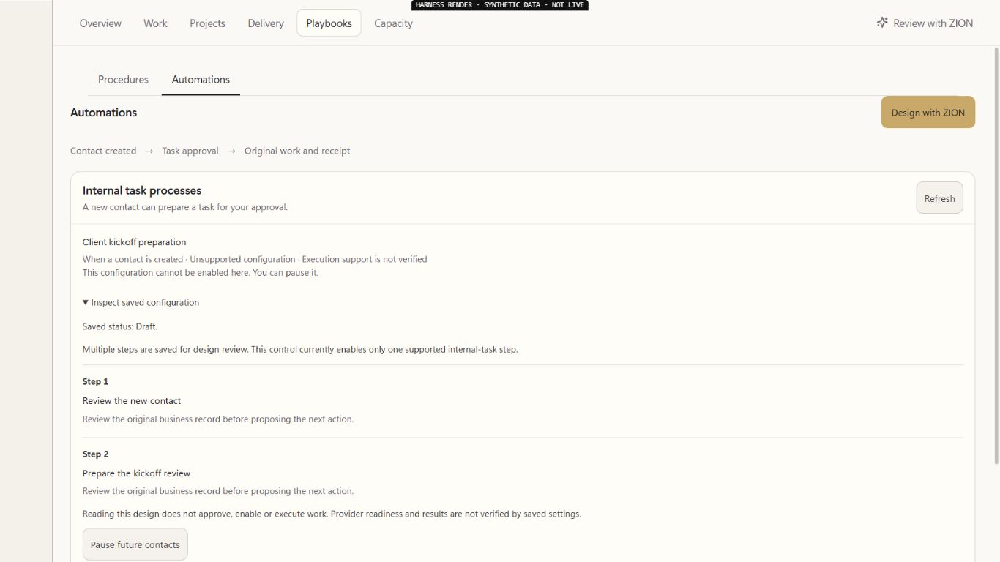
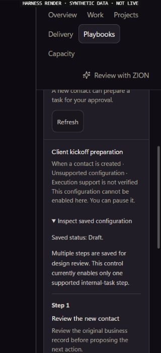

# EXP05 O05 — inspect the original saved process design

UI_DELIVERY_EVIDENCE_VERSION: 1
INTERNAL_BUILD_IDENTITY: source=260c8081a30d2ae7fd803974e7d60ac8fe05b699; deployment=offline-original-Operations-mount; environment=local; migrations=NOT_APPLICABLE; edge=NOT_APPLICABLE; evidence=docs/evidence/ui-delivery/assets/exp05-saved-process-design/build-manifest.json. Final review/CI/head are recorded on the original PR.
RELEASE_CHANNEL: development: isolated original Operations workspace with explicit synthetic read/Auth/transport ports.
RELEASE_CLASSIFICATION: internal-only: bounded saved-design inspection within the unfinished EXP05 Experience.
CUSTOMER_RELEASE_IDENTITY: none: no complete automation lifecycle, authenticated or founder acceptance claimed.
RELEASE_NOTE_REQUIRED: NO: original PR/ANT-11 and existing Master closeout retain the release record.
RELEASE_TRUTH_BOUNDARY: PARTIAL: readable saved step inspection; original one-step admission and all writers remain unchanged. Multi-step execution is unavailable here.
RELEASE_RECOVERY: position=original reviewed forward-fix/revert pipeline; reference=original process and acts, never another execution or uncertain-effect retry.
FLOW_BY_FLOW: PASS: Operations → Playbooks → Automations → original saved process → existing disclosure → inspect recorded step order/purpose/limitations → collapse or return to original work. Existing supported one-step review and Cancel return are preserved.
PAIGE_UI_DESIGN: PASS: applied installed Flow-by-Flow, Paige UI Design, Flow Prototype, Impeccable and React guidance. Compact hierarchy, original tokens and disclosure; no banner, tab or navigation redesign.
MATERIAL_FLOW_CHANGE: YES: unsupported saved designs now disclose bounded literal task purposes, ordering/settings gaps and actual enablement limits instead of a raw configuration dump.
FLOW_PROTOTYPE: PASS: framework-native original OperationsWorkspace/Playbooks/OwnerTaskAutomations mount; owner-approved Operations design direction, private offline data ports and inert dock/navigation are explicit in build-manifest.json.
PURPOSE_AUDIENCE_PRIMARY_ACTION: PASS: authorized SOLO owner/admin understands what a saved process contains and what remains unsupported before deciding what needs revision.
VISUAL_DIRECTION: PASS: quiet saved-process inspection with step separators, readable literal content and native disclosure affordance; original PAIGE typography/color/spacing. No invented activity, readiness or progress.
AUTOMATED_EVIDENCE: PASS: final203 assertions/five original process-control, Settings, Operations and authority-hook suites; includes12 new inspection cases. Failure-first original62PASS/new11FAIL retained before implementation. Focused ESLint zero diagnostics; original single-step presentation guard exact.
STATIC_EVIDENCE: UNVERIFIED: actual tsconfig.app.json reports nine unchanged-file diagnostics and ZERO changed-path diagnostics; full compile is not claimed green. Required hosted exact-lock checks remain controlling. Offline Vite build and UTF-8/diff checks pass.
RENDERED_EVIDENCE: PASS: sixteen final-source screenshots/DOM records, both themes, original workspace at1536/1366/1024/900/320 widths. Exact product inputs, explicit fixture sources and compiled hashes are in build-manifest.json; frame index is rendered-matrix.json. This is engineering proof with synthetic hook/Auth/transport ports.
BEHAVIORAL_EVIDENCE: PASS: multi-step/mixed/order/oversized inspection, original one-step review→Cancel and loading/refusal/unavailable/empty presentation. Unsupported designs expose no enable choice; synthetic sensitive configuration values are absent from visible content. No configuration control dispatched in browser QA.
AUTHENTICATED_RUNTIME: UNVERIFIED: new saved-design UI has no production owner/current-new SOLO/role/RLS/revocation or Chat/Team Hub proof. Current designated-session context is unstable and owner mutations/activation are outside read-only QA authority. Source fixtures do not establish those claims.
KEYBOARD_FOCUS: PASS: original summary keeps its native marker,44px minimum height and focus outline; Tab reaches Pause, original one-step review focuses Cancel and Cancel returns to the originating review control. No configuration action used in rendered QA.
ZOOM_REFLOW: UNVERIFIED:320px rendered reflow and keyboard reachability pass without document overflow. Native200% and assistive-technology testing remain owed; no emulation or parent proof is substituted.
REDUCED_MOTION: PASS: no new animation, timer, polling or motion added. Original disclosure behavior retained.
STATE_COVERAGE: PASS: readable multi-step, mixed action, malformed ordering, oversized design, supported one-step review/Cancel, loading, denied, unavailable and empty presentation; original stale/uncertain control and scope/navigation regressions retained.
TRUTHFUL_STATE_LABELS: PASS: saved Draft/Paused/recorded-live status remains distinct from activation. Unsupported execution, extra settings and provider evidence stay unverified. Reading never claims approval, execution, receipt or completion.
SOLO_UI: YES: shared original Operations and Settings saved-process view, original resolved account and caller authority; no tenant allowlist or Platform Operator path.
SOLO_1536X770_PAIGE_CLOSED: UNVERIFIED: original workspace light1536 frame passes; complete SoloApp shell and actual PAIGE fold state were not mounted in this fixture.
SOLO_1536X770_PAIGE_OPEN: UNVERIFIED: actual PAIGE-open complete-shell presentation and preserved conversation remain owed; inert dock supplies no proof.
SOLO_1366X768_PAIGE_CLOSED: UNVERIFIED: original workspace light1366/mixed dark1366 frames pass; full-shell fold state remains owed.
SOLO_1366X768_PAIGE_OPEN: UNVERIFIED: full-shell original PAIGE-open path remains owed; no claim from inert navigation/dock.
SOLO_1024X768_PAIGE_CLOSED: UNVERIFIED: original workspace light1024 frame passes without overflow; full-shell fold state remains owed.
SOLO_1024X768_PAIGE_OPEN: UNVERIFIED: actual PAIGE-open shell and overlay continuity remain owed.
SOLO_900X1000_PAIGE_CLOSED: UNVERIFIED: original workspace dark900 frame passes without overflow; actual complete-shell fold state remains owed.
SOLO_900X1000_PAIGE_OPEN: UNVERIFIED: actual PAIGE-open shell/reentry remains owed; no fixture evidence is promoted.
UNVERIFIED: hosted exact-head CI/review, merge/deployment/activation and authenticated owner/new-existing SOLO/full-shell/native200%/AT proof; real saved draft correction, multi-step enablement/execution, canonical outcomes/receipts/reload and all original ten/E5/founder acceptance.
OWNER_INTENT: complete O02 realistic weekly planning, then O05 Builder→O07 monitoring→O09 permitted updates; while narrow native-order receiving is pending, improve existing saved-design inspection within O05 without expanding execution authority.
MUST_NOT_HAPPEN: unsupported action enablement, arbitrary configuration/credential rendering, invented provider readiness, silently reordered steps, source mutation by inspection or another automation runtime.
MUST_PRESERVE: original caller-JWT read/authority/deadline/epoch, exact one-step admission guard, native arm/pause writer, Trust, history/receipt/uncertain recovery, Settings pipeline-message writer and Work navigation.
ACCEPTANCE_CRITERIA: actual stored step positions/literal purposes remain inspectable; unsafe/unknown settings are explicitly withheld; omitted steps/order gaps are disclosed; supported one-step review/Cancel remains correct; reading dispatches no control.
MOTION_PURPOSE: no new motion; existing native disclosure communicates expansion.
PROTECTED_SEAMS: no Chat/index/agent-turn, native SQL, reader hook, shared registry, sender/provider, Team Hub or other Experience writer change.

## Source, orchestration and algorithm contract

REUSE original `useOwnerTaskAutomations` → caller-JWT process/acts reads with
original owner/admin membership, tenant RLS, scope epoch and elapsed deadline.
EXTEND the existing inspection disclosure; REPAIR opaque unsupported presentation.
NEW only a bounded presentation component inside the original view. Stored
positions are displayed as received; missing/duplicate/out-of-order positions
are warned about. At most20 steps are displayed, with explicit omitted count.
Only literal native task title/description fields are rendered. Arbitrary extra
settings, unverified external-step configuration and dynamic/control-text fields
are withheld, without changing any saved data or the original execution guard.

Entry/original record: same saved process/acts/version. Canonical read capability
`automations.list`/`automation_list`; UI reuses its original native reader, not
another registry. Original `owner.task` adapter, Trust approvals, Layer C,
`automation_set_state` owner-only/native arm/pause and original Rail/history stay
unchanged. Inspection dispatches no adapter, approval, model or durable job.
No provider connection, cost, scheduling, receipt or completion is inferred.

Workflow Design Draft remains a bounded design/draft capability; this view does
not make multi-step execution Live or change Chat tool/provider readiness.
operations.department stays PARTIAL. Catalogue/readiness panel runtime evidence
remains owed after release; no shared panel source edit or status promotion.

ALG-01 preserves original read/currentness/control/result separation; ALG-13
explains the permitted next step from real configuration gaps. ALG-08 scheduling,
ALG-12 monitoring and ALG-02/03/10/11 maturity remain unchanged. No new scoring,
scheduler, anomaly, router or memory engine. Complete O05 still requires genuine
clarification/correction/save, exact authorization, supported activation, trigger,
domain execution/receipt, monitoring and recovery; this PR closes no full outcome.

## Evidence and quality

The new cases preserve exact source JSON and prove no read-only inspection
control dispatch. Original negative controls for multi-step/tool/extra/dynamic
enablement, stale versions, denied scope and uncertain outcomes remain intact.
The former raw-JSON display assertions now test readable inspection, withheld
unknown values and the SAME original pause call; native admission is not relaxed.

Pinned Impeccable4.1.0: zero anti-patterns.45 advisory notes are inherited literal
color/radius/type values in the existing broad Settings stylesheet; no new literal
color/radius/type or suppression added. Finish review checked native affordance,
44px disclosure/focus, compact hierarchy, literal text wrapping, both themes,
original scroll owner and no document overflow. React guidance: pure bounded
rendering, no new effect/state/request/store, existing authority never inferred
from display. Canonical upstream Impeccable:
https://github.com/pbakaus/impeccable/blob/main/.claude/skills/impeccable/SKILL.md

Functional: SOURCE IMPLEMENTED/LOCALLY VERIFIED, not released. Visual: bounded
original-workspace proof, full-shell/native/AT gaps explicit. Experiential:
saved inspection and original Cancel continuation verified locally; integrated
automation lifecycle incomplete. Founder: NOT_ACCEPTED / STILL CODING / NOT_READY.
ANT-161/7d8fa7e9 reserves exact owned paths; original E04/E09 native10/11 and E05
Task effort12, E04 ZION native ABI, E02 review instructions and E08 Team Hub
boundaries are retained. No new agent or founder intermediate testing request.
