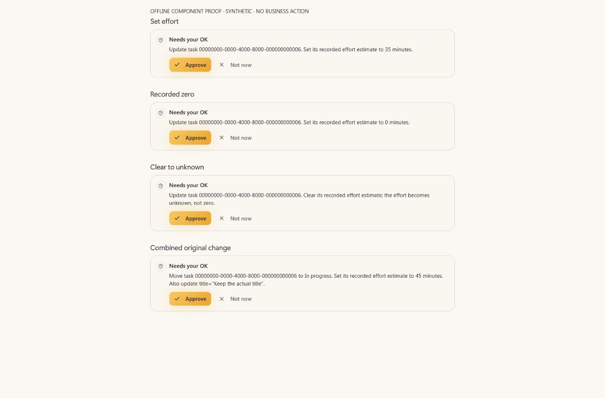
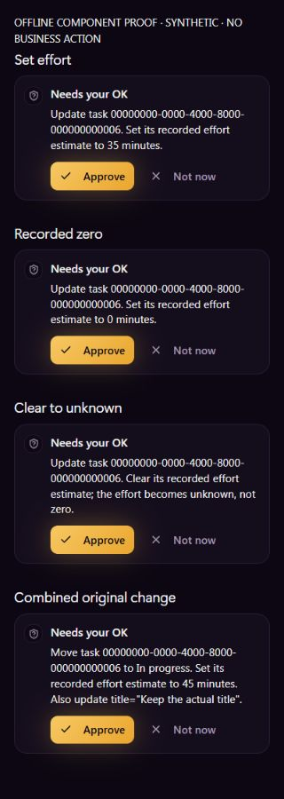
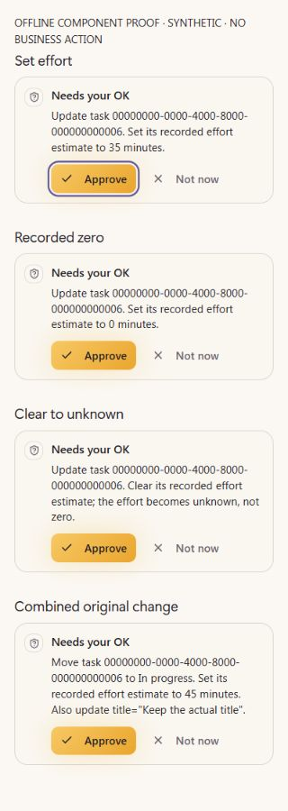

# EXP05 O02/O03 — original Task effort producer and exact approval

UI_DELIVERY_EVIDENCE_VERSION: 1
INTERNAL_BUILD_IDENTITY: source=4c6729d6f0f11cbde2cb932e9904cd8723c0ebae; deployment=offline-original-PaigeConfirmCard; environment=local; migrations=PROOF_OWED(20271126050005_task_effort_scalar forward publication); edge=PROOF_OWED(crm-command exact source deployment after forward migration); evidence=docs/evidence/exp05-task-effort-forward-order.json
RELEASE_CHANNEL: development: original native Task writer and actual served-handler tests; isolated unchanged approval component with neutral summary ports.
RELEASE_CLASSIFICATION: internal-only: bounded original Task-effort correction inside the unfinished EXP05 Experience.
CUSTOMER_RELEASE_IDENTITY: none: no authenticated saved-effort or complete weekly-planning acceptance.
RELEASE_NOTE_REQUIRED: NO: original PR/ANT-11 and existing Master closeout retain the release record.
RELEASE_TRUTH_BOUNDARY: PARTIAL: original Task scalar input, preservation and exact proposal summary; saved UI/readback and complete customer proof remain separate.
RELEASE_RECOVERY: position=original reviewed forward-fix/revert pipeline; reference=original Task, version, CRM operation and receipt. Never retry an unknown operation under another key.
FLOW_BY_FLOW: PASS: docs/delivery/experience-05-weekly-acceptance-packet.md; original task.update proposal → exact recorded minutes or explicit clear → existing single approval → original native versioned execution/readback/recovery. Only proposal and native components are locally proved here; no browser action is approved.
PAIGE_UI_DESIGN: PASS: previously read Flow-by-Flow, Paige UI Design, Flow Prototype, Impeccable and React guidance applied to exact visible summary and unchanged original approval component. No new dialog, banner, design system or navigation.
MATERIAL_FLOW_CHANGE: YES: the existing generated Task schema advertises nullable estimated_minutes; its original approval must disclose that exact value before execution.
FLOW_PROTOTYPE: PASS: unchanged original PaigeConfirmCard with four exact neutral strings asserted against the actual served CRM handler. Inert callbacks, synthetic fingerprint and blocked network are explicit fixture boundaries, not stored approvals.
PURPOSE_AUDIENCE_PRIMARY_ACTION: PASS: an authorized SOLO owner/admin sees the precise recorded estimate or clear-to-unknown change before deciding whether to approve the original Task edit.
VISUAL_DIRECTION: PASS: existing compact Needs your OK card, PAIGE tokens and literal wrapping. No invented capacity, availability, completion or agent activity.
AUTOMATED_EVIDENCE: PASS: scripts/crm-approval-summary-check.mjs actual served-handler104 cases; original CRM47 contract tests/four suites; generator15 conservation/negative controls and generated-field check. Native PostgreSQL16 component20 checks plus three genuine two-connection races pass using explicit synthetic peripheral ports. These results exclude the full-schema225 pgTAP suite.
STATIC_EVIDENCE: PASS: focused original handler ESLint and git diff --check pass; generated fields derive from native SQL. No claim of a full green application typecheck from this bounded change.
RENDERED_EVIDENCE: PASS: three neutral rendered frames: Mineral1366, Mineral320, Obsidian320; fourth Mineral320 keyboard-focus frame. Original component/stylesheet/module and explicit fixture/build hashes are recorded in build-manifest.json. The attempted resize-time Obsidian1366 capture is INVALID and excluded.
BEHAVIORAL_EVIDENCE: PASS: actual-handler set35, zero, one, integer maximum, clear, combined original status/title, malformed scalar and metadata/scalar refusal; exact original arguments/subject/fingerprint retained. All existing actor/tenant/claim/replay/unknown-outcome tests remain. Browser QA pressed Tab only; no approve/deny dispatch.
AUTHENTICATED_RUNTIME: UNVERIFIED: no original customer approval/persistence/role/RLS/domain/Rail/reload/cohort result is established by the private component or fixture database.
KEYBOARD_FOCUS: PASS: Tab reaches original Approve; visible original focus ring captured at320. All eight original buttons are31.5px high with at least94px width in this fixture, above24px minimum;44px recommended targets are not claimed. No shared button styling changed.
ZOOM_REFLOW: UNVERIFIED:320px reflow passes without document overflow or clipped list text. Native200% and assistive-technology checks remain owed.
REDUCED_MOTION: PASS: no new animation, polling, timer or motion; unchanged original card.
STATE_COVERAGE: PASS: actual native/component and original-handler positive, malformed, metadata conflict, stale version, replay, concurrency and receipt-rollback controls. Unchanged confirmation loading/denial states remain original, not newly authenticated here.
TRUTHFUL_STATE_LABELS: PASS: estimate0 is recorded zero; clear means unknown, not zero or capacity. Proposal is not execution, fixture receipt is not canonical Rail, migration source is not applied production.
SOLO_UI: YES: one original Task command/schema for eligible SOLO owner/admin authority; no account-specific branch, allowlist, Platform Operator or Agency work.
SOLO_1536X770_PAIGE_CLOSED: UNVERIFIED: full SoloApp and real PAIGE fold state are not mounted in this isolated original-component fixture.
SOLO_1536X770_PAIGE_OPEN: UNVERIFIED: actual complete shell and PAIGE-open continuity remain owed.
SOLO_1366X768_PAIGE_CLOSED: UNVERIFIED: original card at1366x900 passes; actual complete shell/fold state is not established.
SOLO_1366X768_PAIGE_OPEN: UNVERIFIED: actual complete shell and real PAIGE-open state remain owed.
SOLO_1024X768_PAIGE_CLOSED: UNVERIFIED: no actual complete-shell/fold proof.
SOLO_1024X768_PAIGE_OPEN: UNVERIFIED: no actual complete-shell/open proof.
SOLO_900X1000_PAIGE_CLOSED: UNVERIFIED: no actual complete-shell/fold proof.
SOLO_900X1000_PAIGE_OPEN: UNVERIFIED: no actual complete-shell/open proof.
UNVERIFIED: full-schema225 cases, required exact-head CI/Preview/review, merge, native12 apply, affected Edge deployment, original authenticated approval/domain/Rail/readback/reload/recovery, existing/new eligible SOLO/role/tenant proof, full shell/native zoom/AT and all ten outcomes/E5/founder acceptance.
OWNER_INTENT: O02 feasible weekly planning needs honestly recorded effort; preserve all ten outcomes/E5, then O05 Builder→O07 monitoring→O09 permitted attention.
MUST_NOT_HAPPEN: effort hidden by a generic approval, wrong-tenant edit, metadata clobber, invented capacity, stale mutation, duplicate receipt, unknown-operation retry, advertised field ahead of native support or UI release ahead of its native dependency.
MUST_PRESERVE: original actor/tenant authority, FOR UPDATE/advisory locks, version CAS, exact stored arguments, Gateway/claim, original receipt transaction/replay and every Contact/Company/Deal/destructive/reschedule path.
ACCEPTANCE_CRITERIA: nullable whole minutes0..2147483647; explicit zero/clear; unrelated metadata preserved; malformed/nonobject/conflicting input refused; exact approval values; stale/replay/race/rollback controls; original saved record and receipt prove the eventual action.
MOTION_PURPOSE: none added.
PROTECTED_SEAMS: only original Task-update scalar/native/generated schema and Task approval validation/summary spans; no shared Chat host, Root, Team Hub, Calendar, registry, provider, approval engine or other Experience writer edit.

## October30 forward-publication correction

The earlier12 references and originalb2d6/fdc input manifest below are historical,
not current production applicability. Native3102/fdc and dependent3103/3151 now
have all applicable required exact-head checks green, but currentmain3f37c5b72
has advanced to production native15. Original deploy-migrations.yml expressly
refuses an unapplied older version and prohibits --include-all. Therefore the
unchanged original Task migration is forwarded to20271126050005, after the
published E08 source chain through40008. No applied production history is reset,
repaired or bypassed; migration12 remains absent from production.

The normalized original migration text, function body and two actual-handler
source files are BYTE-EXACT to reviewedfdc. Only the migration filename and the
incumbent generated-artifact/self-test source references change. Body MD5 remains
caea59ab335ecaf295391c41a1a0522f. All five rendered card inputs are unchanged, so
the four original neutral frames keep their bounded component relevance; their
old native-path pins remain tied to their actual historical source. All18191
outside-owned incoming main leaves are conserved. Current generator15/field
check, actual-handler104 and whitespace controls PASS. Full new-head CI/managed
Preview/native225 remain owed; old green checks are not reused as new-head proof.

Original no-data/nonpersistent native12 Preview identity/body/catalogue and scope
are preserved in [forward evidence](../exp05-task-effort-forward-order.json).
It has no Auth users or Tasks and three tenant rows; their provenance was not
examined and they do not prove customer use. Supported retirement/recreation of ONLY this
owned disposable Preview is planned after publication; no production/peer
environment mutation, credentials, account or provider action. Subsequent actual
retirement/new-Preview result must be recorded separately, never presumed here.
Original authority/ACL/function identity and full customer-proof limits remain.

## Original orchestration and source contract

REUSE `crm_update_task` → existing governed `crm-command` → stored exact pending
confirmation → original Gateway/claim → `execute_crm_command_reversible` → Task
record and existing original result/receipt. No new ActionAdapter, approval,
ledger, scheduler or execution door. Native function identity/signature/ACL,
tenant/actor/role authority, idempotency, expected_updated_at and uncertain-result
recovery remain original. `crm_clients.task_read` is the existing Spine read
capability; no static Spine/Layer C Task-write key is newly claimed.

Native12 changes only the original Task-update span. The generator derives the
new field ONLY for task.update; non-Task function spans and original reschedule/
receipt/replay tail are conserved by real negative/conservation controls.
Set and clear preserve unrelated nested metadata; explicit whole-metadata
replacement stays the old contract and cannot be mixed with the scalar.

Pre-publication inspection reproduced a genuine new-field summary omission in
the actual handler: the initial generic summary did not say35minutes. The final
original suite passes104 cases with exact effort and combined status/title
values, refusing invalid or conflicting proposals before they can be stored.
This is a local pre-publication correction, not a claimed production incident.

ALG-01 extends the original state reconciliation/version/replay contract;
ALG-08 consumes a recorded estimate, never inferred working hours; ALG-13 may
explain missing inputs. ALG-02/03/10/11/12 maturity is unchanged. No model router,
capacity store, scoring engine or provider activation is introduced.
`operations.department` and Task Prioritization Review/Weekly Priorities Plan
remain PARTIAL; source/schema/CI does not make the complete capability Live.

## Evidence and limits

The private fixture imports the unchanged original card/CSS/module graph, uses
neutral UUIDs and synthetic fingerprints, forbids network and throws on any
approval/denial callback. It does not mount Auth, real Chat, a stored approval,
Trust, native execution or the full SOLO shell. Exact visible strings correspond
to actual-handler assertions, rather than being claimed server UI observations.
The first local403/server-error page and later resize-time blank capture are
INVALID; neither is counted. Only four valid images and their bounded geometry/
focus observations are included. Temporary tab closed/viewport restored/server
stopped. No customer data, business effect or browser settings change.

Impeccable finish checks: exact action wording, hierarchy, literal wrapping,
both themes, focus visibility and compact card inspected. Original styles are
byte-identical; no new visual anti-pattern or suppression. Canonical guidance:
https://github.com/pbakaus/impeccable/blob/main/.claude/skills/impeccable/SKILL.md

Functional: LOCAL SOURCE/COMPONENT VERIFIED; full native/hosted release pending.
Visual: bounded original-component evidence; full-shell/native zoom/AT owed.
Experiential: exact proposal improved; genuine saved correction/reopen pending.
Founder: NOT_ACCEPTED / STILL CODING / NOT_READY.

Grounding/Collision Check: ANT-11/161/147; mainb696ea0; original E09 receiving
ea0882f6 confirms native10/11 published and production11ONCE before reserved12.
Fresh read-only structural observation retains original Task OID289875,
MD5bbcae6a52f1967ac78128ddb125491bb/service-onlyACL;12ABSENT. ANT161/51d8c74d
reserves exact Task summary/native spans. E04 privatefactor13/ZION native ABI,
E09 Portal and E08 Team Hub writers remain owned. No new agent or founder test.
