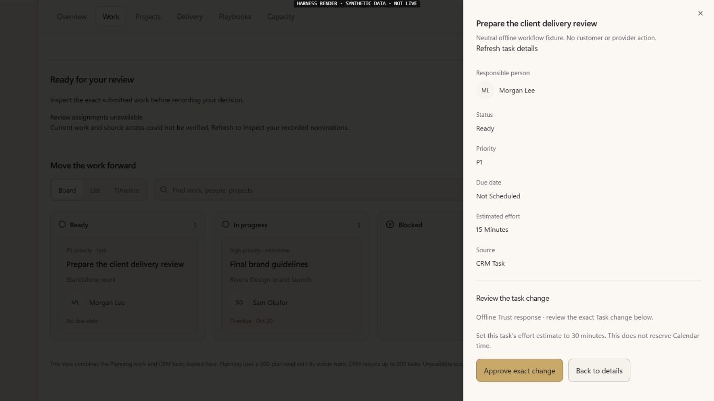
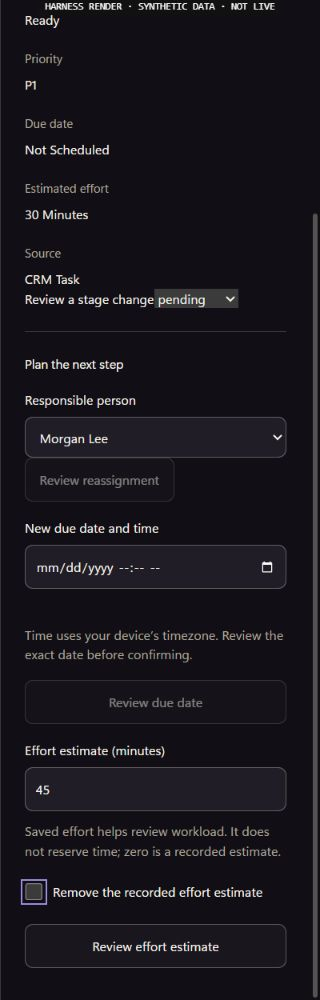

# EXP05 O02/O03 — correct saved Task effort through original Work

UI_DELIVERY_EVIDENCE_VERSION: 1
INTERNAL_BUILD_IDENTITY: source=933410a371d72dafef5a6625f9ed2f47f4fea66f; base=571f8aa84be2fdb1f089a3fc65c8e94ad1b613d4; deployment=offline-original-Operations-current-main-mount; environment=local; migrations=APPLIED(20271126050005_task_effort_scalar); edge=PROOF_OWED(selected-source certification for paige-ai-chat and notify-approval-event, crm-command matched571f); evidence=docs/evidence/ui-delivery/assets/exp05-task-effort/current-main/source-manifest.json
RELEASE_CHANNEL: development: local source and isolated browser/SQL fixtures only.
RELEASE_CLASSIFICATION: internal-only: one correction/save/reopen leg of O02/O03, not complete weekly planning or EXP05.
CUSTOMER_RELEASE_IDENTITY: none: no launch, activation or founder acceptance.
RELEASE_NOTE_REQUIRED: NO: original issue/PR are the unfinished increment's record.
RELEASE_TRUTH_BOUNDARY: PARTIAL: native producer3102 is merged571f and50005 applied/source-verified; current-main editor remains offline prepared, not production UI or authenticated proof. Full selected Edge verification failed and UI merge stays held.
RELEASE_RECOVERY: position=hold UI release for certified compatible Edge source; reference=original Task operation/key/version, CRM source reread and receipt; normal reviewed forward fix, never retry an unknown business write with a fresh operation.
FLOW_BY_FLOW: PASS: original Work → inspect Task → change whole-minute estimate or clear → review exact units → original Trust approval if required → original executor acknowledgement → independent original Work read → saved status; lost acknowledgement → reload → original recovery → readback.
PAIGE_UI_DESIGN: PASS: existing Task inspector, typography, tokens, gold action, native controls and focus ring. New effort input/review action are44px; clear uses an18px visual checkbox inside its44px label target. No new banner, tab, drawer engine or design system.
MATERIAL_FLOW_CHANGE: YES: durable effort correction, distinct from temporary workload estimates.
FLOW_PROTOTYPE: PASS: actual original OperationsWorkspace, editor, command consumer and review in the incumbent full Operations harness; only explicit source/Auth/transport ports are synthetic. No production test route.
PURPOSE_AUDIENCE_PRIMARY_ACTION: PASS: permitted SOLO owner/admin corrects one original Task estimate without overwriting unrelated metadata or reserving Calendar time.
VISUAL_DIRECTION: PASS: compact inline planning fields and exact review inside the existing inspector; original work remains visible behind its modal.
AUTOMATED_EVIDENCE: PASS:147 assertions/nine suites plus18 original focused-reader assertions/one suite,165 total in10 distinct files on current-main composition. Original denial, account switching, unavailable source, CAS/replay, zero/clear, widened proposals, independent readback and refusal focus retained; native component20/generator15 remain separate evidence.
STATIC_EVIDENCE: UNVERIFIED: actual tsconfig.app.json reports nine unchanged-file diagnostics and zero changed-path diagnostics. Empty root-solution tsc result is EXCLUDED. Diff/UTF8/focused lint are separate checks; hosted exact-lock CI remains required.
RENDERED_EVIDENCE: PASS: current-main/source-manifest.json binds126 actual product inputs, nine unchanged fixture sources, compiled assets and eight new1366x768/320x1000 frames. Team Hub changed paigePromptHandoff/workspaceLinks and added composer scope identity; the old composed graph is retained as historical, not borrowed. The prior invalid transition capture remains excluded.
BEHAVIORAL_EVIDENCE: PASS: current-main frames show original editor→exact30-minute review→offline approval→simulated save→full reload/reopen30; narrow keyboard reaches clear, zero stays0 minutes and clear explicitly removes the recorded estimate. Measured document widths equal1366/320. Original response-loss/recovery/refusal/role controls remain in tests and historical captures. All Auth/Trust/execution/read ports are synthetic, not native customer/receipt proof; only own test tab closed and viewport reset.
AUTHENTICATED_RUNTIME: UNVERIFIED: new effort write, original approval/receipt and later real read/reload require legitimate protected production verification after release. Parent3091 has separate bounded owner read-only proof in ANT-52/c8eeddbf; it does not prove this new writer.
KEYBOARD_FOCUS: PASS: native numeric entry/Tab reaches clear label; exact review/approval/recovery retain original controls. A real refusal focus loss was found and repaired: focus moves to Back to details after disabling the refused action. Original focus/retention assertions remain, with only their changed accessible-label selectors reconciled.
ZOOM_REFLOW: UNVERIFIED:320px reflow has no document overflow and new targets are44px; native200% zoom and screen-reader testing of this added flow remain owed. Parent native zoom is not borrowed.
REDUCED_MOTION: PASS: no new animation, timer or polling; original drawer motion retained.
STATE_COVERAGE: PASS: current165 assertions cover recorded/missing/zero/clear effort, invalid/unchanged values, permission loading/denial, stale record, review/approval/refusal, saved/reload and response-loss recovery plus scoped prompt/link regressions. Original absent-task/account-switch retention assertions remain intact; historical117/125 results are preserved separately.
TRUTHFUL_STATE_LABELS: PASS: effort is neither free time nor a Calendar reservation. Clear means unknown, not zero. Executor response alone never establishes saved Work; refused/unknown cannot become optimistic completion.
SOLO_UI: YES: one shared tenant-neutral Task/Operations implementation, no per-account condition, provisioning fork or Platform Operator change.
SOLO_1536X770_PAIGE_CLOSED: UNVERIFIED: full original shell at this size remains owed; current changed-path evidence is1280px plus320px original Operations mount.
SOLO_1536X770_PAIGE_OPEN: UNVERIFIED: this fixture's dock is inert; no actual1536px open-dock interaction was exercised.
SOLO_1366X768_PAIGE_CLOSED: UNVERIFIED: full-shell size remains owed.
SOLO_1366X768_PAIGE_OPEN: UNVERIFIED: original dock/inspector continuity remains owed.
SOLO_1024X768_PAIGE_CLOSED: UNVERIFIED: full-shell size remains owed.
SOLO_1024X768_PAIGE_OPEN: UNVERIFIED: original dock overlay/return remains owed.
SOLO_900X1000_PAIGE_CLOSED: UNVERIFIED: full-shell size remains owed.
SOLO_900X1000_PAIGE_OPEN: UNVERIFIED: original dock overlay/return remains owed.
UNVERIFIED: full selected Edge source certification, final editor review/exact-head CI and web deployment; authenticated exact approval/Task/Rail/reload, existing/new eligible SOLO cohorts and both chats; native zoom/AT, full-shell dock matrix and founder acceptance. Original225 native full-schema passed on producer3102; that does not prove editor or customer acceptance.
OWNER_INTENT: finish realistic weekly planning first, then bounded Automation Builder, monitoring and permitted proactive updates; retain full ten outcomes/E5-CV1–9 and one founder evaluation.
MUST_NOT_HAPPEN: whole metadata erased by a partial update, unknown effort converted to zero, stale/foreign actor or Task reuse, fresh-key replay after response loss, invented receipt/saved status, new approval/writer/ledger/scheduler, provider effect or held ZION activation.
MUST_PRESERVE: native service-only executor/ACL/OID, actor/tenant and record checks, raw Task version/CAS, exact stored command/Trust, original replay/receipt transaction, explicit metadata replacement semantics and all non-Task branches.
ACCEPTANCE_CRITERIA: approved effort change persists only its intended key, original metadata survives, the same scoped Task reopens with native effort and original receipt, invalid/denied/stale/replayed/uncertain cases remain safe; universal eligible SOLO behavior and both conversational consumers verified before full outcome closure.
MOTION_PURPOSE: none added.
PROTECTED_SEAMS: original CRM function is restated only for Task update; original generator derives its field. No Root, Chat host, Spine/risk registry, E04/E09 native functions, Calendar reader/writer or Team Hub implementation edit.

## Original execution and scope

The native producer is review checkpoint4ed8acc91. Nullable integer
`task.update.patch.estimated_minutes` changes only that key, preserving nested
metadata. Whole metadata replacement retains its prior explicit semantics;
combining it with scalar effort is refused. No applied migration changes.
Original ordering checkpoint was production09 with E04reserved10/E09tentative11.
That hold is now resolved in ANT161/51d8c74d/ea0882f6: published10/11 are merged
and production9/10/11eachONCE. Native12 is OPEN#3102/fdc313d21 with its managed
Preview now SUCCESS; required broad/database gates and native production release
remain separate. No applied history was rewritten and no production write was made.

Twenty isolated PostgreSQL16 checks execute the actual whole function, with
baseline refusal first, unchanged OID/ACL, set/clear/zero/bounds, malformed input
and source, stale version, replay and receipt-failure rollback. Peripheral
Auth/access/hash/receipt ports are explicit fixtures: not production Auth/RLS,
Trust, canonical Rail, full-schema or concurrent isolation proof. The original
governed CRM suite preserves194 assertions and adds31 (225 total); that full
schema suite remains UNRUN. Generator self-tests15/15 preserve all non-Task
function bytes and advertise the field only on Task update.

The UI sends one scalar patch through existing `crm-command`. It requires exact
native Task identity/field, internal-effect flags and version before acknowledgement,
then the original independent Work read before saved feedback. Stored recovery
remains same actor/tenant/Task/key/version and cannot mix stage and effort targets.
No browser metadata is authority.

## Capabilities and Algorithm Support

Existing `crm_update_task` and `crm_clients.task_read` remain the original producer
and reader. No static Spine write key was found; this is the existing legitimate
governed direct command, not a new Layer C integration. Catalogue/department
remain PARTIAL; native/tool support and actual displayed availability must be
verified together after release. No provider or specialist privilege is added.

ALG-01: local extension of exact-field readback and original-operation recovery;
real approval/Rail/reload proof owed. ALG-08: saved effort becomes one supported
weekly input, not a complete scheduling/dependency optimizer. ALG-13: unchanged
explainable weekly recommendation contract. ALG-02/03/11/12 and conditional
ALG-10 keep their original maturity/gaps; no new algorithm claimed.

## Evidence interpretation

Final PNG/JSON states in the manifest are synthetic only. One earlier
`light-narrow-refused.png` is excluded: it predates the refusal-focus correction.
The final `light-narrow-refused-final-focus` frame supersedes it. All other final
frames were recaptured after that source correction.18px checkbox geometry is
the glyph; checkbox-target.json records its44px interactive label.

Functional: LOCAL/NOT_MERGED/NOT_DEPLOYED. Visual: changed-path source rendering
and material focus/target correction verified; full-shell/native/AT gaps above.
Experiential: integrated native/customer proof still owed. Founder: NOT_ACCEPTED.

## October30 UTC composition and current rendered boundary

Original editor42b9259 normally merged exact native3102/fdc313d21 plus current
mainb696 to f5a5720d636d7774ea1c53ad2bf053aa1d98c196. One append/append packet
conflict was resolved by retaining BOTH complete dated sections. All45 original
editor/evidence leaves remain, with no incoming non-owned product loss. The
current seven original suites pass125 assertions, including focused read-scope
controls; no failed or skipped assertion. The deliberate synthetic department
failure output is an exercised error-boundary negative, not a failing test.

The composed original Operations fixture was rebuilt against125 actual product
inputs and nine disclosed source/transport/Auth/Trust fixture files. Its source
manifest explicitly lists five incoming changes since the earlier121-input
graph; the original fifteen screenshots are kept as historical83d97 evidence.
Seven valid new JPG/DOM records cover the actual original inspector, exact30
review, simulated approval/save, independent fixture reread/reload/reopen and
narrow keyboard/Cancel continuation. The clear-to-unknown wording was observed
in the actual accessibility state; its transition-time pixel capture was stale,
so that image is INVALID/excluded and is not visual proof of the clear review.
The earlier neutral source fixture and current125 cases retain clear controls.
No real approval, customer Task, server receipt or native Rail was created.

Actual viewport1366x768/320x1000, original dialog scroll owner and no document
overflow retained. New44px effort controls/label target and narrow keyboard focus
were observed; native200%/AT/complete SoloApp and actual PAIGE-open shell remain
UNVERIFIED. Local restricted-socket attempt was INVALID; the ordinary authorized
loopback helper then served correctly. Only own temporary tab closed, viewport
restored and helper stopped. No browser permission/security setting changed.
Exact native3102 and dependent UI review/CI/deployment remain controlling.

## October30 — forward-native dependency received without new UI changes

Original3151 editor normally receives currentmain3f37 and native3102/c5d0 to
e78ac4f56. One append/append packet conflict retains BOTH full dated sections.
Native filename is now50005 after the advanced production15/published E08 chain;
no unapplied older12 or --include-all is shipped. Current seven original suites
again125PASS/0FAIL/0skip. All11 original product/test paths,125 rendered product
inputs, nine fixture sources, package and lockfile are byte-identical to their
previously inspected versions; all18203 outside-owned incoming leaves conserved.
The same seven composed frames therefore retain their actual original synthetic
boundary without recapturing unchanged pixels or claiming a new customer test.
[Exact conservation](assets/exp05-task-effort/composed/forward-conservation.json).

Native replacement managed Preview is SUCCESS; forward50005ONCE/old12ABSENT,
actual body MD5caea59ab335ecaf295391c41a1a0522f and original service-onlyACL match.
Whole required native CI and production migration/Edge readback remain separate.
Original UI draft3103 cannot merge into its temporary native feature base. Final
main retarget/review/exact-head CI follows producer release; original real
approval/Task/Rail/reload, eligible existing/new SOLO, both chats/full shell/
native zoom/AT/fullten/E5/founder acceptance remain owed. No activation or action.

## October30 — native release received, current-main editor reverified

Producer3102 merged571f8aa84be2fdb1f089a3fc65c8e94ad1b613d4 after all13 exact
checks and both web statuses. Normal migration41098303945 succeeded; actual
production50005 is recorded once and original executorOID289875/bodycaea59ab
with unchanged owner/security/settings/privateACL is read back. Vercel exact571f
is READY at dpl_6aXvXVrfzYCcVtGVxTHqdr9RTHrF. Those are native/source receipts,
not this editor's production or authenticated result.

Normal current-main composition is933410a371d72dafef5a6625f9ed2f47f4fea66f.
All11 original product/test blobs remain exact. The126-input graph now contains
Team Hub's changed paigePromptHandoff/workspaceLinks plus original shared composer
scope identity; it was rebuilt instead of borrowing stale125-input evidence.
All nine fixture sources remain exact. Actual147/nine plus18/one focused-reader
tests PASS (165 assertions in10 distinct files). Eight new local frames cover
1366x768/320x1000 editor, exact30 review, offline approval, simulated save,
reload/reopen30, narrow keyboard, zero and clear-as-unknown. No business data,
provider, real approval or original Rail was created; fixture transport guards
remain active. Temporary viewport reset, own tab closed and helper stopped.

Normal Edge41098303978 uploaded its selected functions but failed strict source
verification for notify-approval-event/canonical-app-url and paige-ai-chat's
generated Task patch schema; crm-command itself matched. Original failed report
is retained, certified edge-live did not advance. A single existing failed-job
recovery is pending; UI merge remains held for certified compatible source.
No broad source/runtime edit or relaxed verifier. Hosted editor exact-head CI,
authenticated record/approval/Rail/reload, full-shell/native zoom/AT, both chats,
eligible current/new cohorts and full EXP05/founder acceptance remain owed.
