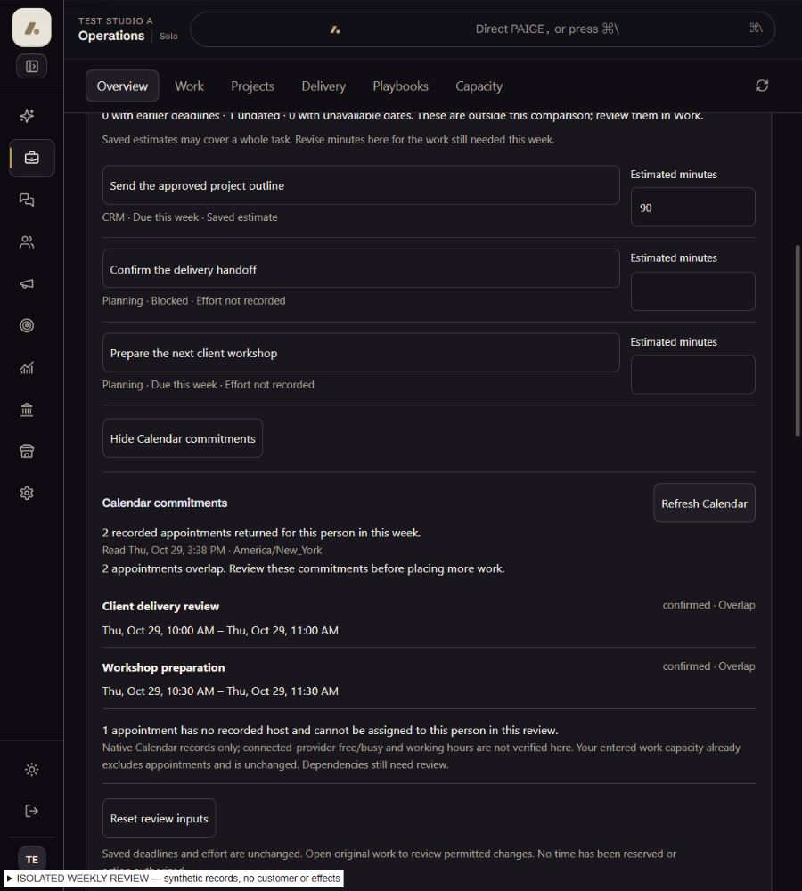
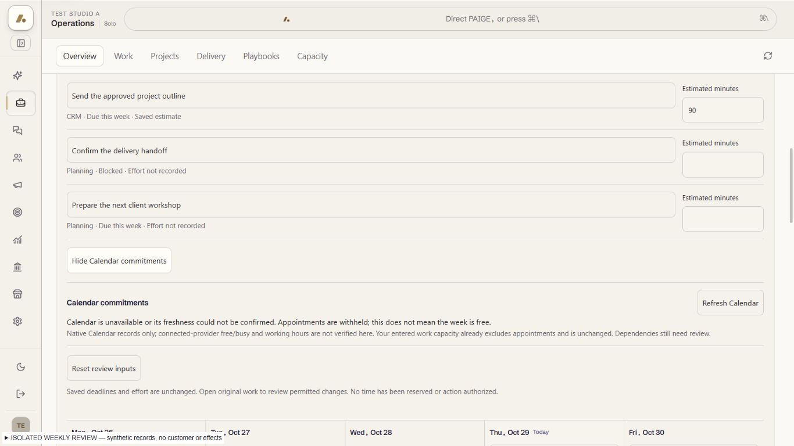

# EXP05 O02 — review Calendar commitments alongside weekly workload

UI_DELIVERY_EVIDENCE_VERSION: 1
INTERNAL_BUILD_IDENTITY: source=ebb0fc7e6cc311b0fdbd97e42ee4477c0bd2642e parent plus exact candidate input hashes in the manifest; deployment=isolated-weekly-calendar-bundle; environment=local; migrations=NOT_APPLICABLE; edge=NOT_APPLICABLE; evidence=docs/evidence/ui-delivery/assets/exp05-weekly-calendar/build-manifest.json. Final candidate SHA and exact-head review/CI are recorded on its PR.
RELEASE_CHANNEL: development: original Operations shell and Calendar hooks with explicitly synthetic transport ports, exact hashes and rendered evidence.
RELEASE_CLASSIFICATION: internal-only: coherent read/review increment within the unfinished EXP05 Experience.
CUSTOMER_RELEASE_IDENTITY: none: no complete Experience launch, authenticated customer acceptance or founder acceptance claimed.
RELEASE_NOTE_REQUIRED: NO: original PR and ANT-11 retain the engineering/release and remaining acceptance record.
RELEASE_TRUTH_BOUNDARY: PARTIAL: mounted Calendar evidence in the weekly workload review, not a feasible saved schedule or full O02 completion.
RELEASE_RECOVERY: position=withhold unavailable or stale Calendar results and use the original retry; reference=original Calendar bookings, never a repeated business effect.
FLOW_BY_FLOW: PASS: week → review workload → select current person → explicitly check Calendar → inspect recorded times/overlaps/freshness → refresh or hide → continue the same review. Person/week/business/source change or reload discards the private review.
PAIGE_UI_DESIGN: PASS: original Operations tokens, compact heading, native 44px controls, inline evidence and no new banner/tab. Applied installed Flow-by-Flow, Paige UI Design, Flow Prototype, Impeccable and React guidance.
MATERIAL_FLOW_CHANGE: YES: explicit native Calendar read, unavailable/freshness/retry and review-reentry states.
FLOW_PROTOTYPE: PASS: actual framework-native full-shell interactive fixture with original useSoloCalendar/useRealtimeTable and explicit offline native transport ports; owner-approved Operations design authority retained.
PURPOSE_AUDIENCE_PRIMARY_ACTION: PASS: eligible SOLO actor compares genuine native appointments for the selected person/business week with already-visible Work before revising the plan.
VISUAL_DIRECTION: PASS: compact appointment evidence follows workload estimates; exact titles, status, business-zone times and overlaps replace any decorative activity or fictional availability.
AUTOMATED_EVIDENCE: PASS: 105 focused assertions across eight weekly/workload/native Work suites, including15 new Calendar assertions. Positive/refusal/stale/retry/reset, exact-host filtering, exclusive midnight boundaries, DST/distant device zones, multi-day appointments and malformed times covered. Focused ESLint zero diagnostics.
STATIC_EVIDENCE: UNVERIFIED: required hosted exact-lock checks remain separate. The first local compile found one test parameter narrowing error, corrected without changing product contracts; the existing locked local runtime also reports nine diagnostics in unchanged files, including optional LiveRoom dependencies. Full-repository compile is not claimed green.
RENDERED_EVIDENCE: PASS: actual current SoloApp/Operations/Week and ORIGINAL Calendar hooks;397 product input hashes,192 explicit ports in build-manifest.json. Sixteen theme/viewport/PAIGE combinations plus four narrow reentry frames in rendered-matrix.json. Native transport/Auth/Work/roster/Chat are synthetic, never authenticated proof.
BEHAVIORAL_EVIDENCE: PASS: actual original-hook refusal → restored fixture source → native retry; stale subscription withholds appointments; second neutral business drops original appointment/input state; reload requires a new explicit read. Source/recovery JSON and screenshots in the same evidence directory.
AUTHENTICATED_RUNTIME: UNVERIFIED: ordinary customer Calendar read/current permission, real account/actor switching, and integrated Chat/Team Hub planning-save/reopen remain owed.
KEYBOARD_FOCUS: PASS: Check/Hide is the same retained button, so an explicit read does not discard focus; original native controls and Refresh → Tab → Reset retain visible44px focus targets. Native label/status and aria-expanded states are present.
ZOOM_REFLOW: UNVERIFIED: new Calendar content reflows at requested521x357 (actual522x358) without document overflow and keyboard reaches Reset; this is viewport proof, NOT native zoom. The native window observation did not match the local QA tab, so no native keys were sent or customer zoom changed. Parent workload's separately recorded native200% proof remains historical; new-flow native200% and assistive technology are still owed.
REDUCED_MOTION: PASS: no new animation, polling timer or motion. Original Calendar subscription/debounce/retry reused.
STATE_COVERAGE: PASS: explicit unread/loading/ready/empty/error/stale/unconfirmed/out-of-range, per-host/unassigned/unreadable/overlap, retry failure/success, hide and person/week/tenant/source/reload resets. Missing business-zone/roster remain withheld by original week/review contracts.
TRUTHFUL_STATE_LABELS: PASS: returned native appointments and last successful read only; no free week, external free/busy, working-hours, feasible schedule, approval, execution or Rail completion inferred. Entered net capacity is not reduced a second time.
SOLO_UI: YES: tenant-neutral shared implementation using original resolved business scope and caller-JWT Calendar authority; no account allowlist or Platform Operator path.
SOLO_1536X770_PAIGE_CLOSED: PASS: actual light/dark frames and document width1536 in rendered-matrix.json.
SOLO_1536X770_PAIGE_OPEN: PASS: original split workspace and same Calendar review; both themes, original inert Chat port.
SOLO_1366X768_PAIGE_CLOSED: PASS: both themes and document width1366; native44px Refresh retained.
SOLO_1366X768_PAIGE_OPEN: PASS: same review in the narrower original Operations column, both themes and no document overflow.
SOLO_1024X768_PAIGE_CLOSED: PASS: both themes and document width1024.
SOLO_1024X768_PAIGE_OPEN: PASS: original overlay captured; Calendar is inspected after folding and exact review resumes. Overlay geometry is not simultaneous interaction proof.
SOLO_900X1000_PAIGE_CLOSED: PASS: both themes and document width900, readable stacked appointment rows.
SOLO_900X1000_PAIGE_OPEN: PASS: original overlay and subsequent Calendar reentry captured separately in both themes; no new overlay implementation.
UNVERIFIED: native200% new-flow/assistive-technology/customer permission/provider evidence; working availability/dependencies/feasible plan alternatives; canonical correction/save/reopen and both-chat ZION continuity; production source release; complete ten-outcome/E5/founder acceptance.
OWNER_INTENT: complete O02 realistic weekly planning first, followed by O05 multi-step Builder, O07 monitoring and O09 permitted proactive updates; retain all original outcomes and one integrated founder evaluation.
MUST_NOT_HAPPEN: automatic Calendar read before request, another person's appointments, stale rows presented as current, zero-appointments-as-free-time, double-subtracted capacity, booking writes/provider effects or another scheduler/reader/ledger.
MUST_PRESERVE: unchanged canonical Calendar hook/RPC/class folding/freshness/realtime/conflict detector, original Work/Planning/roster/tenant scope, native writers, Trust and release gates.
ACCEPTANCE_CRITERIA: correct selected person's native business-week appointments and actual overlaps; refusal/staleness withhold retained rows; retry recovers through original hook; source/scope/reload invalidates review; saved capacity/work/bookings remain unchanged.
MOTION_PURPOSE: no new motion; original disclosure and asynchronous read feedback preserve context.
PROTECTED_SEAMS: no shared Calendar source, Root, agent-turn, native SQL, E04 ZION observation ABI, Team Hub, capability resolver, provider readiness or execution-writer edits.

## Reuse, flow and proof boundary

REUSE: useSoloCalendar("agenda") → caller-JWT list_team_bookings, original
class-seat folding, useRealtimeTable, lastSyncedAt/stale/retry and findConflicts.
EXTEND: original OperationsWeek workload review with an explicit read and hide.
REPAIR: no shared Calendar signature change was needed; proposed extension was
withdrawn in ANT-161/7d8fa7e9 after finding the sufficient original14-day contract.
NEW: bounded business-week presentation/filter and small mounted consumer only.

The read cursor gives the original agenda margin around the selected business
week. Actual device-local read bounds must cover both ends of the business-zone
week; otherwise the request is withheld. End instants are exclusive. The
business-zone projection never substitutes device-local or offset-free times.
Original host identity determines whose records are shown; missing host/times
remain explicit gaps. Cancelled/no-show records do not occupy time.

No booking, task, approval, provider or model request is created. No time is
reserved. Review capacity is already net of appointments and remains unchanged.

## Orchestration Contract / Algorithm Support / catalogue synchronization

Entry/original record: existing Operations weekly review and native booking
identity/title/start/end/status/host. Capability: original calendar.agenda_read
(read_calendar_agenda, PARTIAL), alongside original planning.list/native CRM Work.
The UI consumes the unchanged original Calendar hook, not a second Spine reader.
Actor/business permission: original resolved tenant and caller-JWT RPC. No new
ActionAdapter, MUTATION_VERB, Trust lane, approval/budget, delegation or Layer C
dispatch. Original read subscription/retry only; no durable job or new store.
Readback: last successful native read; unavailable/uncertain freshness withheld.
Execution/Rail: not applicable to this read; no business completion claim.

ALG-08 remains PARTIAL: native Calendar commitments/recorded conflicts now inform
the workload review, while actual working availability, dependencies and feasible
placement remain unfinished. ALG-01 reuses original load/refresh sequencing and
context resets without an effect retry. ALG-13 offers the bounded permitted next
step of checking conflicting commitments/missing facts. ALG-02/03/11/12 and ALG-10
retain original contracts; no new scoring/model/anomaly/notification engine.

Capacity Review, Weekly Priorities Plan and Task Prioritization Review keep their
original bounded review/draft catalogue entries. This UI-only native evidence
adds no Chat tool, connection readiness, Live activation or capability promotion.
operations.department remains PROOF_OWED. No global panel resolver or provider
registry edit; full Chat catalogue/current-actor runtime verification remains due.

## Rendered and review evidence

Source input hashes and explicit synthetic transport boundaries are in the
manifest. The sixteen source-bound frames, native-hook refusal/recovery, stale
subscription, neutral context/reload and narrow keyboard records are engineering
proof only. No test business, Auth identity, customer data or effect was created.

Impeccable: https://github.com/pbakaus/impeccable/blob/main/.claude/skills/impeccable/SKILL.md
Pinned4.1.0 detection: zero anti-patterns; four existing week-shell radius/type
advisories retained, no suppression or gate waiver. Finish review covers compact
hierarchy, reflow, focus, truthful failure and original-system continuity.

Separate sequential review is labeled AUTHOR-REVIEW / LOWER ASSURANCE. Exact
review/CI/merge/deployment/readback/authenticated/founder states remain separate
on the original PR and ANT-11. No full O02 or Experience closure follows here.
