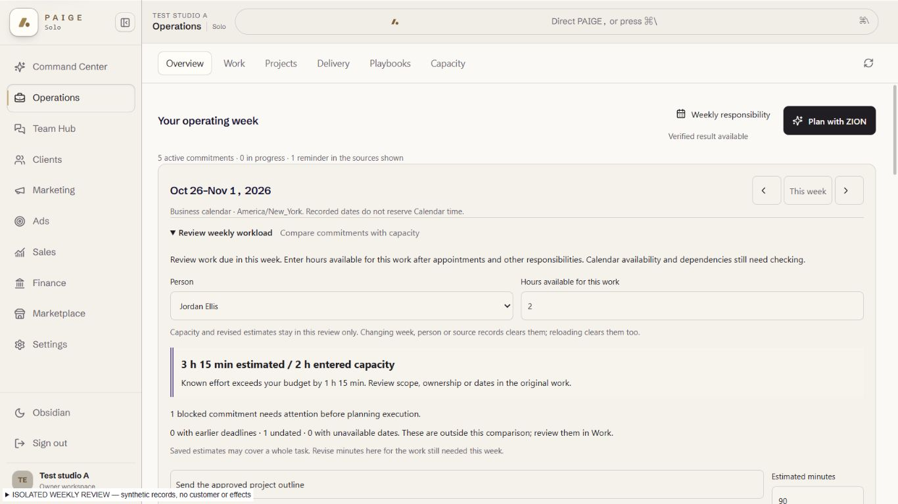
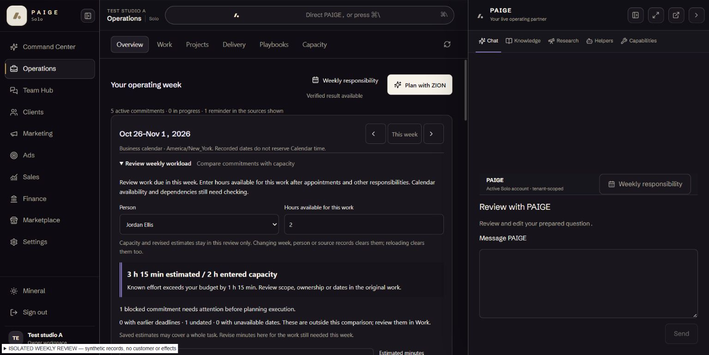

# EXP05 O02 — review a real week's workload

UI_DELIVERY_EVIDENCE_VERSION: 1
INTERNAL_BUILD_IDENTITY: source=848e2784d781ed1f617dbb028e21b48346cec851; base=1044576a7471c33dfb29f16fc420943e884e82e9; deployment=local-weekly-workload-bundle; environment=local; migrations=NOT_APPLICABLE; edge=NOT_APPLICABLE; evidence=docs/evidence/ui-delivery/assets/exp05-weekly-workload/build-manifest.json. Exact final head/review/CI recorded on the original PR.
RELEASE_CHANNEL: development: actual local isolated shell and source hashes in the build manifest; ordinary production release still requires hosted exact-head checks.
RELEASE_CLASSIFICATION: internal-only: one useful capacity-review increment of the complete EXP05 assignment.
CUSTOMER_RELEASE_IDENTITY: none: no customer launch, authenticated acceptance or founder acceptance claimed.
RELEASE_NOTE_REQUIRED: NO: source/PR and original ANT-11 remain the release record for this unfinished Experience.
RELEASE_TRUTH_BOUNDARY: PARTIAL: mounted client-side workload review, focused tests and actual rendered source with explicitly synthetic ports; full O02 and EXP05 remain unfinished.
RELEASE_RECOVERY: position=hold candidate when required checks fail; reference=original Work/Planning record and native inspector, never repeat an uncertain business effect.
FLOW_BY_FLOW: PASS: original week → expand review → choose current roster member → enter net available hours → inspect known/missing effort → correct temporary estimates → open original work or reset. No saved changes or scheduling occur in the review.
PAIGE_UI_DESIGN: PASS: established Operations tokens, compact headings, inline disclosure, native inputs and original inspection actions. Applied installed Flow-by-Flow, Paige UI Design, Flow Prototype, Impeccable and React review guidance.
MATERIAL_FLOW_CHANGE: YES: adds a bounded what-if review, correction and reset path to the existing week.
FLOW_PROTOTYPE: PASS: framework-native, isolated full-shell interactive fixture and state map below; owner-approved Operations design authority continues, no additional founder increment signoff. No production test route or fixture is mounted.
PURPOSE_AUDIENCE_PRIMARY_ACTION: PASS: eligible SOLO actor reviews one actual teammate's dated commitments against explicitly entered remaining capacity and opens the exact original work to correct permitted fields.
VISUAL_DIRECTION: PASS: compact operating workspace; result and next decision precede editable estimates, without a new banner, tab, dashboard or design system.
AUTOMATED_EVIDENCE: PASS: 92 assertions across original week/projection/Overview/native Work/Capacity and the new workload model/actual mounted component; focused ESLint zero diagnostics. Original-record identities, per-person/native-key separation, unknown effort, invalid input, excess budget, DST/week boundaries and tenant/source/reload resets covered.
STATIC_EVIDENCE: UNVERIFIED: full local TypeScript reports nine diagnostics in unchanged files (including missing optional LiveRoom packages), none in changed files after correcting Object.hasOwn target compatibility. Diff check and focused ESLint pass. That local compile is not a green full-repository check; required hosted exact-lock CI remains a separate gate.
RENDERED_EVIDENCE: PASS: actual current SoloApp/OperationsWorkspace/Overview/Week and candidate review, 394 product input hashes in build-manifest.json. Sixteen final-source screenshots and DOM geometry in assets/exp05-weekly-workload/rendered-matrix.json; both themes, all required shell widths, PAIGE closed/open. Source/Auth/roster/Chat transport ports are synthetic and explicitly labeled.
BEHAVIORAL_EVIDENCE: PASS: actual browser correction/excess result, keyboard stepper and tab focus, invalid-minute correction, reset, private source-change invalidation, second neutral context and narrow PAIGE folding/reentry. Owning component tests additionally cover source versions/effort/title/roster changes and reload. No production Auth, RLS or business mutation proof claimed.
AUTHENTICATED_RUNTIME: UNVERIFIED: existing signed-in customer/both-chat/native permission and full planning-save/reopen proof remain owed; synthetic context transitions are not tenant-isolation acceptance.
KEYBOARD_FOCUS: PASS: native summary opens with Enter, native selection and number stepper work; Tab moves to original work and shows the existing focus ring. Validation uses aria-invalid and an associated error; status announces the comparison without moving focus.
ZOOM_REFLOW: PASS: actual Windows Chrome native200% zoom in the confirmed local QA tab, both themes/PAIGE closed-open; native Zoom:200% and DPR2.5 versus OS-scale1.25 confirmed (visual scale1, no emulation). CSS viewport521x357/document width521,44px inputs; keyboard reaches Reset in view and exact original task inspection/Escape return preserves review. Normal100% restored. Native JSON/five page-only screenshots in assets/exp05-weekly-workload/native-200-*. Assistive-technology screen-reader testing remains UNVERIFIED.
REDUCED_MOTION: PASS: no new animation, timer or motion; original shell behavior retained.
STATE_COVERAGE: PASS: no person, no roster, no dated work, missing/invalid capacity, known/unknown/invalid/revised effort, blocked work, excess/within-entered-budget, prior/undated/unreadable dates, reset, changed source/person/week/business and reload. Existing unverified business-zone states withhold the review.
TRUTHFUL_STATE_LABELS: PASS: saved versus review estimate, entered capacity, known effort and missing estimates remain distinct. A within-budget estimate never asserts a feasible schedule, Calendar availability, completed work or authorization.
SOLO_UI: YES: one shared tenant-neutral Operations implementation; no account allowlist, example-account product condition or Platform Operator change.
SOLO_1536X770_PAIGE_CLOSED: PASS: final rendered light/dark screenshots and JSON geometry in assets/exp05-weekly-workload/*-1536-closed.*; document width1536.
SOLO_1536X770_PAIGE_OPEN: PASS: actual original split workspace with final candidate; light/dark *-1536-open.*; original PAIGE body is an explicit inert port.
SOLO_1366X768_PAIGE_CLOSED: PASS: final light/dark *-1366-closed.*; document width1366 and44px inputs.
SOLO_1366X768_PAIGE_OPEN: PASS: final light/dark *-1366-open.*; narrower original Operations column, no document overflow.
SOLO_1024X768_PAIGE_CLOSED: PASS: final light/dark *-1024-closed.*; document width1024.
SOLO_1024X768_PAIGE_OPEN: PASS: original PAIGE overlay and protected underlying workspace captured; folding PAIGE resumes the review. Underlying geometry is not simultaneous interaction proof.
SOLO_900X1000_PAIGE_CLOSED: PASS: final light/dark *-900-closed.*; document width900.
SOLO_900X1000_PAIGE_OPEN: PASS: original PAIGE overlay in both themes, original fold/reentry preserves the review; no new overlay implementation.
UNVERIFIED: assistive-technology screen-reader testing; real customer/role/provider/Calendar availability; exact remaining task effort; canonical dependency graph; automatic time placement; saved capacity or reviewed-plan resume; full Chat/Team Hub ZION handoff; production source release; ten-outcome/E5 closure and founder acceptance.
OWNER_INTENT: deliver the complete Operations Experience in focused coherent releases; owner tests the whole Experience once. First close weekly planning, then builder, monitoring and proactive information.
MUST_NOT_HAPPEN: inferred40-hour capacity, task-count-as-effort, another person's budget, automatic save/approval/scheduling, stale review reuse, provider effect or a new availability/scheduler/ledger service.
MUST_PRESERVE: original Planning/CRM/roster readers, actor/tenant-keyed Operations, business-calendar/DST interpretation, native inspectors/writers, review and required CI.
ACCEPTANCE_CRITERIA: original dated work/owner/effort remains inspectable; correcting a review immediately changes only its comparison; missing facts remain unknown; source/scope changes discard the temporary review; original saved work remains unchanged.
MOTION_PURPOSE: no new motion; native disclosure preserves context.
PROTECTED_SEAMS: no Root, agent-turn, native SQL, E04 observation ABI, Team Hub, global catalogue resolver, connection readiness, Trust, Layer C or shared writer changes.

## Flow and source ownership

Reservation: ANT-161/7d8fa7e9-1720-4107-83ae-0165e18b4ab0, with owner order in
ANT-11/d3b7063f. Current main1044576a and active E04/E09/EXP08 PRs inspected.
E04 owns the separate ZION source-observation/native contract; #3087 stays frozen.
This UI-only work proceeds independently and does not claim that dependency fixed.

REUSE: original authorized Work, roster, dates, estimates, same native inspectors,
business-week projection and SOLO shell. EXTEND: existing Overview → Work week
with a collapsed review. NEW: deterministic view calculation and temporary input
state only. No second canonical plan, task, capacity store, scheduler or reader.

State map: withheld calendar → original recovery, no review; ready → collapsed
review → selected current person → known/unknown estimate comparison; corrected
inputs → recalculation; inspect → original record/writer, not a bulk apply;
Reset → original saved estimates; source/person/week/context change or reload →
new empty review. Closing/reopening the same disclosure retains its local inputs.
No async execution/approval/completion states are invented for this read-only flow.

## Orchestration Contract / Algorithm Support

Entry/original record: existing Overview Work week and original PlanItem/CRM task.
Capability: existing planning.list plus native CRM/roster reads; no new capability
or ActionAdapter. Actor/tenant and read permissions are inherited from original
Operations readers and scope fences, never from review input. Effect/risk:
read-only; no MUTATION_VERB, Trust grant, new budget authority or durable job.
Execution/readback/Rail: N/A for this comparison. Exact original inspection is the
only path to existing governed changes and their own results/receipts.

ALG-08: PARTIAL capacity constraint review using explicit owner input and recorded
dates/effort, with blocked and excluded work disclosed. No optimization engine,
time-slot feasibility or dependency implementation claimed. ALG-13: bounded next
permitted step (inspect original scope/owner/date or confirm missing facts), not a
new ranking/scoring engine. ALG-01: no write/retry here; native identity is retained
and stale inputs reset. ALG-02/03/11/12: unchanged original contracts; no extra
model, metric, first-value or anomaly system. No provider/integration registry
entry or activation required. Harness A/G inherited; Layer C intentionally untouched.

Capabilities synchronization: original Capacity Review, Weekly Priorities Plan and
Task Prioritization Review remain existing bounded review/draft catalogue entries
(original operations_process seed20260907000000). This native UI-only comparison
adds no model tool, connection readiness or changed Chat availability. No Live
promotion or global catalogue source edit; exact Chat catalogue/runtime remains
separate integrated proof. operations.department stays PROOF_OWED.

## Evidence and review boundaries

Source manifest, rendered matrix, source/scope recovery and keyboard-validation
records are neutral offline engineering evidence. The shell, consumer and model
are actual source; read/Auth/context/Chat ports are explicit synthetic boundaries.
No customer record, role, provider, grant, effect or Rail receipt was created.
Impeccable guidance: https://github.com/pbakaus/impeccable/blob/main/.claude/skills/impeccable/SKILL.md

Review is a separate sequential AUTHOR-REVIEW / LOWER ASSURANCE pass; no new
review agent and no claim of non-author independence. Hosted exact-head checks,
merge, deployment readback, authenticated verification and owner acceptance are
separate states on the original PR/ANT-11. O02 still owes genuine Calendar and
dependency integration, feasible alternatives, authorized correction/save/reopen
and useful follow-through; O05/O07/O09 and all original acceptance remain open.

## Required design-check correction — October 29

Exact-head verify at 0afbb reported the pinned Impeccable 4.1.0 side-tab findings
on the comparison panel's heavy left border. The release stayed held. Replaced
that accent with a subtle full perimeter; over-budget remains explicit in text
and a dashed perimeter. No workload, authority, input or navigation logic changed.
The same pinned scanner now reports zero anti-patterns; four advisory notes remain
on the existing week shell's literal radius/type values, without a gate override.

Actual untransformed parent source rebuilt with the same neutral ports:
quiet-panel-build-manifest.json records the new CSS hash. The three quiet-panel
screenshots cover Mineral/Obsidian at 1366×768 and Obsidian at 900×1000, both excess
and within-budget states. Document widths match the viewports; keyboard focus
still reaches the original task inspector. The earlier native 200% and complete
interaction evidence remain scoped to their recorded source; this correction
changes only two border rules. Fresh exact-final-head CI is still required.

## Native zoom review correction

Automated review5703247947 correctly required native200% proof; the original
390px check was insufficient. Completed that exact check in the confirmed local
QA browser after the owner brought the QA tab into view. Native Chrome shortcuts
and its actual200% control establish the zoom; no fabricated/emulated substitute.
Comparison correction, original-task inspection, Escape/focus return, PAIGE
overlay/fold/reentry and Reset keyboard reachability pass without clipping or
horizontal document overflow. No customer account or provider was used.
The earlier unsafe full-window capture request was rejected; no private-page
image is recorded. Only confirmed local QA page screenshots are included.
Source files remain byte-identical to reviewed48a47bf8; this correction adds
missing evidence and does not rewrite the original review or runtime history.
