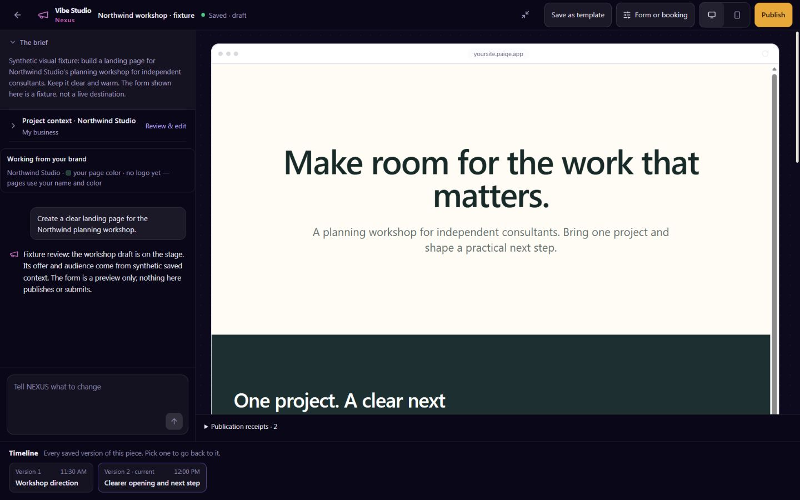
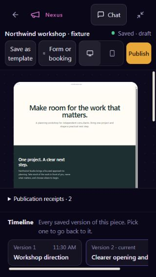
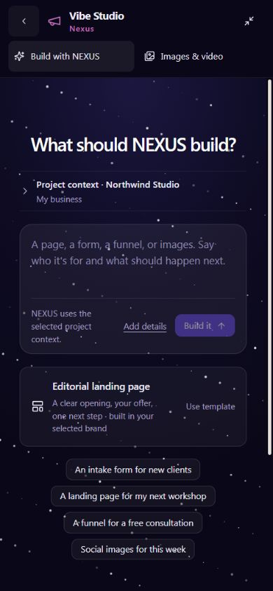
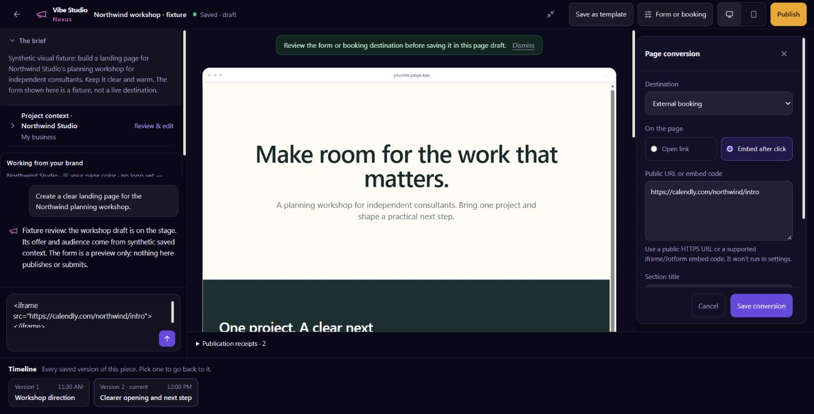
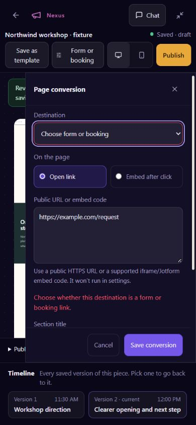
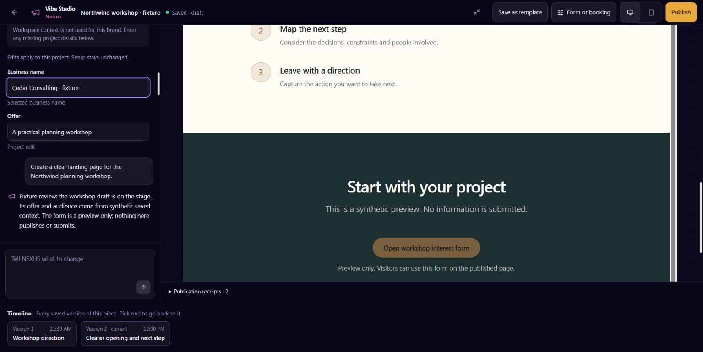
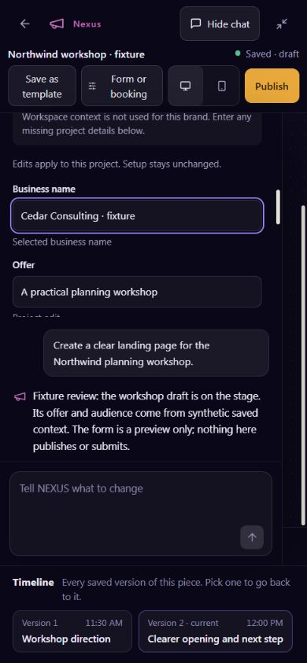

# UI delivery evidence: NEXUS landing page and continuous Studio window

UI_DELIVERY_EVIDENCE_VERSION: 1
FLOW_BY_FLOW: PASS: Owner outcome, source inventory, ten routing answers, state map and protected seams below were recorded before product edits.
PAIGE_UI_DESIGN: PASS: Project router, five modules, pinned frontend/accessibility references, Flow Prototype and Impeccable 4.3.1 were read; current owner prelaunch release method controls.
MATERIAL_FLOW_CHANGE: YES: Chat/Hub entry, saved target context, continued editing, minimize/reopen and conversion choices join the original Studio project and publication path.
FLOW_PROTOTYPE: UNVERIFIED: No new interactive prototype has been driven. Owner ANT147/85dc8dd1 and ANT162/9408cd6f authorize this specified continuation through engineering review/CI, safe release and live verification without a prototype or preview-login gate.
PURPOSE_AUDIENCE_PRIMARY_ACTION: PASS: An eligible SOLO owner/admin asks for one landing page, works with NEXUS in one recoverable Studio project and approves its exact public version.
VISUAL_DIRECTION: PASS: Extend existing ink Studio layout C, lit tenant-branded artifact, violet selection and gold publication acts. Reuse the canonical NEXUS glyph/tokens; preserve the working canvas and original versions.
AUTOMATED_EVIDENCE: PASS: At5e336af1 the complete local Studio run passes983 tests across43 suites, with independent focused251/83/8 runs kept separate. The unchanged original full-handler command now passes1280 checks after correcting its named Studio fixtures; its seven original failures and diagnostic crash remain recorded. Current isolated native and historical frozen proof scopes are recorded below. Full-schema SQL/HTTP and required hosted checks remain owed; overlapping totals are not summed.
STATIC_EVIDENCE: PASS: Exact5e336af1 production build and canonical type ratchet pass (baseline10/current6/no new errors); scoped changed UI/shared-source lint passes. Direct Edge checking removed three owned SDK-annotation diagnostics; the unchanged original growth-forms.ts75 optional-options diagnostic remains, so a complete direct Edge PASS is not claimed. Final required hosted checks and source-renewal review remain owed; no baseline or assertion relaxation.
RENDERED_EVIDENCE: PASS: Actual Studio components rendered in an isolated local fixture at 1440x900, 1528x778, 390x844 and 320x568. Fresh independent Impeccable verdict cleared its four corrections after seven replacement captures. These are synthetic frames, not the authenticated SOLO shell.
BEHAVIORAL_EVIDENCE: UNVERIFIED: Local real-browser minimize/restore retained the same mounted window and unsent text; local context/conversion controls were exercised. Actual Chat/Hub entry, persistence and complete customer behavior remain owed.
AUTHENTICATED_RUNTIME: UNVERIFIED: The new landing-page/window outcome has not been executed on production. The preceding separate native PAGE test is preserved as dated evidence, never replayed.
KEYBOARD_FOCUS: UNVERIFIED: Local mounted/inert behavior and unit focus controls pass; authenticated source-focus return and complete keyboard/zoom paths remain owed.
ZOOM_REFLOW: UNVERIFIED: Local responsive frames cover 320/390/1440/1528 widths; complete SOLO-shell zoom/reflow remains owed.
REDUCED_MOTION: UNVERIFIED: Approved short NEXUS arrival is planned; input must remain usable and routine restore must not replay it.
STATE_COVERAGE: UNVERIFIED: The mapped states below are requirements, not executed proof.
TRUTHFUL_STATE_LABELS: PASS: Current source gaps and all new runtime claims are explicitly unverified; no connection, external submission, booking or full EXP06 completion is inferred.
SOLO_UI: YES: The one canonical Studio host and all equally eligible current/future SOLO workspaces.
UNVERIFIED: Final fixture review, full-schema SQL/HTTP, final exact-head CI, native/Edge/web release identities, live useful page/receipt/reopen and owner acceptance remain owed. Pre-renewal NON-AUTHOR review is a source checkpoint, not release or whole-outcome clearance.

OWNER_INTENT: Owner ANT147/85dc8dd1 resumes the already-approved ANT162/9408cd6f single NEXUS landing-page/window outcome: PAIGE coordinates, actual original NEXUS uses permitted target-specific saved context, asks only material unanswered design questions, builds/revises one quality page in the same minimizable Studio project/version lineage and returns the authorized public URL and original receipt. Support native PAIGE form/calendar and supported external form/calendar URL/HTML/embed input, original CRM routing/tags/segments and approved NEXUS arrival/identity.
MUST_NOT_HAPPEN: No replay of the completed publishing test; generic repeated intake; false NEXUS labels over another runtime; client/prospect/workspace brand mixing; private/secret material in public copy; arbitrary executable HTML; duplicate project/page/receipt after unknown or reopen; silent publication or booking; provider activation; another Studio, scheduler, CRM writer, memory, approval queue or permanent agent.
MUST_PRESERVE: Existing session/thread/artifact/version writers, publish door and stale-content binding, owner/admin authorization and server-resolved tenant, private Hub follow-up, original Chat/document/CRM results, current models and metering, existing media/templates/export behavior, tenant-owned brand and original matrix IDs/denominators.
ACCEPTANCE_CRITERIA: Start through Chat and private Hub using an original source-backed project reference; edit and continue in the same window; minimize/restore/full reload without regeneration; show editable sourced target context and only missing design questions; build a polished real page with the four supported conversion choices; native intake uses original routing/tags/segments; approve exact version/address through the original door; verify public content, original receipt and same project/version reopen; test refusal, stale/unknown/cancel and tenant/role negatives; report/STOP with full EXP06 still open.
MOTION_PURPOSE: A short, once-per-arrival transform/opacity transition connects the existing NEXUS mark to its persistent Studio position. No blocking splash, loading theater, repeated restore animation or layout shift; reduced motion uses immediate placement.
PROTECTED_SEAMS: AFFECTED: tenant/client/target isolation, authority/Spine, canonical writes/readback, receipts/private context, Chat/Hub source references and minimize/history, URL/embed/privacy boundaries, recovery/idempotency, responsive geometry and accessibility. Tests and live evidence must cover each. NOT AFFECTED: authentication/account-choice implementation, signup/paywall/billing/provisioning writers, Live audio/session state, Secure Browser execution, raw Vault/credential stores, provider connection activation, external sends/payments and recurring scheduling. Their authority and existing contracts remain unchanged.

INTERNAL_BUILD_IDENTITY: 92772ca8fdd60a3cf666036427c6dda0c7b96a9b; current-main source composition after reviewed typed Root3a138400 and native guard84de4b7, with finite second source renewal recorded below; deployment=UNVERIFIED; environment=development; migrations=PROOF_OWED(20271133000035_exp06_studio_source_binding is an unapplied public draft with original full-schema execution and ordered native readback required); edge=PROOF_OWED(paige-ai-chat growth-page-draft growth-process-submission require normal affected-graph deployment and exact served-source readback); evidence=docs/evidence/exp06-studio-c0-typed-source-renewal.json and original ANT147/7c694323
RELEASE_CHANNEL: development: No selected-outcome product source has been released.
RELEASE_CLASSIFICATION: internal-only: One connected prelaunch outcome; no customer announcement is authorized by this record.
CUSTOMER_RELEASE_IDENTITY: none: No customer release identity assigned.
RELEASE_NOTE_REQUIRED: no: Internal prelaunch implementation; customer announcement remains separately controlled.
RELEASE_TRUTH_BOUNDARY: PROOF OWED: The connected landing-page/window and original intake-tag implementation is published in draft PR3351 and unreleased. Full-schema/hosted checks, ordered native/Edge/web delivery, live page/intake/receipt/recovery and owner acceptance remain owed.
RELEASE_RECOVERY: position=preserve original project/version and publish-door recovery; reference=ANT162/9408cd6f and the existing Studio/publish contracts; exact forward/revert position will follow the actual patch.

SOLO_1536X770_PAIGE_CLOSED: UNVERIFIED: New connected window not yet rendered.
SOLO_1536X770_PAIGE_OPEN: UNVERIFIED: New connected window not yet rendered.
SOLO_1366X768_PAIGE_CLOSED: UNVERIFIED: New connected window not yet rendered.
SOLO_1366X768_PAIGE_OPEN: UNVERIFIED: New connected window not yet rendered.
SOLO_1024X768_PAIGE_CLOSED: UNVERIFIED: New connected window not yet rendered.
SOLO_1024X768_PAIGE_OPEN: UNVERIFIED: New connected window not yet rendered.
SOLO_900X1000_PAIGE_CLOSED: UNVERIFIED: New connected window not yet rendered.
SOLO_900X1000_PAIGE_OPEN: UNVERIFIED: New connected window not yet rendered.

## Capability routing before edits

### November13 first genuine hosted-CI corrections

The owner explicitly approved public publication and continued same-outcome delivery. Reviewed748b5b22 was published in draft PR3351. Actual hosted CI remains red: the first database replay refused create_studio_session at native35's first prerequisite guard, before the new full-schema SQL/HTTP proof could run; subsequent connection failures are fallout, not additional proved defects. Read-only source/catalog diagnosis identified the actual compact production definition6f0a0cef4d411b4ef75a00a5bb5bec42 and original repository replay definitionf42d5a5d6d47fc4e7bd57e37cb909e85, with identical257 SQL tokens and quoted literals. The reviewed guard-only amendment91955293fa7987401620f283f1c95db1561407e5aa652159fff179e2e368948c accepts exactly those two for that signature. All thirteen original expected hashes, other checks and all writer/DDL bytes outside the first guard remain exact. Fifteen actual isolated PG16 catalog/inverse assertions pass; the NON-AUTHOR independently inspected source/harness/logs but did not rerun the stopped server. Genuine PG17 full-schema SQL/HTTP remains UNVERIFIED.

Actual hosted Deno evidence found ten new Root diagnostics from conditional select-string union inference. Reviewed3a138400 keeps the two original explicit select branches, all existing query fences and private-source refusal; the original unchanged ratchet comparator against actual hosted baseline reports no new diagnostics (same nine incumbent Root diagnostics). Focused112 and unchanged full-handler1280 local checks pass. This local comparison is not a hosted ratchet PASS. The original INT-336 step is also red in the first hosted run; its independently run local commands and29 Deno tests pass, but the hosted failure's exact attribution remains owed.

The same NON-AUTHOR independently reproduced all58 original current938/successor aggregates: only enclosing identity[15] changes. E01's actual finited06451b8 handback permits only the same29 fingerprint string initializers and factual dated receipt. Complete inverse restores the ENTIRE current938 checker, including the first renewal/history, all131 dependency pins and both E01 pins. The bounded second receipt records that proof without raw source. Original shared Planning/CRM/N5 factory input corrections remain UNEDITED pending their actual original-owner and overlapping Social composition handoffs (ANT14794c6f847/9466d781). No assertion weakening, defaults or swallowed failures are used.

Actual E08 production source/native30 handbackcb6b84c6 was received and mainfa7a334 composed without source changes. Original E05/33 then E07/34 then E06/35 release ordering remains; no need to batch unrelated PRs. No new Studio production/native/customer/provider effect has occurred.

1. **Outcome:** one saved, editable, published NEXUS landing page with continuous source conversation, window, receipt and reopen; no second outcome.
2. **Domain:** portfolio family7 Vibe/creative, original EXP06. EXP01 owns Chat/shell integration; EXP08 private Hub accepted-turn/result presentation; EXP03 form-to-CRM intake; EXP05 original booking resources. Finite dependencies are recorded in ANT147/1930b175, not broad ownership transfers.
3. **Harness:** reuse context/authority/model/skill, canonical execution, receipt and proof layers A–G. The Harness map's October23 correction confirms the existing LayerC engine; its older absence prose is historical. Full A–G and temporary creative-team activation remain unverified/held. No new executor, scheduler, job or approval system.
4. **Spine:** existing growth_page.save/publish, growth_form.save/publish, growth_funnel.build/publish/unpublish and studio_image.publish/unpublish. A model-callable original Studio-project start/reference seam is currently UNAVAILABLE; native create/open/thread/version RPCs exist and must be extended/reused rather than claimed as an existing tool.
5. **Providers:** native pages/forms need no new external connection; native calendar uses the original booking resource. Model calls reuse existing Model Fabric, no provider/client changes. External URL/widget display is not provider account management, native CRM intake or verified external submission. Relevant existing registry entries and any narrowly added display contract must remain truthful; listing is never connected. No credential or activation work.
6. **Authority:** current growth_page_save/growth_form_save are ordinary private drafts; growth_page_publish/growth_form_publish and unpublish are high. Preserve current mutation verbs, Trust Compass and the ONE canonical publish confirmation. Any new project-start tool is explicitly proposed, not registered reality, until its original writer/risk/receipt contract lands.
7. **Durability:** studio_sessions, its original thread, seed brief, artifact links and artifact_versions are the source. Preserve initial-seed-only-on-empty behavior. A window pointer is navigation state, never a new project/job store or authority grant. No recurrence/native-event producer is needed for this requested authoring flow.
8. **Readback:** original save/publish result and canonical record_capability_run/Rail receipt, same session/thread/artifact/version and exact public URL. Studio currently omits receipt ID in its result projection; that is an integration gap, not permission for a second receipt stream.
9. **Binding:** campaigns.vibe-studio currently UNAVAILABLE for full bounded creative-team/Harness activation, with a PARTIAL existing authoring chain. Correct only proven scoped chain facts after delivery; this outcome does not activate seven creative roles or imply full Studio/EXP06 acceptance.
10. **Proof:** exact published source/review/required CI/native/Edge/web identity plus legitimate owner start→build/revise→publish→public readback→same receipt/reload/reopen and safe negatives. Representative accounts are evidence; source remains universal and no QA tenant, credential reset or impersonation is authorized.

## Direction contract

THESIS: NEXUS's working desk opens the real page and its conversation together. Saved context reduces the interview; the artifact, rather than an introductory dashboard, owns the space.

OWN-WORLD: Preserve Studio's authored ink #0A0818/#110E24, pale working sheet #F6F5F1, violet selections and gold publish act. Keep existing type/tokens and the original canonical NEXUS Megaphone glyph and agent colors. The public artifact wears its selected business brand, never platform chrome.

STORY: The owner sees whose brand is selected, corrects only project context, answers any genuinely missing conversion/design choice, and watches actual saved work appear. The same project can be minimized, resumed and published with a truthful receipt.

FIRST VIEWPORT: A compact persistent NEXUS/Studio identity and original project title sit over the existing conversation/stage/version composition. The request field is immediately usable. Saved source context is compact and editable; one deliberate page template and conversion controls support the canvas without a generic intake wall.

FORM: Established-surface extension, code-led, owner-specified layout continuity. No new visual-world or concept tournament; no seed key applies to this narrow inherited-world path. The approved short NEXUS arrival resolves into its persistent position and does not recur on minimize/restore.

FINISH: unreviewed and undocumented is unfinished; this build ends with the finish review, the verdict, DESIGN.md, and every shipping raster carrying its provenance

## State and transition map

| From | Trigger/guard | To and container | Recovery/exit |
| --- | --- | --- | --- |
| Chat/Hub/Studio request | Current authorized actor, target and original request | Same original project; existing Studio window | Refuse inaccessible project; return to source |
| Context loading | Current scoped readers | Compact sourced context or honest unavailable facts | Retry read; custom target remains separate |
| Missing material choice | Request/saved context do not answer it | Design-specific editable choice card | Keep answers in original brief; no generic restart |
| Building | Actual admitted NEXUS tool execution | Existing chat/stage progress and real saved artifact | Cancel/unknown remain truthful; no blind replay |
| Editing | Original artifact ID and version lineage | Same working copy; existing version history | Restore through original version writer |
| Window open | Minimize | Persistent project pointer; source regains focus | Restore without a new seed or generation |
| Reload/source reopen | Current project access revalidated | Same session/thread/current version | Workspace/actor change clears prior private state |
| Conversion settings | Native resource or normalized supported external destination | Original page/form draft writer | Invalid HTML/URL refuses; input retained |
| Publish review | Exact original version/address and canonical authority | Existing single publish confirmation | Stale/revoked refuses; unknown reconciles |
| Published | Actual public readback and canonical receipt | Durable URL/result and original source return | Reopen original receipt/project without redispatch |

## Source and baseline evidence

- Baseline a746457 preserves the just-merged original EXP03 Opportunity result. No Studio, SoloApp or global token delta from the preceding verified publishing source was found.
- All62 open PR complete manifests were read. Studio-owned files have no published overlap; old shared Chat/Hub patches are retained for named-hunk reconciliation.
- Source inventory: StudioSession/studio-data/useStudioChat retain original project/thread/version; one growth-publish-command door; existing GrowthBlocks/export/native validators must agree on supported conversion blocks.
- Source gaps: generic optional brief fields, planning-only NEXUS handoff, design-studio persona, fullscreen unmounting host, no Chat/Hub Studio reference, no native booking/external conversion block and no native intake tag/segment execution.
- Baseline six suites/116 tests PASS. This is automated synthetic proof only.
- Original full21-row matrix, WEB01–14 and ALG classifications remain authoritative and open. NO VERIFIED SUPPORTING ALGORITHM IDENTIFIED for the new complete outcome yet; existing ALG candidates require source/register substantiation, not new IDs.

## Review and limitations

November13 implementation checkpoint: the branch preserves EXP05 c4c70ad and EXP03, and composes current main35144df including EXP01's merged3339/6ef7978 model/cache changes. E01 finite windows70f1e7e7/a6ca3037 and E08d7f90696 were received. ACTUAL E01 f7e332e2 acknowledges the narrower optional-answer Chat preparation amendment; receiving status is recorded in original ANT147 reply8cd6fe55. No new model tool or Kit exemption is introduced. Original global continuation/claim guards are unchanged; only a fully complete zero-tool normal answer with the exact truthful target question can promote a native-confirmed source pointer.

Coordinator950a23fa supersedes the earlier unused32 reservation: the same unpublished/unapplied Studio carrier is now20271133000035, after immutable published33 and EXP07's new34. Remote branch lookup confirms no published Studio branch; no own managed Preview or production application exists. Only the local filename changed, preserving SQL SHA256094cc2275f4581836250d3c62cf78e1274df0e928a71ee01e7a568775816fbc3. The local310 assertions/twelve concurrent groups remain body-level engineering proof, including atomic original page save, late revision/context/conversion changes, duplicate new-page dispatch, read-only lost-acknowledgment recovery and original form takedown contention. No production DDL or native release is claimed. Focused totals are not summed or represented as final-head proof; latest exact composition checks remain owed. Critical native30-first and fresh frontier reconciliation remain required; no filler or published/applied history rewrite.

The original project carries authored target/context with CAS; actual platform NEXUS identity/personality remains separate from the existing narrow design-Studio tool policy. E01 addendum9fb7e9a1 permits the bounded original USER-row source recovery and atomic Studio save composition. Lost Chat stage/assistant acknowledgment now uses a minimal caller-native history projection with no read/render writes. The generator's complete native source remains server-only and is compared under lock by the same original page/form/link/version writers. UNKNOWN uses read-only reconciliation, never a new creation. Legacy projects remain readable without inheriting new workspace context. The original form-intake tag/segment handback remains unresolved. No new provider/model/public-page/authenticated action has run.

Preliminary independent technical review identified three issues; legacy reopen and primary-form replacement are repaired locally, and the atomic save integration is being verified. Final exact-head NON-AUTHOR clearance remains owed. Fresh Impeccable reviewer studio_finish_review cleared all four scoped UI corrections after seven actual local captures: visible mobile identity, compact project header, Lucide disclosure and source-derived scoped DESIGN.md/sidecar. This verdict does not claim complete customer acceptance. The single root detector pass reported158 advisory findings and zero primary findings; no detector assertion was relaxed.

Browser screenshots below were captured from actual Studio components over explicit synthetic/local-memory ports. They contain fictional Northwind context, no authenticated account or real receipt, no AI-generated raster and no provider execution. Previous frames were retained locally. The complete authenticated SOLO-shell viewport matrix above remains UNVERIFIED.

The later union38b4bfc composes main6f68876, preserving owner rules3341 and the original bounded-cache repair3342. The current local publication repair counts canonical native-form IDs and retained legacy aliases once, resolves each reference independently before claim, and retains page-unpublish behavior. The same original service-only form takedown now locks/rechecks authority before inspecting actual live canonical/legacy/funnel dependencies. No dependent-form draft/version binding is claimed; native19 binds the page.

Chat URL/iframe/Jotform input for a saved page now opens the original conversion panel with only its normalized public URL. Unknown link kinds require selection. Review/cancel performs no write or model call; explicit save uses the same native page revision and input survives an unconfirmed save. Parser/panel/original-input and actual Session/save entry suites pass locally. Pending source dependencies remain: original approval continuation must retain the generated source through its own record, original intake tags/segments need their finite handback, and existing-client/prospect business selection must use a permitted minimal identity projection. No guessed original ABI, manual segment membership or workspace-brand inheritance is introduced.

The fresh UI reviewer also cleared the new paste-state corrections after a retained failed focus-only check exposed intrinsic inspector overflow. At390x844, actual corrected panel and stage heights both measure575.45px, Studio headerY/outer scroll remain0 before and after invalid-save focus, and only the inspector scrolls. Missing kind marks its selector only; the valid URL keeps its help and ordinary border. The existing178 panel/parser checks pass. These remain synthetic/local-browser measurements, not authenticated application proof.

The subsequent original E01 source handback9f5c7689 permits private expected-source retention in the SAME pending confirmation INSERT and claim CAS. Studio now preserves the complete generation source beside unchanged stored arguments/fingerprint/nonce, compares it privately before reuse, restores it only to the actual claimed call, and refuses null legacy source. UNKNOWN performs bounded original-identity readback without another claim, proposal or page write. The new nullable private field and update-only immutability guard preserve the fifteen incumbent readable columns and original RLS. This source handback is not schema/release clearance. Carrier35 now has substantive source-protection changes after its mechanical rename (SHA256ecc077b5f3596dbdb8bffd2ebdf14c5bc3338f67f00222c69cfb8f275f1fefad).

Local isolated PostgreSQL16 proof now passes347 assertions and13 two-connection groups; genuine LOCAL PostgREST16.5 passes22 HTTP checks for private-field denial, original-column/RLS compatibility, original service INSERT/claim CAS and immutability. These run against captured original functions with minimal synthetic schema/auth ports and synthetic local JWTs, not the full Supabase schema or a customer account. Full-schema composition and independent exact-source review remain owed. The focused application approval/source/save and original containment/fingerprint/portal/reminder regression run passes412 tests across9 suites. The containment test now extracts its unique original confirmation block by AST instead of a fixed character budget; all23 original test bodies are byte-identical.

Bounded explicit target intent from ORIGINAL human request text now seeds editable proposal context in owned Studio components and Home, preserving manual edits and original UNKNOWN-start context. The same original guard-compatible question is “Anything to adjust in the business and project details before starting Studio?” The six-suite intent/handoff/Home/rendered/actual Chat-entry/preparation run passes248 tests. Protected Chat/Hub consumer forwarding is still unwired pending actual source handbacks; no model brief supplies business identity or authority. Existing-client/prospect business selection and original intake tags/segments remain pending. Current application build and canonical type ratchet passed at9628fd39132e266fede2e086760583b655a03012; later source changes require fresh final checks. The separate shared decline-failure repair and native30-first release hold remain with the original EXP08/EXP01 owners.

Subsequent finite contracts are actually received: E01 Chat forwarding7211a5b1, E08 private-question forwarding414406b3, E03 form/business selection5b4ba7f4+b2f4046d and causal intake26857ffe+8490f996. Original human routing0e8e6e02 and receiving289ebfaf/a7bb1cdc/41045887 retain the same sole EXP06 outcome. Chat now associates original dispatched human text with the admitted native source independently of its local UI UUID; reload uses the exact loaded native USER row. Hub explicitly excludes agent rows even when they reuse the asker's user ID. The five-suite consumer run passes360 tests. No text is added to model-wire/history metadata and no read/render starts a project.

The optional existing-business selector uses only the current caller's minimal id/name/original timestamp projection. Explicit search has one bounded cancellable request; stale scope/incarnation results are discarded. Selected identity/version is expected state, never access authority or saved design facts. Authored values and blanks remain separate; original native Start/context/page boundaries must revalidate the selected source. Five focused selector/data/source/Home/handoff suites pass104 tests; twelve added Home/Session/handoff integration cases pass within the115-test three-suite run, including exact original context CAS and UNKNOWN packet preservation. The canonical application type ratchet reports baseline10/current6/no new errors; scoped root lint has zero errors or warnings.

Original form settings now accept bounded future-submission tags while preserving existing five/six-argument saves. Changed tags use the compatible seven-argument setter; tag-free old callers retain omission semantics. The original contact executor uses one original-submission apply/result seam and read-only same-source recovery after uncertainty; it never infers an operation receipt from present tag membership or a later unrelated audit. Focused application/adapter/entry and original contracts pass235 checks across separate runs (not an aggregate independent test corpus). The original Deno processor check passes with its unchanged SDK2.45 declarations. Source conservation retains every other executor case and all original resolve/create/conditional-contact-pin/custom-field statements. Native35's new business/intake/causal/privacy implementation is still being verified; its full-schema/concurrency/HTTP proof and final immutable-head review are not supplied by these application results. The shared decline repair and normal ordered release remain separate dependencies; no new customer/provider act has run.

The same NON-AUTHOR reviewer found a selected-name replacement defect at4be89124693885fe7253df3f781fb4ab3707b8bd. Four original UI regressions fail before the repair. Selected identity names now live separately as optional project business_name defaults: changing/removing the selection replaces/removes the default while manual names and explicit blanks remain authored values. The native source still revalidates actual identity/name/version. NEXUS and the original landing recipe classify the admitted default as observed business identity, never confirmed or authored copy; no other business facts are inferred. The four owning UI suites pass138 tests; three persona/recipe/source suites pass103 tests. The initial four server-provenance failures are retained. Final exact-head NON-AUTHOR re-review remains owed.

Actual local desktop1536x770 and mobile390x844 selection/clear interactions preserve entered offer/audience and expose the selected-name source label. The same NON-AUTHOR Impeccable reviewer independently returned scoped SHIP with no material issue in this default/selector delta; that does not clear the complete outcome or runtime. Captures below remain synthetic component evidence, not authenticated or durable native proof. Temporary viewport overrides were reset.

The original intake dispatch result now projects only outcome/replayed; full causal tags, operator/source/version and audit metadata stay on the private original-submission record and service-only read. Five pre-repair failures are retained; the same adapter/entry/original replay run passes55 tests. Native35 is now52480bb317119d8e5926edf96cb3e41e34921b66bd996ceabfe84922185e7467. Its current isolated PostgreSQL16 proof passes27 causal assertions, nine actual two-connection/savepoint/fault groups,24 Business-source assertions and four Unicode-envelope boundary assertions. The earlier frozen347 minimal-schema file remains unchanged and historical. Valid fifty-tag Unicode results exceed16KiB; the bounded closed result permits32KiB without changing shape or access. New full-schema rollback SQL and populated local Data API proof are prepared on the existing original database-contract job; execution is UNVERIFIED. No second stack, managed DDL, new ledger, production release or customer action is claimed.

Timers OFF; finish this same outcome, update original records, report owner/Coordinator, then STOP.
